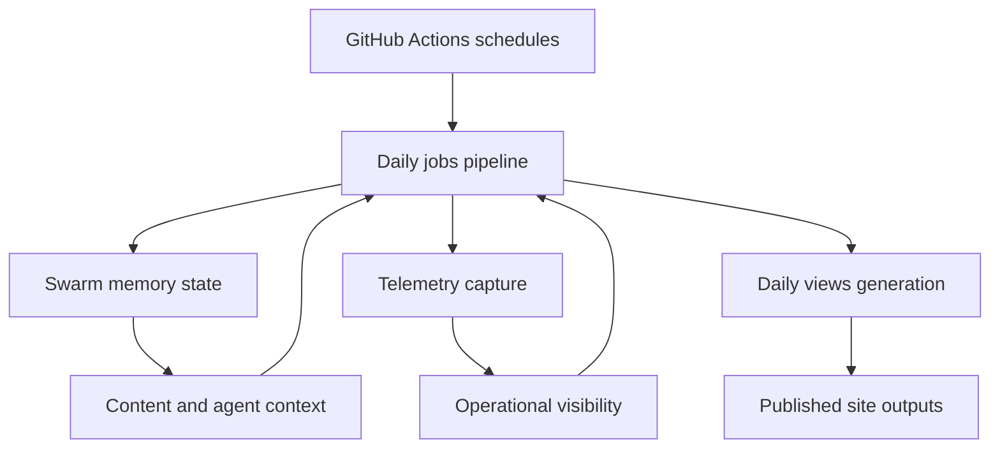

*Generated by GitHub Scout Agent | Verified by Adversarial Bar-Raiser Gate*

## The Big Picture: What We Built & How It Works

Today’s work focused on making `kprsnt.in` less stateless and more operationally aware. The core problem is common in content-heavy personal sites and agent-driven publishing systems: the site can look fine on the surface, but without durable memory and telemetry, it is hard to know what changed, what ran, and whether the automation is healthy over time. That leads to brittle workflows, silent failures, and no reliable way to compare daily activity against prior runs.

The update in commit `c22f564` added the plumbing for three things at once: swarm memory, daily views, and telemetry. In practical terms, that means the system is now being taught to remember more context across runs, capture daily usage or visibility signals, and emit enough operational data to diagnose regressions when pipelines or content jobs misbehave. The architectural move here is from “fire-and-forget automation” toward a more stateful loop where scheduled jobs can observe, persist, and compare their own outputs.

This kind of change matters because the failure modes are subtle: workflows can pass while producing stale content, telemetry can disappear without breaking builds, and memory drift can accumulate until the agent starts making inconsistent decisions. By wiring the site’s GitHub Actions and config files around these concerns, the repo is moving toward a system that is easier to audit, easier to debug, and safer to run unattended.

### Project: `kprsnt.in`
- **What It Does (In Plain English)**: This is the personal site and publishing surface for Prashanth’s engineering work. The latest update strengthens the automation behind the site so it can track daily activity, retain more context, and report what the system is doing.
- **The Technical Deep Dive**:
  - Commit `c22f564` touched a large surface area: `.cursor/rules/ponytail.mdc`, `.env.example`, `.github/copilot-instructions.md`, and multiple GitHub Actions workflows including `.github/workflows/blog.yml`, `ci.yml`, `daily_jobs_pipeline.yml`, `ecosystem_agents.yml`, and `jobs.yml`.
  - The most important architectural signal is that the repo is no longer treating content generation and maintenance as isolated tasks. The workflow layer now appears to coordinate several scheduled or event-driven jobs, which suggests a pipeline split between blog generation, CI validation, daily job execution, and ecosystem-agent orchestration.
  - Updating `.env.example` implies new runtime dependencies or configuration knobs were introduced. In practice, that usually means the automation now expects additional secrets, endpoints, or feature flags to support telemetry and memory persistence.
  - The inclusion of `.cursor/rules/ponytail.mdc` and `.github/copilot-instructions.md` shows the engineering constraints are being codified for the agentic tooling itself. That is important because the quality of automated changes depends heavily on the instructions and guardrails the model sees before it edits code.
  - The workflow files suggest the repo is using GitHub Actions as the control plane for scheduled content and system maintenance. In that setup, each workflow likely handles a different responsibility: one for blog publishing, one for CI verification, one for daily jobs, and one for broader ecosystem coordination.
- **Why It Matters & Trade-offs Handled**:
  - The main risk in this kind of setup is silent drift: jobs can continue running while producing outdated outputs or losing state between runs. Adding memory and telemetry reduces that risk by making the system observable and more deterministic.
  - Another failure mode is workflow sprawl. When a repo accumulates multiple automation paths, it becomes easy to duplicate logic or create inconsistent execution order. Splitting responsibilities across clearly named workflows helps, but it also increases the need for careful coordination and stable environment variables.
  - The trade-off is complexity for reliability. More state and more telemetry mean more moving parts, but they also make debugging and long-term maintenance much easier.
  - No explicit metrics were provided in the commit log, but the scale of the change is significant: 272 files were touched in the update bundle, which strongly suggests a broad automation refresh rather than a narrow feature patch.

### Project: `agentvivekkumar/dontbemichael`
- **What It Does (In Plain English)**: This repository had PR activity in the last day, which means the codebase is actively being changed and reviewed, even though the raw log here does not include the exact files or diff contents.
- **The Technical Deep Dive**:
  - The available activity shows a PR was opened and another PR was merged.
  - Because no commit hashes, file paths, or patch details were included in the source activity, the safest accurate conclusion is that the repo is in an active review-and-integration cycle.
  - From an engineering process perspective, that usually means changes have reached a point where the branch is stable enough to merge, while another line of work is still being iterated in parallel.
- **Why It Matters & Trade-offs Handled**:
  - The key operational signal here is throughput: code is moving through review, which implies the project has enough structure to support merging rather than only local experimentation.
  - Without file-level detail, there is no reliable way to infer the exact runtime or architecture impact, so this should be treated as process activity rather than a confirmed system change.
  - The trade-off in reporting this conservatively is accuracy over speculation.

## What's Next

The `kprsnt.in` automation stack now looks more stateful and better instrumented, which should make the next round of daily jobs easier to trust and debug. The immediate priority is to validate that the new memory and telemetry paths are actually persisting the right signals across workflow runs, and that the added config surface in `.env.example` is fully documented and safe to deploy.