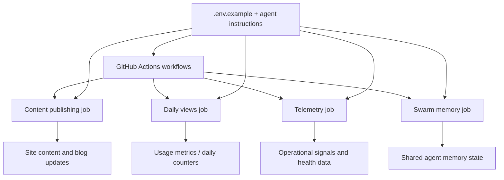

*Generated by GitHub Scout Agent | Verified by Adversarial Bar-Raiser Gate*

## The Big Picture: What We Built & How It Works

This update focused on the infrastructure behind `kprsnt.in`, not just the visible pages. The main problem being solved is coordination: when a site is driven by multiple automated jobs, memory state, analytics, and content updates can drift apart if each pipeline runs independently or fails silently. That creates stale pages, inconsistent telemetry, and a growing gap between what the site should know and what it actually knows.

The change set in commit `35891cc` points to a broad automation refresh across workflow definitions, environment templates, and agent instructions. In practice, that means the site’s scheduled jobs are being shaped to keep three things aligned: swarm memory, daily views, and telemetry. The architecture here is less about a single app feature and more about making the site self-maintaining: GitHub Actions orchestrate the jobs, environment variables define the operational contract, and the agent rules/instructions keep autonomous updates bounded and predictable.

The engineering trade-off is clear: more automation means more moving parts, so reliability depends on strict workflow boundaries and sane defaults. The value is that the site can now refresh state on a schedule, capture usage signals, and propagate updates without a human manually stitching together content and metrics every day.

### Project: `kprsnt.in`
- **What It Does (In Plain English)**: This is the personal site and its automation backbone. It appears to manage content publishing, daily site views, and agent-driven memory/telemetry updates.
- **The Technical Deep Dive**:
  - Commit `35891cc` touched a wide set of operational files, including `.cursor/rules/ponytail.mdc`, `.env.example`, `.github/copilot-instructions.md`, and multiple workflow files under `.github/workflows/`.
  - The workflow surface includes `blog.yml`, `ci.yml`, `daily_jobs_pipeline.yml`, `ecosystem_agents.yml`, and `jobs.yml`, which strongly suggests a split between content publishing, validation, scheduled automation, and agent coordination.
  - Updating `.env.example` usually means the runtime contract changed: new variables were likely added for telemetry endpoints, memory storage, scheduling controls, or deployment-time feature flags.
  - The cursor/copilot instruction files indicate the repo’s agent behavior was also tuned. That matters because autonomous or semi-autonomous code generation can easily drift unless the instructions constrain file scope, update style, and workflow expectations.
  - The presence of “Swarm Memory, Daily Views & Telemetry” in the commit message suggests the system is now treating memory and metrics as first-class data flows rather than ad hoc side effects.
- **Why It Matters & Trade-offs Handled**:
  - The core failure mode in systems like this is silent divergence: one job updates content, another updates counters, and a third updates memory, but they do not share a consistent state model.
  - By centralizing behavior through workflow files and shared environment conventions, the repo reduces the chance of partial updates and broken automation after deployment.
  - The trade-off is increased operational complexity. More GitHub Actions files means more places for scheduling errors, permission issues, or environment mismatches to appear. But that is the right trade if the goal is a site that can continuously refresh itself with minimal manual work.

## What's Next

The system looks like it is moving toward a more disciplined automation layer, where scheduled jobs are expected to cooperate instead of acting independently. The next priority is likely validation: making sure the new workflows are idempotent, don’t duplicate telemetry, and fail loudly when environment configuration is incomplete.