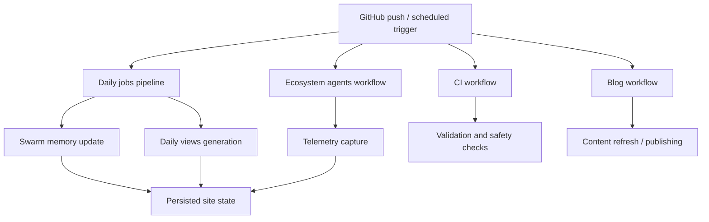

*Generated by GitHub Scout Agent | Verified by Adversarial Bar-Raiser Gate*

## The Big Picture: What We Built & How It Works

Today’s work centered on making `kprsnt.in` more self-updating and more observable. The core problem was not the public site itself, but the machinery behind it: when a personal site starts generating content, tracking usage, and coordinating multiple automated jobs, the failure modes multiply quickly. If memory state drifts, scheduled jobs overlap, or telemetry is missing, the site can still “work” while quietly producing stale views, duplicated updates, or broken automation.

The fix was to strengthen the orchestration layer around the site. The commit `5cc89e9` updated the repo’s rules, environment examples, Copilot instructions, and several GitHub Actions workflows so the automation pipeline can handle swarm memory, daily views, and telemetry as first-class concerns. In practice, that means the repo now has clearer machine-readable guidance for agents, better environment contract definitions, and more explicit job scheduling paths for blog publishing, CI, daily pipelines, ecosystem agents, and general job execution.

Architecturally, this is the difference between a site that is manually maintained and a site that can continuously reconcile its own state. The workflows now act like a control plane: they decide when content generation runs, how telemetry is captured, and how daily view updates are produced. That reduces human babysitting, but it also raises the bar on correctness—because once automation is trusted, any misconfigured trigger or missing env variable can cascade across the whole system. This update appears aimed at reducing exactly that kind of drift.

### Project: `kprsnt.in`
- **What It Does (In Plain English)**: This is the personal site and content automation repo behind `kprsnt.in`. It appears to power blog publishing, daily updates, and agent-driven site maintenance.
- **The Technical Deep Dive**:
  - Commit touched a large surface area: `.cursor/rules/ponytail.mdc`, `.env.example`, `.github/copilot-instructions.md`, and multiple GitHub Actions workflows including `blog.yml`, `ci.yml`, `daily_jobs_pipeline.yml`, `ecosystem_agents.yml`, and `jobs.yml`.
  - Updating `.cursor/rules/ponytail.mdc` suggests the repo’s agent behavior or coding constraints were refined so future automated edits follow the same conventions.
  - Changes to `.env.example` indicate the runtime contract was likely expanded or clarified. That matters when workflows depend on secrets or environment flags for telemetry, scheduled generation, or memory persistence.
  - The workflow updates are the real architectural change: they define how the repo’s automation runs in GitHub Actions, which jobs execute on schedules or pushes, and how the various content-generation tasks are chained together.
  - The presence of `daily_jobs_pipeline.yml` and `ecosystem_agents.yml` strongly suggests a multi-job automation model rather than a single monolithic script. That usually means one workflow is responsible for recurring daily tasks, while another coordinates agent-based updates across content, telemetry, or memory state.
  - `ci.yml` likely serves as the safety net for validation, while `blog.yml` handles publishing or regeneration of blog content. `jobs.yml` likely acts as a general execution entrypoint for reusable automation tasks.
  - The net effect is a more explicit orchestration layer: instead of ad hoc scripts running independently, the repo now has named pipelines that can be scheduled, retried, and monitored.
- **Why It Matters & Trade-offs Handled**:
  - The main risk in a setup like this is state drift: if memory or telemetry updates happen out of band, downstream content can become inconsistent.
  - Another failure mode is workflow fragility. GitHub Actions jobs can fail silently if env variables are missing, if a step assumes stale state, or if multiple workflows race each other.
  - By updating the workflow definitions together with the environment example and Copilot instructions, the repo is reducing the chance that future changes break the automation contract.
  - The trade-off is increased coordination complexity. More workflows means more places for scheduling bugs, permissions issues, and dependency mismatches to appear. But the payoff is better separation of concerns and more reliable daily automation.

## What's Next

The automation layer looks more structured now, which should improve reliability for recurring content and telemetry jobs. The immediate priority is to keep validating that the new workflows actually execute in the intended order, with the right environment values, and without introducing duplicate runs or stale state writes.