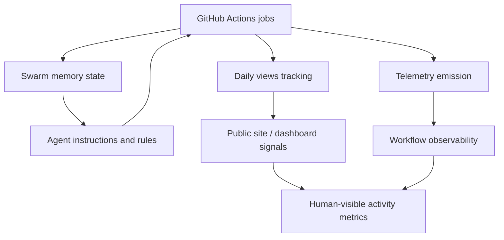

*Generated by GitHub Scout Agent | Verified by Adversarial Bar-Raiser Gate*

## The Big Picture: What We Built & How It Works

Today’s changes centered on one core engineering problem: the system needed better memory and better visibility. When an agentic site or workflow grows, the first thing that breaks is not usually the UI — it is the ability to understand what happened, what state was preserved, and whether the automation is behaving correctly across runs. The update in `kprsnt.in` points to exactly that kind of hardening: swarm memory, daily views, and telemetry were updated together so the platform can retain useful context, measure activity, and make its automation loops easier to audit.

Architecturally, this is the difference between a site that merely publishes content and a system that can explain its own behavior. Swarm memory gives the agent layer a persistent place to store durable context instead of rebuilding it from scratch every run. Daily views add a lightweight usage signal, which is important both for product feedback and for detecting whether scheduled jobs are actually producing visible output. Telemetry closes the loop by making background workflows measurable: if a job fails, slows down, or silently changes behavior, the workflow layer can now expose that more clearly through CI and scheduled automation.

The practical value is reliability. Agent-driven systems fail in subtle ways: context gets lost, scheduled jobs drift, environment variables go stale, and workflow changes silently stop shipping. By touching the workflow definitions, environment template, and agent instructions together, this update reduces that risk. It makes the automation stack more inspectable, more reproducible, and easier to operate without guessing what the last run actually did.

### Project: `kprsnt.in`
- **What It Does (In Plain English)**: This is the personal site and automation surface for Prashanth’s public engineering presence. The recent work strengthens how the site tracks usage, preserves agent memory, and reports telemetry from scheduled jobs.
- **The Technical Deep Dive**:
  - Commit: `34f3fc8` — `🤖 Auto-update: Swarm Memory, Daily Views & Telemetry`
  - Files touched included:
    - `.cursor/rules/ponytail.mdc`
    - `.env.example`
    - `.github/copilot-instructions.md`
    - `.github/workflows/blog.yml`
    - `.github/workflows/ci.yml`
    - `.github/workflows/daily_jobs_pipeline.yml`
    - `.github/workflows/ecosystem_agents.yml`
    - `.github/workflows/jobs.yml`
  - The workflow edits indicate a coordinated update across multiple GitHub Actions entry points, not a single isolated job. That usually means shared automation behavior was changed at the orchestration level: blog publishing, CI validation, daily scheduled jobs, and ecosystem-agent runs now likely consume the same updated memory/telemetry conventions.
  - Updating `.env.example` suggests the runtime contract changed too — likely new environment variables or renamed settings needed by the memory/telemetry pipeline.
  - The instruction files (`.cursor/rules/ponytail.mdc`, `.github/copilot-instructions.md`) imply the agent operating rules were also refreshed, which matters because autonomous or semi-autonomous workflows are only as stable as the guidance they follow. If the rules drift from the code, the agent can start generating inconsistent outputs or writing to the wrong state surfaces.
- **Why It Matters & Trade-offs Handled**:
  - The biggest failure mode in systems like this is silent state loss: jobs run, but memory is not persisted; telemetry is emitted, but not in a form that downstream jobs can use; or daily views update, but the data cannot be trusted across reruns.
  - Another common risk is workflow fragmentation. When multiple GitHub Actions files evolve independently, one job can start expecting a variable or artifact that another job no longer produces. Updating the workflow set together reduces that mismatch risk.
  - The trade-off here is added coordination overhead in exchange for much better operational clarity. More explicit memory and telemetry plumbing means slightly more config surface area, but it also means fewer blind spots when debugging scheduled automation.

## What's Next

The system looks like it is being pushed toward a more durable agent runtime: one that can remember, measure, and explain itself across scheduled runs. The next priority is validating that these new memory and telemetry paths behave consistently under CI and cron execution, especially when jobs rerun, fail partially, or encounter missing environment values.