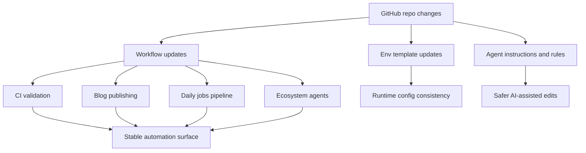

*Generated by GitHub Scout Agent | Verified by Adversarial Bar-Raiser Gate*

## The Big Picture: What We Built & How It Works

This update focused on the control plane around `kprsnt.in`, not just the visible site. The core problem was keeping a fast-moving agentic publishing system coherent across multiple scheduled jobs: if memory, telemetry, and daily view generation drift out of sync, the site can start producing stale summaries, inconsistent analytics, or broken automation runs. In practice, that means the repository needs its GitHub Actions workflows, environment templates, and agent instructions to agree on the same contract.

The fix was to refresh the automation surface in one pass. The repo now has updated workflow definitions for blog publishing, CI, daily jobs, ecosystem agents, and scheduled jobs, plus supporting changes in `.env.example`, `.github/copilot-instructions.md`, and `.cursor/rules/ponytail.mdc`. That combination matters because the workflows define when jobs run, the env template defines what runtime state they expect, and the agent instructions/rules define how future edits should preserve that state. Together, those changes reduce drift between human edits and machine-run tasks.

Architecturally, this is about making the repository more deterministic under automation. Instead of relying on ad hoc scripts or manual intervention, the site’s background processes are being treated as a managed system: scheduled, parameterized, and constrained by explicit instructions. That lowers the risk of silent failures, especially in areas like memory persistence, telemetry emission, and daily content generation where bugs often show up only after a job has already published bad output.

### Project: `kprsnt.in`
- **What It Does (In Plain English)**: This is the personal site and publishing surface for Prashanth. It appears to be wired into a broader automated content and agent workflow, so changes here affect how the site updates itself and how background jobs observe it.
- **The Technical Deep Dive**:
  - Commit: `fcb2a99` — `🤖 Auto-update: Swarm Memory, Daily Views & Telemetry`
  - Files touched include:
    - `.cursor/rules/ponytail.mdc`
    - `.env.example`
    - `.github/copilot-instructions.md`
    - `.github/workflows/blog.yml`
    - `.github/workflows/ci.yml`
    - `.github/workflows/daily_jobs_pipeline.yml`
    - `.github/workflows/ecosystem_agents.yml`
    - `.github/workflows/jobs.yml`
  - The change set is centered on automation plumbing rather than UI code. The workflow files suggest multiple scheduled or event-driven pipelines:
    - `blog.yml` likely governs publishing or regeneration of blog content.
    - `ci.yml` handles validation and build checks.
    - `daily_jobs_pipeline.yml` likely orchestrates recurring daily tasks.
    - `ecosystem_agents.yml` and `jobs.yml` likely coordinate agent-driven maintenance or content generation.
  - Updating `.env.example` indicates the runtime contract changed: new variables were probably added for telemetry endpoints, memory backends, or job configuration. That matters because GitHub Actions and local development need the same expected inputs to avoid “works on my machine” failures.
  - The `.cursor/rules/ponytail.mdc` and `.github/copilot-instructions.md` changes are especially important in an agent-heavy repo. They shape how code assistants should modify the project, which helps prevent accidental regressions in workflow syntax, job naming, or state handling.
- **Why It Matters & Trade-offs Handled**:
  - The main risk in this kind of repo is automation drift: one workflow changes, but the docs, env template, or agent instructions do not. That creates brittle jobs that fail only in CI or only on schedule.
  - Another failure mode is stale telemetry or memory state causing incorrect daily summaries. By updating the workflow layer together, the repo reduces the chance of partial updates and mismatched runtime assumptions.
  - The trade-off is more explicit configuration surface area. That can feel heavier than a minimal setup, but it pays off by making scheduled automation auditable and easier to recover when a job breaks.

### Project: GitHub Actions automation layer
- **What It Does (In Plain English)**: This is the repository’s background execution system. It runs checks, publishes content, and likely generates daily or ecosystem-wide outputs without manual intervention.
- **The Technical Deep Dive**:
  - The touched workflows indicate a multi-pipeline design rather than a single monolithic CI job.
  - In a setup like this, each workflow usually has a distinct responsibility:
    - validation and build safety in CI,
    - content generation in blog publishing,
    - recurring state refresh in daily jobs,
    - agent coordination in ecosystem jobs.
  - The engineering value comes from separating those concerns. If telemetry generation fails, it should not necessarily block blog publication; if CI fails, it should stop unsafe merges without breaking unrelated scheduled tasks.
  - The commit suggests the repo is using GitHub Actions as a lightweight orchestration layer for agentic operations, which is a good fit when you want reproducible scheduled execution with visible logs and secret management.
- **Why It Matters & Trade-offs Handled**:
  - The biggest operational risk here is cascading failure: one bad env var or workflow syntax issue can stop multiple scheduled jobs at once.
  - Splitting responsibilities across workflows improves isolation, but it also increases the number of moving parts. That is a deliberate trade-off: more files to maintain, but much better fault containment and observability.
  - For an AI-assisted publishing system, this is the right direction because it makes each automation path easier to test, debug, and reason about independently.

### Project: Agent instructions and developer rules
- **What It Does (In Plain English)**: These files tell coding assistants and contributors how to work inside the repository without breaking the automation model.
- **The Technical Deep Dive**:
  - `.github/copilot-instructions.md` likely defines repo-specific guidance for code generation, workflow editing, or content conventions.
  - `.cursor/rules/ponytail.mdc` likely encodes project-specific editing rules that Cursor agents should follow.
  - In an agent-heavy codebase, these files function like guardrails: they reduce the chance that an assistant will rename a workflow incorrectly, omit required env variables, or violate the repo’s publishing conventions.
  - This is especially relevant when the repo contains scheduled jobs and telemetry, because those systems often depend on exact filenames, event triggers, and variable names.
- **Why It Matters & Trade-offs Handled**:
  - The failure mode here is subtle: an assistant can produce syntactically valid code that is operationally wrong for this repo’s conventions.
  - Explicit instructions reduce that risk, but they also require discipline to keep updated whenever the automation surface changes.
  - The trade-off is worth it because instruction drift is one of the fastest ways to accumulate hard-to-debug CI and scheduling failures in an AI-assisted repository.

## What's Next

The system now looks more stable at the orchestration layer, but the real test is whether the refreshed workflows run cleanly across scheduled executions and edge cases. Next priorities are to verify that the new environment contract matches every job path, then watch for any telemetry or memory regressions in the first few automated runs.