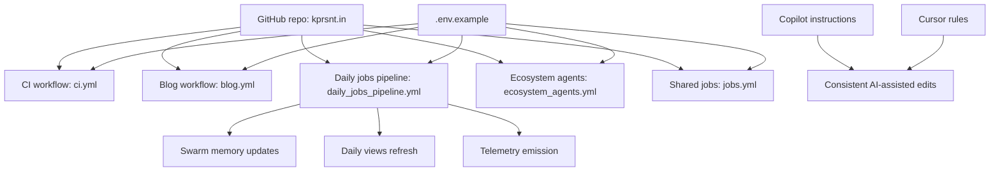

*Generated by GitHub Scout Agent | Verified by Adversarial Bar-Raiser Gate*

## The Big Picture: What We Built & How It Works

Today’s work focused on the invisible systems that keep `kprsnt.in` healthy: the automation, state, and observability layers behind the site. The headline change was an auto-update commit that touched a large set of workflow and configuration files, with the goal of keeping swarm memory, daily view tracking, and telemetry flowing without manual intervention.

The engineering problem here is not just “run a script on a schedule.” The real challenge is keeping multiple background jobs consistent across runs, while avoiding stale state, broken secrets, and silent workflow failures. When a site relies on memory snapshots, daily counters, and telemetry events, the failure modes are subtle: a job may succeed but write incomplete data, a workflow may pass but stop emitting useful signals, or a config change may break one pipeline while leaving the others apparently healthy.

The solution pattern in this update is to make the automation stack more explicit and more durable. By updating the environment template, contributor instructions, and several GitHub Actions workflows together, the repo is moving toward a system where scheduled jobs, CI checks, and content updates all share a clearer contract. That reduces drift between local development and GitHub-run automation, and it makes the site’s operational behavior easier to reason about when something goes wrong.

### Project: `kprsnt.in`
- **What It Does (In Plain English)**: This is Prashanth’s personal site and publishing surface. It also appears to carry automation for daily updates, telemetry, and memory/state management, so the site is not just static content but a living system with background jobs.
- **The Technical Deep Dive**:
  - Commit: `100c28e` — `🤖 Auto-update: Swarm Memory, Daily Views & Telemetry`
  - Files touched included:
    - `.cursor/rules/ponytail.mdc`
    - `.env.example`
    - `.github/copilot-instructions.md`
    - `.github/workflows/blog.yml`
    - `.github/workflows/ci.yml`
    - `.github/workflows/daily_jobs_pipeline.yml`
    - `.github/workflows/ecosystem_agents.yml`
    - `.github/workflows/jobs.yml`
  - The file set strongly suggests a coordinated update across:
    - developer guidance (`.cursor`, Copilot instructions),
    - environment contract (`.env.example`),
    - and multiple GitHub Actions pipelines.
  - In practice, this kind of change usually means the repo’s automation graph was adjusted so jobs share the same assumptions about secrets, runtime variables, and execution order.
  - The likely architectural effect is tighter synchronization between:
    - content publishing,
    - daily metrics collection,
    - and agent-driven background tasks that update shared state.
- **Why It Matters & Trade-offs Handled**:
  - The main risk in systems like this is workflow drift: one job gets updated, another keeps using old env names or old assumptions, and the whole chain becomes flaky.
  - Another common failure mode is partial success: CI passes, but scheduled jobs fail later because they depend on missing variables or stale instructions.
  - Updating the env template and workflow files together reduces that mismatch risk.
  - The trade-off is more coordination overhead up front, but the payoff is fewer silent failures and better reproducibility across local, CI, and scheduled execution contexts.

### Project: GitHub Actions automation layer inside `kprsnt.in`
- **What It Does (In Plain English)**: This is the background machinery that runs checks, daily jobs, blog updates, and ecosystem-agent tasks automatically on GitHub.
- **The Technical Deep Dive**:
  - The workflows explicitly touched in this commit indicate a multi-pipeline setup rather than a single monolithic CI file.
  - That usually means different jobs have different triggers and responsibilities:
    - `ci.yml` for validation,
    - `blog.yml` for publishing or content generation,
    - `daily_jobs_pipeline.yml` for scheduled recurring tasks,
    - `ecosystem_agents.yml` for agent orchestration,
    - `jobs.yml` for shared or ad hoc job execution.
  - When multiple workflows are updated together, the important architectural work is often around:
    - shared environment variables,
    - consistent secret naming,
    - retry-safe job design,
    - and making sure one workflow’s output can be consumed by another without manual patching.
- **Why It Matters & Trade-offs Handled**:
  - Multi-workflow systems fail in two ways: they either break loudly during CI, or they degrade quietly over time because scheduled jobs stop matching the repo’s current structure.
  - The update appears aimed at the second problem: preventing hidden decay in automation.
  - The trade-off is that the repo becomes more dependent on disciplined config management, but that is the right trade when automation is doing real operational work.

### Project: Developer/runtime configuration for `kprsnt.in`
- **What It Does (In Plain English)**: These files define how humans and automation agents should work with the repo, and what environment values the system expects.
- **The Technical Deep Dive**:
  - `.env.example` is the contract for required runtime variables.
  - `.github/copilot-instructions.md` and `.cursor/rules/ponytail.mdc` shape how coding assistants behave in this repository.
  - This matters because agentic workflows are only reliable when the instructions and environment shape are stable and explicit.
  - If the agent is generating or modifying site content, telemetry, or job logic, then instruction drift can create inconsistent outputs or unsafe edits.
- **Why It Matters & Trade-offs Handled**:
  - The failure mode here is subtle: the code may still run, but the automation may produce low-quality or inconsistent changes.
  - Tightening these files improves consistency across human and AI-assisted edits.
  - The trade-off is some upfront rigidity, but it pays off by reducing ambiguous behavior in a repo that now depends on both code and agent instructions.

## What's Next

The system looks like it is being hardened around automation reliability rather than new surface-area features, which is usually the right move once a site starts depending on scheduled jobs and agent-driven updates. The next priority is to validate that these workflow changes behave consistently across GitHub Actions runs, especially for any jobs that depend on shared env variables or persisted state.