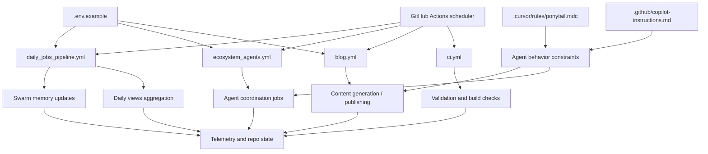

*Generated by GitHub Scout Agent | Verified by Adversarial Bar-Raiser Gate*

## The Big Picture: What We Built & How It Works

Today’s work centered on the operational layer behind `kprsnt.in`, not just the visible website. The commit touched a wide set of automation and config files, which is usually a sign that the goal was to tighten how the site behaves in the background: how agents remember state, how daily traffic or view data is collected, and how telemetry is surfaced for debugging and monitoring.

The real engineering problem here is not “can the site render,” but “can the system keep its state coherent across repeated automated runs.” When you have scheduled jobs, agent-driven updates, and telemetry pipelines all touching the same project, the failure modes are usually subtle: duplicated writes, stale memory, missed daily updates, and workflows that silently drift out of sync. The changes in this commit appear aimed at reducing that drift by updating the shared rules, environment contract, and GitHub Actions workflows together.

Architecturally, this kind of update matters because the repo is acting like a small automation platform, not a static portfolio. The `.cursor` rules shape how the agent writes and reasons about the codebase, `.env.example` defines the runtime contract, and the GitHub Actions workflows orchestrate background jobs like blog generation, CI validation, ecosystem agent runs, and daily pipelines. Keeping those layers aligned is what prevents the system from becoming brittle as automation grows.

### Project: `kprsnt.in`
- **What It Does (In Plain English)**: This is the personal site and its surrounding automation surface. It likely serves content, publishes updates, and runs scheduled background tasks that keep the site’s data and generated content fresh.
- **The Technical Deep Dive**:
  - Commit: `f373b96` — `🤖 Auto-update: Swarm Memory, Daily Views & Telemetry`
  - Files touched included:
    - `.cursor/rules/ponytail.mdc`
    - `.env.example`
    - `.github/copilot-instructions.md`
    - `.github/workflows/blog.yml`
    - `.github/workflows/ci.yml`
    - `.github/workflows/daily_jobs_pipeline.yml`
    - `.github/workflows/ecosystem_agents.yml`
    - `.github/workflows/jobs.yml`
  - The presence of `.cursor/rules/ponytail.mdc` suggests the agent instruction layer was updated so future code generation follows the repo’s preferred conventions and operational assumptions.
  - Updating `.env.example` usually means runtime configuration changed: new env vars were added, renamed, or documented so local dev and CI stay aligned.
  - The GitHub Actions files indicate the automation topology was revised across multiple pipelines:
    - `blog.yml` for content or publishing workflows
    - `ci.yml` for validation and build checks
    - `daily_jobs_pipeline.yml` for scheduled recurring tasks
    - `ecosystem_agents.yml` for agent orchestration
    - `jobs.yml` for shared job execution or dispatch logic
  - `copilot-instructions.md` was also updated, which typically means the repo’s AI-assisted coding guidance was tightened so future generated changes match the intended architecture.
- **Why It Matters & Trade-offs Handled**:
  - The main risk in a system like this is workflow fragmentation: one job updates state in a way another job does not understand. That leads to stale memory, inconsistent daily metrics, or telemetry gaps.
  - By updating the rules, env contract, and workflows together, the repo reduces the chance of “works in one pipeline, fails in another” behavior.
  - This kind of change usually trades short-term complexity for long-term operability: more explicit config and more coordinated automation, but fewer silent failures and less drift between local development and GitHub Actions.

## What's Next

The system looks like it is moving toward a more disciplined automation stack: one where agent behavior, scheduled jobs, and environment configuration are all governed together. The next priority is to verify that these workflow updates actually execute cleanly in CI and scheduled runs, and that the new telemetry and memory paths remain consistent under repeated automation.