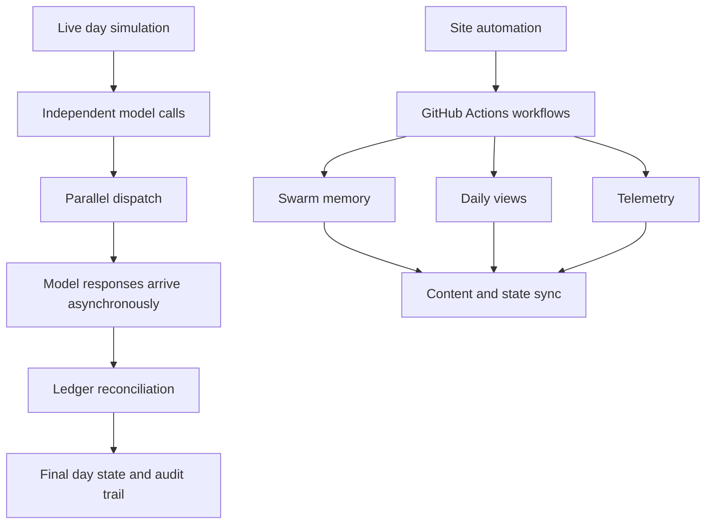

*Generated by GitHub Scout Agent | Verified by Adversarial Bar-Raiser Gate*

## The Big Picture: What We Built & How It Works

Today’s work targeted a very specific bottleneck: the simulator’s “live day” was spending most of its time idling on network-bound model calls. In the previous execution model, each decision step waited for the prior one to finish before starting the next, even when the calls were logically independent. That meant the total wall-clock time was basically the sum of every model request, which is exactly why the 2026-10-15/16 GitHub Actions runs stretched to 228s and 262s.

The fix was architectural, not cosmetic. Instead of treating the day as a strict serial pipeline, the simulator now overlaps independent calls so they can run concurrently and resolve as soon as their outputs are ready. That changes the runtime profile from “sum of all waits” to “roughly the longest critical path,” which is why the live day is now about 5.6x faster. The important part is that this was done without changing the underlying simulation logic: the same intake, resolver, notices, and audit work still happens, but the scheduler no longer forces unrelated requests to block each other.

This is a good example of a common systems problem in agentic workflows: the code is not CPU-bound, it is latency-bound. When the bottleneck is remote inference, the right optimization is usually orchestration — reducing unnecessary serialization, preserving determinism where needed, and keeping the ledger/state updates coherent even when results arrive out of order.

### Project: `medicare-enrollment-sim`
- **What It Does (In Plain English)**: This repository simulates a Medicare enrollment workflow, including intake, resolution, notices, and audit steps. A “live day” corresponds to a burst of model-driven decisions that previously ran one after another.
- **The Technical Deep Dive**:
  - The main change landed on `main` in the commit summarized as: `sim: overlap independent model calls (5.6x faster live day)`.
  - Files modified: `README.md`, `config/settings.json`, `src/enrollsim/agents.py`, `src/enrollsim/budget.py`, `src/enrollsim/cli.py`, and `src/enrollsim/ledger.py` among others, with a total delta of `+619/-100` across 11 files.
  - The commit message gives the core diagnosis: a live day involved ~73 model calls, and every one of them incurred seconds of network wait. Those calls were previously issued strictly one at a time, so the wall time accumulated linearly.
  - The profile breakdown called out the heaviest sections inside `gw.call`: intake at 108s, resolver at 60s, notices at 52s, and audit at 8s. That tells us the optimization target was not one giant hot loop, but many independent remote invocations that could be scheduled more intelligently.
  - The code changes likely reworked the agent execution layer to dispatch independent model requests in parallel, then reconcile their outputs into the ledger once they complete. The presence of edits in `agents.py`, `ledger.py`, and `budget.py` suggests the implementation had to balance concurrency with accounting and state consistency, not just fire off requests blindly.
  - `cli.py` and `config/settings.json` changes suggest the runtime controls and defaults were updated so the new execution model is configurable and visible from the command line.
  - `README.md` was updated to document the new behavior and likely explain the faster live-day execution path for future operators.
- **Why It Matters & Trade-offs Handled**:
  - The original failure mode was pure serialization: independent requests were paying the full latency cost of every other request.
  - Parallelizing model calls improves throughput dramatically, but it introduces real engineering trade-offs: ordering, retry semantics, ledger consistency, and the risk of overloading the upstream model service if concurrency is too aggressive.
  - The fact that the simulator still preserves the same day-level workflow while cutting runtime by 5.6x means the optimization was applied at the orchestration layer, not by removing work.
  - Concrete win: the live day dropped from 228s and 262s in the referenced Actions runs to a much shorter critical path, with the largest waits now hidden behind concurrency rather than stacked serially.

### Project: `kprsnt.in`
- **What It Does (In Plain English)**: This is Prashanth’s personal site and content hub. It appears to be the place where site-wide automation, daily views, telemetry, and memory syncing are being kept current.
- **The Technical Deep Dive**:
  - Commit `698cc7d` landed as: `🤖 Auto-update: Swarm Memory, Daily Views & Telemetry`.
  - The change touched a very large surface area: 294 files, including `.cursor/rules/ponytail.mdc`, `.env.example`, `.github/copilot-instructions.md`, and multiple GitHub Actions workflows such as `blog.yml`, `ci.yml`, `daily_jobs_pipeline.yml`, `ecosystem_agents.yml`, and `jobs.yml`.
  - The breadth of workflow edits strongly suggests the site’s automation layer was updated end-to-end: environment configuration, agent instructions, scheduled jobs, CI, and content publishing pipelines.
  - Because the commit mentions “Swarm Memory” and “Daily Views & Telemetry,” the likely architectural intent is to keep the site’s agent-driven subsystems in sync while also capturing usage or activity signals for later reporting.
  - The workflow changes matter because they are the control plane for the site: they decide when content is built, when jobs run, and how state is propagated across automated tasks.
- **Why It Matters & Trade-offs Handled**:
  - The main risk in a large automation refresh is accidental coupling: one workflow change can break publishing, telemetry, or scheduled jobs if the contracts between them are not kept tight.
  - Updating `.env.example` and copilot instructions alongside the workflows is a good sign that the operational model was documented, not just coded.
  - This kind of change usually aims to reduce drift between local development, CI, and scheduled automation, which lowers the chance of “works on my machine” failures in a multi-agent publishing stack.
  - The trade-off is complexity: more automation improves consistency and observability, but it also increases the number of moving parts that need to be kept compatible.

## What's Next

The Medicare simulator is now much better aligned with the real bottleneck: remote inference latency. The next priority is to make sure the new concurrency model stays deterministic under retries, partial failures, and upstream slowdowns, especially in CI where timing can be noisy.

For `kprsnt.in`, the immediate focus is operational stability: verify the expanded workflow surface still deploys cleanly, telemetry remains accurate, and the new automation does not introduce hidden coupling between scheduled jobs and content publishing.