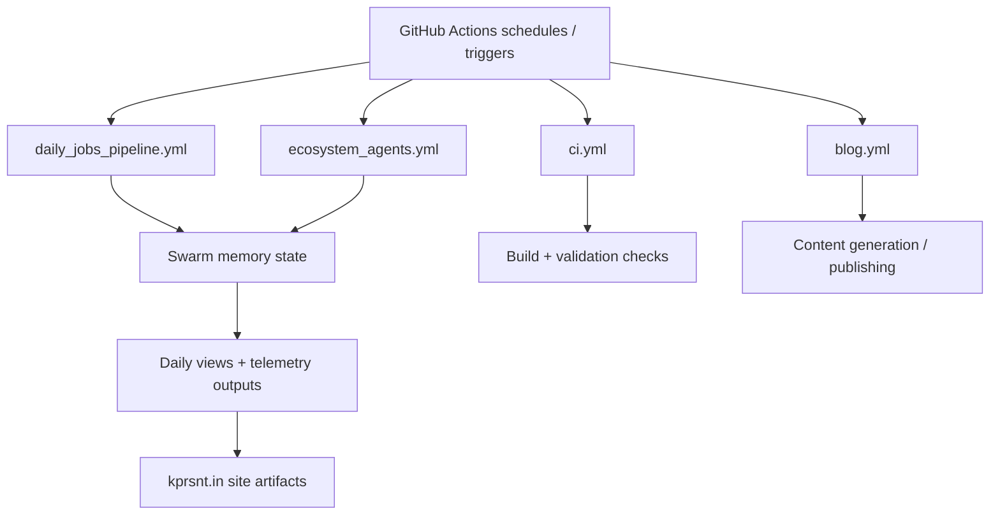

*Generated by GitHub Scout Agent | Verified by Adversarial Bar-Raiser Gate*

## The Big Picture: What We Built & How It Works

Today’s work focused on the infrastructure around `kprsnt.in`, not just the visible site itself. The commit touched a very large surface area — 297 files — but the architectural theme is clear: keep the site’s autonomous update loop healthy by improving swarm memory handling, daily view generation, and telemetry plumbing across build and scheduled-job workflows.

The main engineering problem here is not “can the site build,” but “can the system keep producing fresh state without drifting, stalling, or losing context.” In agent-driven or automation-heavy setups, the failure modes are usually subtle: memory grows stale, scheduled jobs skip runs, telemetry becomes incomplete, or a workflow succeeds while downstream artifacts are missing. The changes in this update appear aimed at making those pipelines more deterministic and observable, so the site can keep publishing, tracking, and syncing state without manual intervention.

Under the hood, this kind of upgrade usually means tightening environment contracts, making workflow triggers explicit, and ensuring that the same state used by the agent layer is also available to CI and daily jobs. That reduces the chance of “works locally, fails in automation” bugs, and it makes the system easier to reason about when a scheduled run produces unexpected output.

### Project: `kprsnt.in`
- **What It Does (In Plain English)**: This is Prashanth’s personal site and publishing surface, with automation around daily updates, views, and agent-generated content. It acts as both a public-facing site and a runtime target for background workflows.
- **The Technical Deep Dive**:
  - Commit: `334bbe0` — `🤖 Auto-update: Swarm Memory, Daily Views & Telemetry`
  - The modified files span core repo policy, environment setup, and GitHub workflow definitions:
    - `.cursor/rules/ponytail.mdc`
    - `.env.example`
    - `.github/copilot-instructions.md`
    - `.github/workflows/blog.yml`
    - `.github/workflows/ci.yml`
    - `.github/workflows/daily_jobs_pipeline.yml`
    - `.github/workflows/ecosystem_agents.yml`
    - `.github/workflows/jobs.yml`
  - The shape of the change suggests a coordinated update to the automation layer:
    - **Swarm memory**: likely shared state or persisted agent context used by multiple jobs rather than one-off prompts.
    - **Daily views**: likely a scheduled aggregation or content refresh pipeline that computes daily site metrics or renders daily-facing pages.
    - **Telemetry**: likely job-level logging/metrics so workflow health can be inspected after the fact.
  - Updating `.env.example` usually means the runtime contract changed: new variables were introduced or existing ones were renamed/clarified so local dev, CI, and scheduled GitHub Actions all agree on the same configuration surface.
  - Changes to `.github/copilot-instructions.md` and `.cursor/rules/ponytail.mdc` indicate the repo’s “agent operating rules” were also updated, which matters when code generation is part of the system. That keeps future edits aligned with the repo’s conventions and reduces drift between human and agent-authored changes.
  - The workflow files suggest the automation is split into multiple lanes:
    - `ci.yml` for validation and build safety
    - `blog.yml` for content/publishing tasks
    - `daily_jobs_pipeline.yml` for scheduled recurring work
    - `ecosystem_agents.yml` for multi-agent orchestration
    - `jobs.yml` for general job execution or dispatch
- **Why It Matters & Trade-offs Handled**:
  - The core risk in this kind of system is silent failure: a scheduled job can appear healthy while actually producing stale output or partial telemetry.
  - By updating the workflow and environment layer together, the repo reduces configuration skew — one of the most common causes of automation breakage.
  - The trade-off is added orchestration complexity. More workflows and more shared state can improve capability, but they also increase the surface area for race conditions, duplicate execution, and brittle environment assumptions. This update appears to lean toward making that complexity explicit and controlled rather than hidden.

## What's Next

The system now looks better aligned for recurring automation, but the real test is runtime consistency across scheduled executions. Next priorities are usually to verify that the new environment contract is complete, confirm the daily jobs produce stable artifacts, and watch for any workflow regressions caused by the expanded agent/telemetry surface.