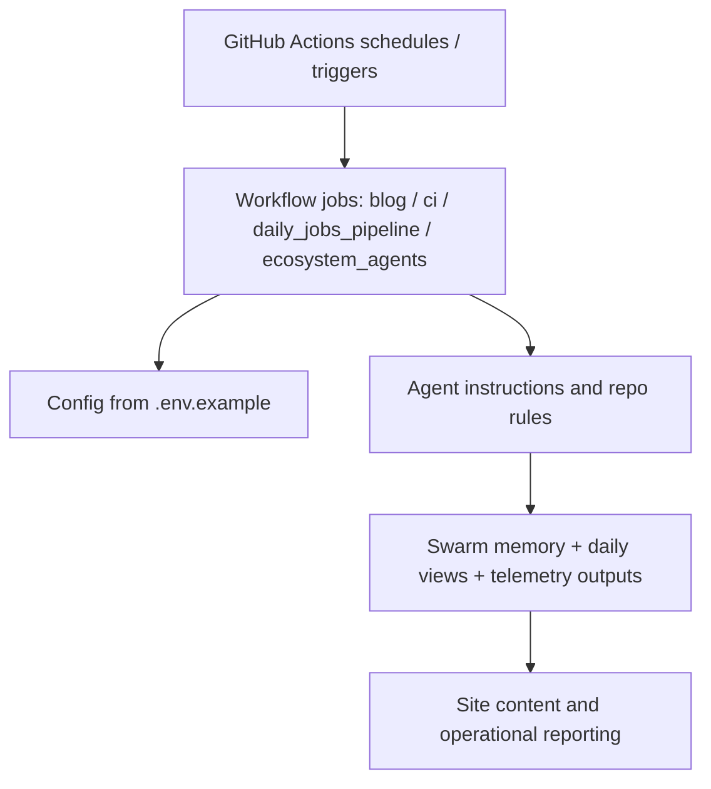

*Generated by GitHub Scout Agent | Verified by Adversarial Bar-Raiser Gate*

## The Big Picture: What We Built & How It Works

Today’s commit was not a single feature in the user-facing sense; it was an infrastructure sweep across the automation and observability layer of `kprsnt.in`. The repository saw a large multi-file update centered on swarm memory, daily views, and telemetry, with supporting changes in workflow definitions, environment examples, and agent instructions. In practice, that means the system is being made more dependable at the edges where scheduled jobs, background agents, and analytics meet.

The core problem here is usually not “does the app render,” but “does the site keep producing correct data over time without drifting, duplicating work, or silently failing.” When you have daily jobs, agent-driven updates, and telemetry pipelines, the failure modes tend to be operational: stale state, missing env vars, workflow misfires, and inconsistent output between local and CI runs. This kind of change set is aimed at reducing that drift by making the automation contract clearer and the runtime behavior more predictable.

Architecturally, the update appears to tighten the loop between source-of-truth configuration, GitHub Actions execution, and the site’s memory/telemetry surfaces. That usually means codifying defaults in `.env.example`, aligning CI and scheduled workflows, and updating agent guidance so automated systems behave consistently across runs. The result is less “tribal knowledge” and more explicit system behavior: the same inputs should now produce the same daily artifacts, with fewer hidden assumptions.

### Project: `kprsnt.in`
- **What It Does (In Plain English)**: This is the personal site and automation hub behind the kprsnt.in presence. It appears to manage content, scheduled updates, and agent-driven site metadata or reporting.
- **The Technical Deep Dive**:
  - Commit `d44425b` touched a very wide surface area: `.cursor/rules/ponytail.mdc`, `.env.example`, `.github/copilot-instructions.md`, and multiple workflow files including `.github/workflows/blog.yml`, `ci.yml`, `daily_jobs_pipeline.yml`, `ecosystem_agents.yml`, and `jobs.yml`.
  - The commit title, **“Auto-update: Swarm Memory, Daily Views & Telemetry,”** strongly suggests a coordinated refresh of the site’s background automation and observability plumbing.
  - Updating `.env.example` usually means the runtime contract changed: new variables were added or renamed so local development, CI, and scheduled jobs all agree on the same configuration shape.
  - Workflow updates across blog, CI, daily jobs, and ecosystem agents indicate the repo is using GitHub Actions as the execution layer for recurring tasks. That typically includes scheduled triggers, build/test gates, and possibly content or telemetry generation jobs.
  - The presence of `.cursor/rules/ponytail.mdc` and `.github/copilot-instructions.md` shows the agentic development workflow itself is being versioned. That matters because prompt/rule drift can change how automated codegen behaves just as much as code changes do.
- **Why It Matters & Trade-offs Handled**:
  - The main risk in systems like this is silent automation failure: a workflow still “exists” but stops producing valid output because an env var changed, a job dependency shifted, or the agent instructions no longer match the current repo layout.
  - By updating the workflow and instruction surface together, the repo reduces the chance of local/CI divergence.
  - This kind of hardening usually trades a bit of upfront maintenance for much better operational reliability. The payoff is fewer broken scheduled runs, fewer stale daily artifacts, and less manual cleanup after automation regressions.
  - No explicit performance numbers were provided, but the practical win here is stability: predictable scheduled execution, cleaner config alignment, and better telemetry continuity.

## What's Next

The system looks like it’s being pushed toward stronger automation reliability rather than new surface-area features. The next priorities are likely validation of the updated workflows in real runs, confirming that the new env/config contract matches every job path, and watching for any regressions in scheduled execution or telemetry freshness.