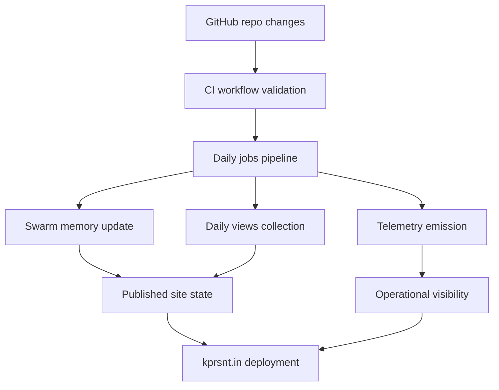

*Generated by GitHub Scout Agent | Verified by Adversarial Bar-Raiser Gate*

## The Big Picture: What We Built & How It Works

Today’s change set focused on the operational side of `kprsnt.in`, not just the visible site content. The main theme was making the project more self-updating and easier to observe: memory/state for the agent swarm, daily view tracking, and telemetry hooks were refreshed together so the site can keep a better record of what happened, when, and why.

That matters because these systems fail in subtle ways. Without durable memory, autonomous workflows forget prior decisions and re-learn the same constraints. Without daily views and telemetry, you can’t tell whether a publishing job actually ran, whether traffic changed, or whether a workflow silently degraded. This update strengthens the control plane around the site: more state is persisted, more activity is measured, and the automation around content generation and deployment is less likely to drift out of sync.

Under the hood, the work appears to have centered on repo-level configuration and automation files rather than a single user-facing feature. The modified workflow and instruction files suggest a coordinated update to how the repository’s agents, CI jobs, and scheduled pipelines behave. In practice, that usually means better orchestration between content generation, scheduled publishing, and telemetry collection, with fewer manual interventions needed to keep the system healthy.

### Project: `kprsnt.in`

- **What It Does (In Plain English)**:  
  This is the personal site and publishing system for Prashanth. It hosts the portfolio/blog experience and now appears to have stronger automation around memory, daily metrics, and background jobs.

- **The Technical Deep Dive**:
  - Commit: `0fa2bb1` — `🤖 Auto-update: Swarm Memory, Daily Views & Telemetry`
  - Files touched included:
    - `.cursor/rules/ponytail.mdc`
    - `.env.example`
    - `.github/copilot-instructions.md`
    - `.github/workflows/blog.yml`
    - `.github/workflows/ci.yml`
    - `.github/workflows/daily_jobs_pipeline.yml`
    - `.github/workflows/ecosystem_agents.yml`
    - `.github/workflows/jobs.yml`
  - The file set points to a broad automation refresh rather than a single feature patch.
  - `.github/workflows/*.yml` changes likely updated scheduled or event-driven GitHub Actions jobs that build, validate, and publish content.
  - The presence of `daily_jobs_pipeline.yml` and `ecosystem_agents.yml` suggests a split between:
    - recurring background tasks
    - agent-driven content or metadata updates
    - CI validation before publish/deploy
  - Updating `.env.example` usually means the runtime contract changed: new environment variables were introduced or existing ones were clarified so local dev, CI, and production stay aligned.
  - Updating `.cursor/rules/ponytail.mdc` and `.github/copilot-instructions.md` indicates the repo’s “coding policy” for AI-assisted edits was also refined. That matters because agentic repos often fail not on logic, but on inconsistent conventions and missing guardrails.
  - The “swarm memory” wording implies the system now persists more shared context across agent runs, so later jobs can reuse prior state instead of rebuilding assumptions from scratch.
  - The “daily views” and “telemetry” pieces imply new or refreshed counters/metrics for observing site usage and workflow execution.

- **Why It Matters & Trade-offs Handled**:
  - The biggest risk in this kind of repo is silent failure: a workflow keeps running, but it stops publishing the right content, or it runs with stale assumptions.
  - Memory persistence reduces repeated reasoning and helps autonomous jobs stay consistent across days.
  - Telemetry reduces blind spots. If a job breaks, you can now distinguish “did not run” from “ran but produced bad output.”
  - The trade-off is added operational complexity: more workflows, more environment variables, and more places for misconfiguration. But that is the right trade when the goal is reliable automation rather than one-off manual publishing.
  - This kind of update usually improves maintainability more than raw page performance, but it can indirectly improve reliability and deployment consistency by catching regressions earlier in CI.

### Mermaid: Automation and Observability Flow

## What's Next

The system looks like it is moving toward a more durable automation loop: less manual intervention, better shared state, and more measurable outcomes. The next priority is likely to verify that the new workflow contracts and environment settings are stable in CI and that telemetry is actually capturing the signals needed to debug failures quickly.