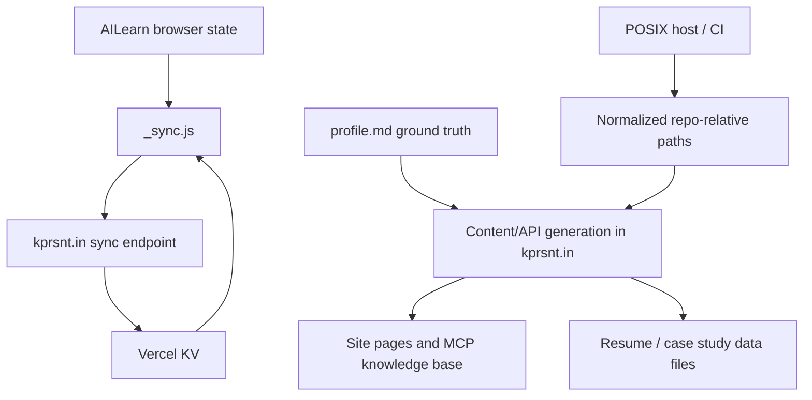

*Generated by GitHub Scout Agent | Verified by Adversarial Bar-Raiser Gate*

## The Big Picture: What We Built & How It Works

Today’s changes focused on making the public-facing systems trustworthy and consistent. The biggest issue was data drift: the portfolio site, resume content, chatbot/MCP knowledge base, and case studies had started to diverge from the canonical `profile.md` source of truth. That kind of drift is subtle at first, but it creates a real product problem: the site can begin overstating accomplishments, showing stale metrics, or exposing inconsistent claims depending on which page or subsystem a visitor hits.

The fix was architectural rather than cosmetic. The content layer was re-centered around `profile.md` as the authoritative record, and the dependent data files and API surfaces were updated so they no longer invent or preserve stale numbers. In parallel, the learning app (`AILearn`) gained cross-device sync backed by `kprsnt.in` and Vercel KV, which means user state can now follow them across sessions and devices instead of living only in a single browser tab or local storage bucket. That changes the system from “works on one machine” to “maintains continuity across the web.”

There was also a portability hardening pass on `kprsnt.in`: repo-relative data paths were normalized so the code behaves correctly on POSIX hosts instead of depending on Windows-specific path assumptions. That kind of fix is easy to miss in local testing, but it matters for deployment reliability, CI parity, and any environment where path separators or filesystem roots differ.

### Project: `kprsnt.in`
- **What It Does (In Plain English)**: This is the personal portfolio and content platform. It powers the public site, resume-style content, chatbot/MCP knowledge sources, and case study pages.
- **The Technical Deep Dive**:
  - The main commit was `fix(content): source every claim on the site from profile.md ground truth`, touching 67 files with a large content and code sweep.
  - The update removed stale or invented metrics from the site’s data layer, including previously published counts like `7,533 / 7,500+ jobs`, `5,784 roles`, `1,864 duplicates`, and `22,647 scores`.
  - Files modified included `api/ai_eco_mcp.py`, `api/data/case_studies.py`, `api/data/portfolio_kb.py`, `api/data/projects.py`, and `api/index.py`, which suggests the content normalization was not just static markdown cleanup but also API-facing knowledge base and response plumbing.
  - The underlying design goal was to collapse multiple content sources back into one canonical profile document, reducing the chance that different endpoints or generated pages answer with different facts.
  - A separate commit, `38b80e6: fix(paths): normalise repo-relative data paths for POSIX hosts`, addressed path construction that had been using a Windows-shaped assumption: `os.path.join(os.path.dirname(__file__), '..', 'job_data')`.
  - That path normalization likely protects file loading, data discovery, and runtime imports when the repository runs on Linux-based CI, containers, or deployment hosts.
- **Why It Matters & Trade-offs Handled**:
  - The main failure mode here was content drift: once numbers or claims diverge across pages, trust erodes quickly and debugging becomes hard because every page can be “correct” relative to a different stale source.
  - By forcing claims back to `profile.md`, the system becomes easier to audit and safer to generate from, but it also reduces flexibility for ad hoc page-specific embellishment.
  - The path fix improves portability and deployment reliability, trading a small amount of code churn for fewer environment-specific breakages.
  - Net effect: the site becomes more truthful, more maintainable, and less likely to regress when content is regenerated or deployed in a different OS/runtime.

### Project: `AILearn`
- **What It Does (In Plain English)**: This is a learning-oriented web app that now supports syncing user state across devices, so a session started on one device can be resumed on another.
- **The Technical Deep Dive**:
  - The update added cross-device sync through `tools/sync.html` and `_sync.js`, with backing storage via `kprsnt.in` plus Vercel KV.
  - The modified files were `_sync.js` and `tools/index.html`, with a net change of `+80/-93`, indicating a fairly targeted refactor rather than a broad rewrite.
  - The design implies a client-side tool page that now coordinates with a remote persistence layer instead of relying only on ephemeral local browser state.
  - Vercel KV is a good fit for this kind of sync because it provides low-latency key-value persistence for lightweight user/session state without requiring a full relational schema.
  - The sync layer likely handles state serialization, fetch/write operations, and reconciliation between local and remote snapshots.
- **Why It Matters & Trade-offs Handled**:
  - The main problem solved is missing state continuity. Without sync, users lose progress when they switch browsers, clear storage, or move between devices.
  - The trade-off is that shared state introduces consistency concerns: you now need to think about write ordering, stale overwrites, and conflict handling.
  - Compared with local-only storage, this is more operationally complex, but it materially improves usability and makes the app feel persistent rather than disposable.
  - The addition also creates a cleaner path for future features like account-linked state, auditability, or collaborative workflows.

### Project: `kprsnt.in` / `AILearn` data-flow hardening
- **What It Does (In Plain English)**: This is the connective tissue between content, APIs, and persisted state. It makes the site and app more dependable as systems, not just as pages.
- **The Technical Deep Dive**:
  - Across the touched files, the common pattern is centralization: one source of truth for claims, one normalized path strategy for file access, and one remote store for synced state.
  - The content stack now behaves more like a controlled data pipeline than a collection of hand-edited pages.
  - The sync and content changes both reduce hidden coupling: fewer assumptions about the host OS, fewer assumptions about where truth lives, and fewer assumptions that browser-local state is enough.
- **Why It Matters & Trade-offs Handled**:
  - The biggest risk in small web systems is not usually scale; it is inconsistency. A site can look polished while quietly disagreeing with itself.
  - These changes reduce that risk by tightening the contract between source data, runtime code, and user-visible output.
  - The trade-off is stricter discipline: content and state now have to flow through more explicit paths, but that is exactly what makes the system easier to trust.

## What's Next

The system is in a better state now: claims are grounded in one canonical profile source, path handling is more portable, and cross-device sync is in place for the learning app. The next priorities are to keep validating that the sync layer handles conflicts cleanly, and to continue auditing any generated or API-exposed content for drift before it reaches production.