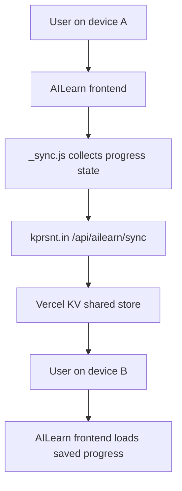

*Generated by GitHub Scout Agent | Verified by Adversarial Bar-Raiser Gate*

## The Big Picture: What We Built & How It Works

Today’s engineering work focused on making two related systems more reliable: the personal site/backend at `kprsnt.in` and the learning app at `AILearn`. The main theme was state correctness. One set of changes fixed how the backend finds local data on different operating systems, another fixed a request-size guard that was rejecting valid writes, and a larger feature added cross-device course progress sync using Vercel KV so a learner can move between devices without losing state.

The architectural problem behind these changes is simple but important: if the server cannot reliably locate its data files, or if it rejects valid payloads before they reach persistence, the whole system becomes brittle. On top of that, if user progress only lives in one browser or one machine, the product feels broken the moment someone switches devices. The new sync layer addresses that by introducing a shared remote state store, while the path and body-size fixes remove two failure modes that could silently break production behavior.

There was also a substantial content-governance pass on `kprsnt.in`. The portfolio, resume, chatbot/MCP knowledge base, and case studies were brought back in line with `profile.md`, which now acts as the ground-truth source for claims. That matters because a public engineering profile is part product, part record: once numbers drift, the site starts to overstate capabilities and undermines trust. This update removes stale metrics and makes the site’s content pipeline much more defensible.

### Project: `kprsnt.in`
- **What It Does (In Plain English)**: This is the public personal site and backend for Prashanth’s portfolio, blog, and supporting APIs. It also powers data-driven content like project summaries, case studies, and the AI/eco blog feed.
- **The Technical Deep Dive**:
  - Commit `fix(paths): normalise repo-relative data paths for POSIX hosts` changed `api/index.py` to normalize repo-relative data paths instead of relying on a raw `os.path.join(..., '..', 'job_data')` style path.
  - The failure mode was platform-specific: the unnormalized `..` path component behaved differently across Windows and POSIX. On POSIX, path resolution and existence checks could diverge when an intermediate directory was missing, which meant `os.path.exists()` could produce misleading results and the app could think a data directory was present when it wasn’t.
  - Commit `fix(ailearn): inverted body-size check rejected every write with 413` updated `api/index.py` again to correct a request-size validation bug. The check was inverted, so valid requests were being treated as oversized and rejected with HTTP 413.
  - Commit `feat(api): add /api/ailearn/sync for cross-device course progress (Vercel KV)` added a new sync endpoint in `api/index.py` and a new service module `api/services/ailearn_sync.py`.
  - The sync API uses Vercel KV as the shared persistence layer for course progress. That changes the state model from device-local to server-backed, enabling progress to be read and written across sessions and devices.
  - Commit `fix(content): source every claim on the site from profile.md ground truth` touched 67 files and rewrote large portions of the site’s data sources: `api/ai_eco_mcp.py`, `api/data/case_studies.py`, `api/data/portfolio_kb.py`, `api/data/projects.py`, and `api/index.py`, plus the generated blog artifact `AI_Eco_Blogs/github-activity-2026-10-07.md`.
  - The content system was previously drifting from `D:\JobAgents\config\profile.md`. The update removes stale or invented metrics and forces the portfolio/resume/chatbot knowledge base to reflect the canonical profile file.
  - The commit explicitly removed inflated or superseded numbers such as `7,533 / 7,500+ jobs`, `5,784 roles`, `1,864 duplicates`, and `22,647 scores`.
  - This is not just editorial cleanup; it is a data-governance fix. The app’s generated content now depends on a single authoritative source instead of scattered, stale copies.
  - The `c5d7dc8` auto-update commit also touched `.github/workflows/blog.yml`, `.github/workflows/ci.yml`, `.github/workflows/daily_jobs_pipeline.yml`, `.github/workflows/ecosystem_agents.yml`, `.github/workflows/jobs.yml`, `.env.example`, `.cursor/rules/ponytail.mdc`, and `.github/copilot-instructions.md`, suggesting a broader automation refresh around telemetry, daily views, and swarm memory.
- **Why It Matters & Trade-offs Handled**:
  - The path normalization fix removes OS-specific ambiguity and prevents false-positive file existence checks that can cause startup or data-loading failures.
  - The inverted body-size check fix restores normal write behavior and eliminates a production-blocking 413 failure mode.
  - The new `/api/ailearn/sync` endpoint trades a little extra backend complexity for a much better user experience: progress now survives device changes and browser resets.
  - Using Vercel KV gives low-latency shared state, but it also means the app now depends on environment configuration being present. That dependency was explicitly acknowledged by the redeploy commit to pick up the KV env vars.
  - The content-grounding pass improves trust and maintainability. The trade-off is less “marketing polish” and more factual accuracy, which is the right choice for a public engineering profile.

### Project: `AILearn`
- **What It Does (In Plain English)**: A learning app that tracks course progress and now keeps that progress synchronized across devices.
- **The Technical Deep Dive**:
  - Commit `Add cross-device sync (tools/sync.html + _sync.js) backed by kprsnt.in + Vercel KV` added a sync UI in `tools/index.html` and a new client-side module `_sync.js`.
  - Commit `Add DEPLOY.md and vercel.json mirror config` introduced deployment documentation and Vercel configuration so the GitHub Pages app can mirror the backend expectations cleanly.
  - The sync flow is split across the frontend and backend: the UI collects progress state, `_sync.js` sends it to the backend, and the backend stores/retrieves it from Vercel KV.
  - The repo also added `.nojekyll`, `CNAME`, and `_probe.js` in the GitHub Pages deployment update, which indicates the site is being served as a static frontend with explicit control over routing and domain mapping.
  - The custom domain `learn.kprsnt.in` is now wired into the deployment path, which makes the app easier to access consistently and keeps the sync experience aligned with the public site.
- **Why It Matters & Trade-offs Handled**:
  - Before sync, progress was effectively trapped on one device. That is a classic state fragmentation problem: the app may work locally, but the user experience breaks the moment the browser context changes.
  - By moving progress into a shared KV-backed store, the app gains continuity at the cost of introducing a remote dependency and eventual consistency concerns.
  - The deployment config and docs reduce the chance of environment drift between local development, GitHub Pages, and the backend API.
  - The redeploy to pick up Vercel KV env vars shows the team hit a real operational requirement: the feature exists only if the runtime has the right secrets and bindings.

## What's Next

The system is in a better place now: the backend has fewer path and validation traps, and AILearn has a real shared-state layer instead of device-local progress. The next priority is to harden the sync contract end to end — especially around conflict handling, missing KV bindings, and any edge cases where two devices write different progress snapshots close together.