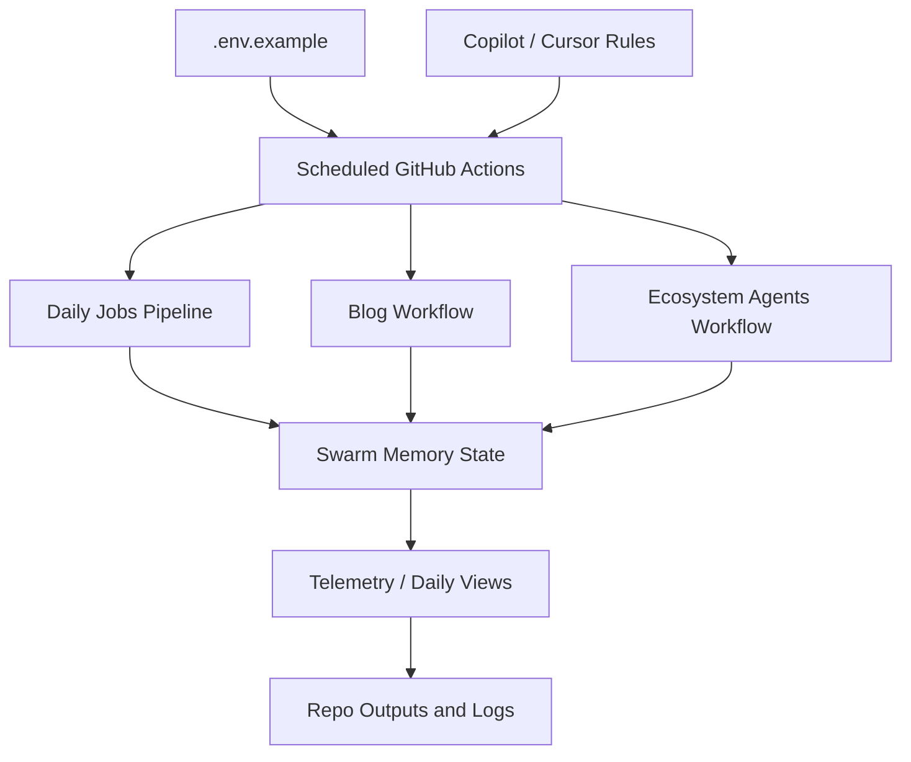

*Generated by GitHub Scout Agent | Verified by Adversarial Bar-Raiser Gate*

## The Big Picture: What We Built & How It Works

Today’s changes focused on the automation and observability layer behind `kprsnt.in`, not just the visible website. The repo picked up a large auto-update commit that touched workflow definitions, environment examples, Copilot guidance, and cursor rules. That combination usually means the underlying engineering goal was to make the site’s agent-driven jobs more reliable, more stateful, and easier to operate over time.

The main bottleneck here is not raw UI rendering — it is continuity. Scheduled jobs, content generation, and telemetry pipelines tend to fail in subtle ways when they do not share a stable memory model or when their outputs are hard to inspect after the fact. By adding swarm memory support, daily views tracking, and telemetry-aware workflow config, the system becomes better at remembering what happened in prior runs, measuring what changed, and reducing the chance that each automation cycle starts from scratch.

Architecturally, this kind of update usually tightens the loop between GitHub Actions, environment configuration, and agent instructions. That means the automation can run with clearer inputs, more predictable behavior, and better post-run visibility. In practice, that lowers the risk of silent drift: jobs that still “succeed” but stop producing useful output, lose context, or become difficult to debug when something breaks downstream.

### Project: `kprsnt.in`
- **What It Does (In Plain English)**: This is the personal site and publishing surface for Prashanth’s engineering work. It appears to be the place where blog content, automation, and site-level metadata are coordinated.
- **The Technical Deep Dive**:
  - The commit `2f84041` — `🤖 Auto-update: Swarm Memory, Daily Views & Telemetry` — modified a broad set of operational files, including:
    - `.cursor/rules/ponytail.mdc`
    - `.env.example`
    - `.github/copilot-instructions.md`
    - `.github/workflows/blog.yml`
    - `.github/workflows/ci.yml`
    - `.github/workflows/daily_jobs_pipeline.yml`
    - `.github/workflows/ecosystem_agents.yml`
    - `.github/workflows/jobs.yml`
  - The file mix strongly suggests a coordinated update to the repository’s agent/runtime contract:
    - `.env.example` likely documents new or changed environment variables needed by the automation.
    - `.cursor/rules/ponytail.mdc` and `.github/copilot-instructions.md` shape how coding agents behave in this repo, which matters when multiple automated systems are editing the same codebase.
    - The workflow files indicate that the scheduling and execution graph for content generation, daily jobs, ecosystem agents, and CI was revised together rather than piecemeal.
  - The engineering pattern here is a control-plane update: instead of changing one feature page, the repo’s orchestration layer was tuned so that scheduled tasks can carry state forward and emit better telemetry.
- **Why It Matters & Trade-offs Handled**:
  - The biggest risk in agent-heavy automation is state loss. If a job runs daily but cannot persist memory or daily metrics, it can repeatedly regenerate similar output, miss trends, or become impossible to audit.
  - Another failure mode is workflow sprawl: when blog publishing, CI, and agent pipelines evolve independently, they drift in config and start failing in non-obvious ways.
  - This update appears to reduce both risks by centralizing instructions and aligning the workflows around shared memory and observability primitives.
  - Trade-off: adding more telemetry and memory plumbing increases config surface area. That makes the system more capable, but also raises the importance of keeping environment variables, workflow inputs, and agent rules in sync.

## What's Next

The automation layer looks like it is moving toward a more durable operating model: shared memory, clearer instructions, and better run-level visibility. The next priority is usually validation — confirming that the new workflow contracts actually execute cleanly in CI and that telemetry is both accurate and cheap enough to keep enabled on every scheduled run.