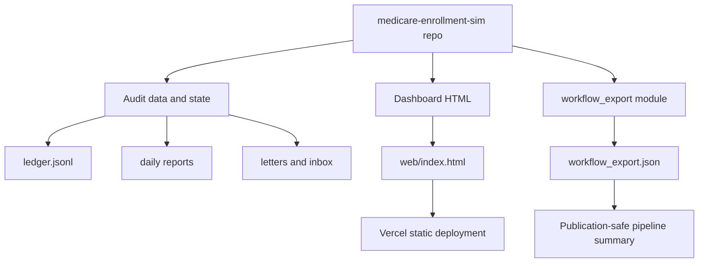

*Generated by GitHub Scout Agent | Verified by Adversarial Bar-Raiser Gate*

## The Big Picture: What We Built & How It Works

Today’s changes were mostly about making complex engineering work publish cleanly and reliably. On `kprsnt.in`, two detailed Medicare audit case studies were added to the site, then the blog rendering layer was corrected so Mermaid diagrams in those posts actually display instead of breaking the page. That matters because these posts are not simple text articles — they include architecture diagrams and structured metadata, so a small syntax issue can stop the entire visual explanation from rendering correctly.

At the same time, `medicare-enrollment-sim` was reshaped so it can deploy as a static site from a proper web root instead of being stranded in `docs/`. That repo also gained a read-only `workflow_export` pipeline: a single JSON publication artifact generated from the same inputs the dashboard uses. The result is a cleaner separation between the live dashboard, the deployment target, and the exported pipeline description. In practical terms, that reduces publishing friction, avoids Vercel “nothing to publish” failures, and makes the project easier to ship, audit, and reuse.

The broader pattern across both repos is the same: convert internal engineering state into durable, publication-safe artifacts. That means metadata in the site, JSON for blog payloads, static HTML for deployment, and a deterministic export for the simulator’s pipeline. The trade-off is stricter structure up front, but the payoff is fewer broken renders, fewer deployment surprises, and a much more reliable path from code to public-facing output.

### Project: `kprsnt.in`
- **What It Does (In Plain English)**: This is the personal site and publishing layer for Prashanth’s portfolio, resume, and technical blog content. Today it was updated to surface the MediFlow work and publish two Medicare audit case studies with proper metadata and renderable architecture diagrams.
- **The Technical Deep Dive**:
  - There were three related commits in the last day:
    - `feat(mediflow): add MediFlow project card and publish 2 Medicare audit blogs`
    - `feat: add MediFlow to resume and publish Medicare audit blogs with metadata`
    - `fix(blog): repair mermaid flowchart syntax and render support for mediflow architecture`
  - Files touched included:
    - `api/data/projects.py`
    - `api/resume_data.py`
    - `templates/projects.html`
    - `templates/blog_post.html`
    - `blog_inputs/medicare_multi_agent_enrollment_audit.md`
    - `blog_inputs/zero_tolerance_cms_medicare_audit_ledger.md`
    - `blog_data/medicare_multi_agent_enrollment_audit.json`
    - `blog_data/zero_tolerance_cms_medicare_audit_ledger.json`
  - The site now exposes MediFlow in two places:
    - as a project card in the projects listing
    - as a resume entry in the structured resume data
  - The blog pipeline was also tightened:
    - the markdown inputs were published into JSON blog data records
    - the blog template was updated so Mermaid blocks render correctly
    - the flowchart syntax was repaired, which suggests the previous diagram markup was invalid enough to break parsing or rendering
  - The `+117/-136` template change strongly suggests the blog renderer was refactored to handle the diagram blocks more safely, likely by normalizing markdown-to-HTML output or adjusting the template’s Mermaid integration points.
- **Why It Matters & Trade-offs Handled**:
  - The main failure mode here was presentation-layer breakage: a blog post can be technically correct but still fail to communicate if the diagram syntax is malformed.
  - Mermaid is powerful but brittle when node labels, arrows, or special characters are not escaped consistently. Fixing the syntax reduces the risk of blank diagrams or broken page rendering.
  - Publishing the blogs as structured JSON alongside markdown also improves reliability for the site’s rendering pipeline, because the frontend can consume normalized metadata instead of parsing everything ad hoc at request time.
  - Adding MediFlow to both the resume and project index keeps the public narrative aligned across the site, so the same work is discoverable in multiple contexts.

### Project: `medicare-enrollment-sim`
- **What It Does (In Plain English)**: This repo simulates Medicare enrollment workflows and exposes the result as a static dashboard. Today it was reorganized so the project can actually deploy cleanly, and its pipeline can be exported as a single read-only JSON artifact.
- **The Technical Deep Dive**:
  - Two major commits were made:
    - `Add workflow_export: one JSON describing this project's pipeline`
    - `Add web/ so this project deploys as a static site`
  - Files touched included:
    - `README.md`
    - `audit/gold/gold.json`
    - `audit/ledger.jsonl`
    - `audit/reports/2026-10-18_audit.json`
    - `audit/reports/2026-10-18_eval.json`
    - `audit/reports/2026-10-18_summary.json`
    - `docs/index.html`
    - `web/index.html`
    - `web/vercel.json`
    - `web/workflow_export.json`
    - `workflow_export.json`
  - The deployment fix is architectural, not cosmetic:
    - Vercel previously had nothing to publish because the dashboard lived in `docs/` and the repository root did not contain an app entrypoint.
    - Moving the deployable surface to `web/` gives Vercel a clear static root.
    - `web/index.html` now serves as the deployment target, mirroring the dashboard content from `docs/index.html`.
    - `web/vercel.json` defines the deployment behavior for the static site.
  - The new `workflow_export` module is especially important:
    - it is run as `python -m enrollsim workflow_export --root . --out FILE`
    - it is read-only and stdlib-only
    - it reads the same sources the dashboard uses: config, `state/`, the hash-chained ledger, daily reports, letters, and inbox
    - it emits a single publication-safe JSON document describing the pipeline’s eight stages
  - This is a classic “make the system observable without making it mutable” design:
    - the export can be generated from live project state
    - but it does not alter the simulation or its audit trail
    - that keeps the pipeline safe for publication and reproducible for review
- **Why It Matters & Trade-offs Handled**:
  - The biggest operational risk was deployment failure caused by an incorrect root directory. That is a common static-hosting issue: the code exists, but the platform cannot find the publishable entrypoint.
  - By introducing `web/`, the project now separates source-of-truth simulation data from deployment packaging.
  - The `workflow_export` artifact reduces ambiguity for readers and reviewers. Instead of asking them to infer the pipeline from scattered files, the repo can now emit one canonical document.
  - The read-only, stdlib-only constraint is a good trade-off for this kind of export: it improves portability, reduces dependency risk, and avoids accidental side effects while reading audit material.

## What's Next

The immediate stability gain is clear: `kprsnt.in` now has a cleaner blog rendering path for diagram-heavy case studies, and `medicare-enrollment-sim` now has a deployable static root plus a deterministic export artifact. The next sensible step is to verify both publishing paths end-to-end in production-like conditions, especially the Mermaid rendering in the blog template and the Vercel deployment behavior for the new `web/` root.