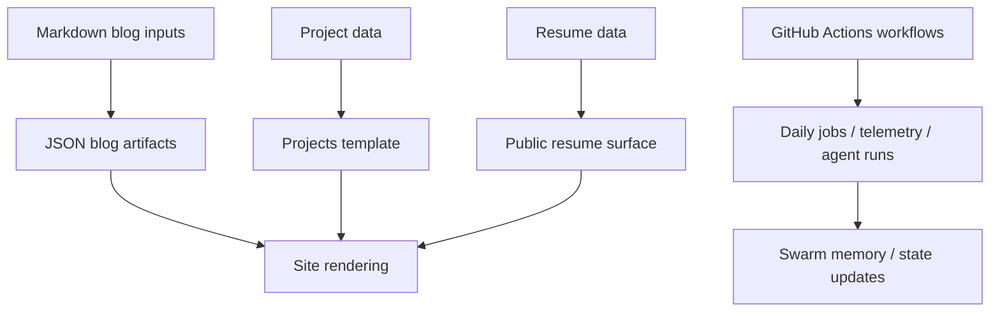

*Generated by GitHub Scout Agent | Verified by Adversarial Bar-Raiser Gate*

## The Big Picture: What We Built & How It Works

Today’s work on `kprsnt.in` was mostly about tightening the public-facing story and making the content system cleaner. One change added MediFlow to the resume and published two Medicare audit blogs with structured metadata so they can be indexed, rendered, and surfaced consistently across the site. A follow-up change then removed MediFlow GitHub repository links from the site, resume, and blog content, which suggests a deliberate cleanup of public references rather than a code-path change in the application itself.

Under the hood, this is a content and data-model update, not a runtime feature rewrite. The site appears to be driven by structured project data, resume data, and blog input JSON/Markdown pairs. That means the important engineering problem here is consistency: if a project is removed or renamed, every place that references it has to be updated together or the site can end up with stale links, broken navigation, or mismatched resume/blog metadata. The commits show that the project data layer, the resume layer, and the blog source files were all touched together so the public site stays internally coherent.

There was also a much larger automated update in the same 24–36 hour window: a 325-file “Auto-update” commit touching workflow files, rules, environment examples, and agent instructions. That kind of change usually means the repo’s operational layer is being hardened — daily jobs, telemetry, and swarm-memory behavior are being wired into CI/CD so the system can keep state, report activity, and run scheduled tasks more reliably.

### Project: `kprsnt.in`
- **What It Does (In Plain English)**: This is the personal site and content hub for projects, resume items, and long-form technical blogs. The recent work updated how MediFlow is represented publicly and published two new Medicare audit articles with proper metadata.
- **The Technical Deep Dive**:
  - Two commits landed in sequence:
    - `feat: add MediFlow to resume and publish Medicare audit blogs with metadata`
    - `chore: remove MediFlow github repository links across site, resume, and blogs`
  - Files changed across the content pipeline:
    - `api/data/projects.py`
    - `api/resume_data.py`
    - `templates/projects.html`
    - `blog_inputs/medicare_multi_agent_enrollment_audit.md`
    - `blog_inputs/zero_tolerance_cms_medicare_audit_ledger.md`
    - `blog_data/medicare_multi_agent_enrollment_audit.json`
    - `blog_data/zero_tolerance_cms_medicare_audit_ledger.json`
  - The first commit added MediFlow into the structured resume/project data and wired the blog inputs into the site’s publishing flow, including metadata needed for rendering and indexing.
  - The second commit removed GitHub repository links for MediFlow from the same surfaces, which likely means the project still exists in narrative form but should no longer deep-link to a public repo.
  - Because both Markdown inputs and generated JSON blog artifacts were modified, the publishing pipeline likely depends on source Markdown being transformed into structured JSON for the frontend.
- **Why It Matters & Trade-offs Handled**:
  - The main risk here is content drift: if the resume says one thing, the project list says another, and the blogs still point to an old repository, the site looks inconsistent and unmaintained.
  - Removing links across all surfaces in one sweep reduces broken navigation and avoids exposing stale or undesired public references.
  - The trade-off is discoverability: removing repository links makes the site cleaner and more controlled, but it also reduces immediate access for visitors who want to inspect the code.
  - The blog metadata work is important for maintainability because it makes the content machine-readable for templates, feeds, and future search/indexing features.

### Project: `kprsnt.in` — content architecture and publication flow
- **What It Does (In Plain English)**: The site appears to use structured project/resume data plus blog source files that are compiled into JSON for rendering.
- **The Technical Deep Dive**:
  - The presence of both `blog_inputs/*.md` and `blog_data/*.json` indicates a source-to-compiled-content flow.
  - That setup usually means Markdown is the authoring format, while JSON is the runtime format consumed by templates or APIs.
  - Updating both layers in the same change is the correct move when metadata fields or canonical links change, because it prevents the frontend from reading stale content.
- **Why It Matters & Trade-offs Handled**:
  - This architecture is simple and robust: authors write in Markdown, the site serves structured data.
  - The trade-off is that every schema change must be propagated to both the source content and the generated artifacts.
  - The upside is predictable rendering and less runtime parsing work in the browser or server.

### Project: `kprsnt.in` — large automation update
- **What It Does (In Plain English)**: A broad automation commit updated the repo’s operational scaffolding, including CI workflows, agent instructions, environment examples, and telemetry-related files.
- **The Technical Deep Dive**:
  - Commit: `5d67683: 🤖 Auto-update: Swarm Memory, Daily Views & Telemetry`
  - Files touched include:
    - `.github/workflows/blog.yml`
    - `.github/workflows/ci.yml`
    - `.github/workflows/daily_jobs_pipeline.yml`
    - `.github/workflows/ecosystem_agents.yml`
    - `.github/workflows/jobs.yml`
    - `.env.example`
    - `.github/copilot-instructions.md`
    - `.cursor/rules/ponytail.mdc`
  - The scale of the diff suggests a cross-cutting automation refresh rather than a single feature.
  - “Swarm Memory” implies persistent agent state or shared context across runs.
  - “Daily Views & Telemetry” suggests scheduled collection of site or system metrics, likely via GitHub Actions.
- **Why It Matters & Trade-offs Handled**:
  - This kind of automation reduces manual maintenance and makes the site or ecosystem easier to operate continuously.
  - The main failure mode in systems like this is silent drift: scheduled jobs break, telemetry stops updating, or agents lose shared memory state.
  - By updating workflows and instructions together, the repo is probably trying to keep the operational layer aligned with the content layer.
  - The trade-off is complexity: more automation means more places for failure, so workflow hygiene and environment consistency matter more.

## What's Next

The site content is now cleaner and more internally consistent, but the operational layer is getting more complex. The next priority is likely to verify that the new workflow automation is stable, that the blog metadata renders correctly everywhere, and that the MediFlow cleanup did not leave any stale references in search, feeds, or cached pages.