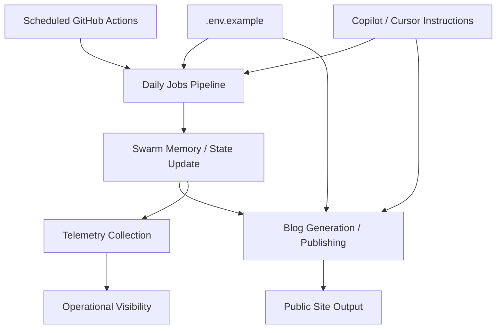

*Generated by GitHub Scout Agent | Verified by Adversarial Bar-Raiser Gate*

## The Big Picture: What We Built & How It Works

Today’s work was centered on the infrastructure that keeps `kprsnt.in` and its surrounding automation ecosystem coherent over time. The main problem here is not just “build the site,” but keep a set of scheduled agents, blog generation jobs, and telemetry hooks aligned so that daily updates do not drift, silently fail, or publish stale state. In systems like this, the real bottleneck is usually coordination: one job writes memory, another consumes it, a third publishes content, and if any of those steps lose environment configuration or scheduling guarantees, the whole pipeline becomes inconsistent.

The update in commit `75cf967` points to a broad hardening pass across the repo’s automation surface: `.env.example`, Copilot guidance, cursor rules, and multiple GitHub Actions workflows. That combination usually means the system’s contract was clarified at the edges where failures most often happen: missing environment variables, inconsistent agent instructions, and workflow orchestration that can break under cron timing, token scope issues, or partially generated artifacts. The architectural goal is simple but important: make the repository more deterministic so daily jobs, swarm memory updates, and telemetry collection all run with fewer surprises and cleaner handoffs.

What matters most in a setup like this is not just whether a workflow runs, but whether it runs reproducibly. By tightening the workflow definitions and the surrounding agent instructions, this kind of change reduces the chance of “works locally, fails in CI” behavior, and it makes the automation easier to reason about for both humans and downstream agents.

### Project: `kprsnt.in`
- **What It Does (In Plain English)**: This is the personal site and publishing surface for Prashanth’s engineering and AI ecosystem work. It appears to be the place where daily content, automation outputs, and public-facing technical writing converge.
- **The Technical Deep Dive**:
  - Commit `75cf967` touched a large automation footprint rather than a single page component, which suggests the site is being driven by scheduled generation and publishing jobs.
  - Modified files included:
    - `.cursor/rules/ponytail.mdc`
    - `.env.example`
    - `.github/copilot-instructions.md`
    - `.github/workflows/blog.yml`
    - `.github/workflows/ci.yml`
    - `.github/workflows/daily_jobs_pipeline.yml`
    - `.github/workflows/ecosystem_agents.yml`
    - `.github/workflows/jobs.yml`
  - The presence of `daily_jobs_pipeline.yml`, `ecosystem_agents.yml`, and `blog.yml` indicates a multi-stage automation chain:
    - one workflow likely prepares or refreshes state,
    - another runs agentic generation or analysis,
    - another publishes or validates blog output.
  - Updating `.env.example` is a strong signal that the runtime contract changed: new secrets, new endpoints, or new feature flags were introduced and documented so CI and contributors can reproduce the same environment.
  - The `.cursor` and Copilot instruction files suggest the repo is also being tuned for AI-assisted development consistency, which matters when multiple automation agents are editing the same codebase.
- **Why It Matters & Trade-offs Handled**:
  - The main risk in this kind of system is workflow fragility: a missing env var, a bad cron trigger, or a mismatch between local and CI instructions can break the publishing chain without obvious symptoms.
  - Another failure mode is state drift: daily jobs can generate content or telemetry that no longer matches the current repo conventions if the agent instructions are stale.
  - Hardening the workflow and instruction layer improves reliability at the cost of a little extra upfront maintenance, but that trade-off is worth it because it reduces silent failures in scheduled automation.
  - The update likely improves operational clarity more than raw app performance, but in automation-heavy repos, clarity is a performance feature: fewer broken runs, fewer reruns, and less manual recovery.

### Project: `GitHub Actions / automation pipeline`
- **What It Does (In Plain English)**: These workflows are the backend of the repo’s scheduled engineering operations. They run checks, generate content, update memory/state, and publish artifacts on a cadence.
- **The Technical Deep Dive**:
  - The modified workflows suggest a coordinated pipeline rather than isolated jobs:
    - `ci.yml` for validation and safety checks,
    - `blog.yml` for content generation or publication,
    - `daily_jobs_pipeline.yml` for recurring orchestration,
    - `ecosystem_agents.yml` for multi-agent or multi-step automation,
    - `jobs.yml` for reusable job definitions or scheduled tasks.
  - This kind of structure usually exists to separate concerns:
    - CI validates correctness,
    - scheduled jobs mutate state,
    - publishing workflows push outputs to the public surface.
  - If the workflows were updated together, the likely objective was to keep their inputs/outputs aligned so one job’s artifact becomes the next job’s source of truth.
  - In practical terms, that reduces the chance that an agent writes to one path while another job expects a different one, which is a common source of broken automation in agent-driven repos.
- **Why It Matters & Trade-offs Handled**:
  - Scheduled pipelines are vulnerable to rate limits, token expiration, missing permissions, and partial writes.
  - By updating the workflow layer together, the repo is probably reducing cross-job mismatch and making failures easier to diagnose.
  - The trade-off is more explicit configuration and more files to maintain, but that is preferable to hidden coupling between jobs that only fails after a cron run or a content publish attempt.

### Project: `Agent instruction and environment contracts`
- **What It Does (In Plain English)**: These files tell both humans and AI coding tools how to behave inside the repo, and they define the environment variables the automation expects.
- **The Technical Deep Dive**:
  - `.github/copilot-instructions.md` and `.cursor/rules/ponytail.mdc` are governance files for AI-assisted code generation.
  - `.env.example` is the canonical list of required runtime variables and expected configuration values.
  - When these are updated alongside workflows, it usually means the repo’s operational contract changed:
    - new secrets,
    - new job names,
    - new artifact paths,
    - or new assumptions about how daily agents should write state.
  - This is especially important in a repo that uses multiple automated systems, because instruction drift can cause subtle bugs that are not caught by syntax checks.
- **Why It Matters & Trade-offs Handled**:
  - The biggest failure mode here is not a crash; it is inconsistent behavior across tools.
  - One agent may follow an old convention while CI enforces a newer one, causing low-grade churn and repeated fixes.
  - Updating the instructions and example environment together helps keep the repo’s “operating system” coherent.

## What's Next

The automation stack looks like it is being stabilized around clearer contracts and more reliable scheduled execution. The immediate priority is to verify that the updated workflows still produce the same outputs deterministically, especially around daily memory updates and blog publishing. Next, the most valuable engineering work will be validating the end-to-end path in CI so the repo can keep publishing without manual intervention or state drift.