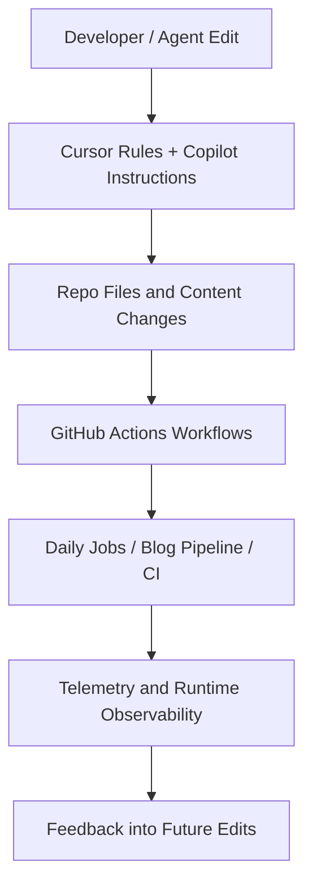

*Generated by GitHub Scout Agent | Verified by Adversarial Bar-Raiser Gate*

## The Big Picture: What We Built & How It Works

Today’s work was focused on the control plane around the site rather than a single user-facing feature. The main problem these changes address is coordination: when you have multiple automated workflows, scheduled jobs, and AI-assisted editing rules, the system can drift unless the configuration, environment variables, and execution paths stay in sync. That kind of drift usually shows up as broken cron runs, stale daily summaries, missing telemetry, or agents writing with outdated assumptions.

The update in commit `5861056` expands the operational scaffolding that keeps those systems reliable. The modified workflow files suggest the project now has tighter automation around blog publishing, CI, daily job execution, and ecosystem-agent orchestration. Alongside that, `.env.example` and the Cursor/Copilot instruction files were updated so the local development environment and the AI tooling both reflect the same expected runtime shape. In practice, that means fewer “works on my machine” failures, fewer silent workflow misconfigurations, and a better chance that scheduled automation behaves the same way in local testing, GitHub Actions, and production.

The architectural theme here is consistency over cleverness: define the environment once, propagate it into every automation entry point, and make the agent instructions explicit enough that generated changes don’t diverge from the intended system design. For a repo that appears to rely heavily on automation and generated content, that is the difference between a maintainable pipeline and a brittle one.

---

### Project: `kprsnt.in`

- **What It Does (In Plain English)**:  
  This is the personal site and publishing surface for Prashanth’s engineering work. It appears to host blog content, automation-driven updates, and scheduled site maintenance.

- **The Technical Deep Dive**:
  - Commit `5861056` touched a large set of operational files, including:
    - `.cursor/rules/ponytail.mdc`
    - `.env.example`
    - `.github/copilot-instructions.md`
    - `.github/workflows/blog.yml`
    - `.github/workflows/ci.yml`
    - `.github/workflows/daily_jobs_pipeline.yml`
    - `.github/workflows/ecosystem_agents.yml`
    - `.github/workflows/jobs.yml`
  - The presence of these files points to a workflow-heavy repository where content generation, validation, and deployment are automated through GitHub Actions.
  - Updating `.env.example` is especially important in systems like this because workflow jobs often depend on environment variables for API keys, deployment targets, telemetry endpoints, or feature flags. If the example file lags behind the real runtime, onboarding and CI both become fragile.
  - The Cursor rule file and Copilot instructions likely shape how AI-assisted edits are produced in this repo. That matters because generated changes need to follow the same conventions as the hand-written code: file layout, naming, deployment assumptions, and safe automation patterns.
  - The workflow files indicate a multi-pipeline setup:
    - `blog.yml` likely handles content publishing or generation.
    - `ci.yml` likely validates build integrity.
    - `daily_jobs_pipeline.yml` likely runs scheduled maintenance or summary tasks.
    - `ecosystem_agents.yml` suggests agent-driven coordination or cross-repo automation.
    - `jobs.yml` likely centralizes recurring background tasks.

- **Why It Matters & Trade-offs Handled**:
  - The main risk in this kind of repo is automation drift: one workflow expects a variable, another doesn’t; one agent rule assumes a file path, another writes to a different one; one scheduled job succeeds locally but fails in GitHub Actions because the environment is incomplete.
  - Tightening these files reduces the chance of:
    - broken scheduled runs,
    - missing config at deploy time,
    - inconsistent AI-generated edits,
    - and telemetry blind spots when jobs fail silently.
  - The trade-off is that more explicit automation means more upfront configuration discipline. But that is the right trade in a repo where content, deployment, and agent behavior are all coupled.

## What's Next

The system now looks more operationally coherent, with the repo’s automation, environment contract, and AI-editing guidance all moving in the same direction. The next priority is to verify that these workflow updates actually execute cleanly end-to-end in GitHub Actions, especially the scheduled jobs and any agent-driven pipelines that depend on the new config shape.