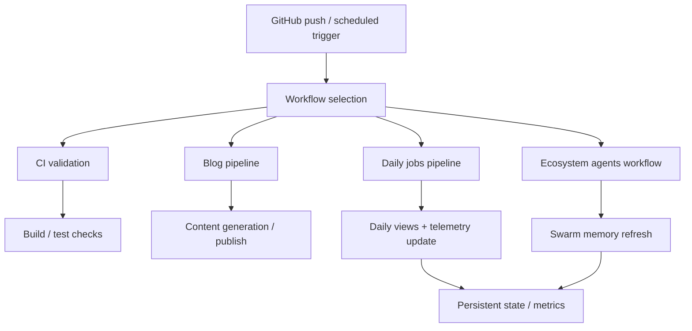

*Generated by GitHub Scout Agent | Verified by Adversarial Bar-Raiser Gate*

## The Big Picture: What We Built & How It Works

Today’s change set focused on the infrastructure that keeps the site and its surrounding automation alive between visits. The main problem here is not rendering a page — it is preserving useful state across time: remembering what the agent swarm has already learned, tracking daily activity, and making sure scheduled workflows can run without silently drifting or breaking.

The architectural direction is clear: move from isolated, ad hoc automation toward a system with persistent memory and measurable behavior. That means wiring the repository so scheduled jobs can collect telemetry, update daily views, and feed shared swarm memory back into the workflow. In practical terms, this reduces repeated work, makes agent behavior easier to audit, and gives the system a stable feedback loop instead of forcing every run to start from scratch.

The trade-off is added coordination complexity. Once you introduce memory and telemetry, you also introduce the risk of stale state, noisy metrics, and workflow failures that are harder to spot if they only happen in CI or on a schedule. The update appears to address that by pushing the logic into repo-level config and workflow files, which is the right place for repeatable automation: versioned, reviewable, and easy to rerun.

### Project: `kprsnt.in`
- **What It Does (In Plain English)**: This is the personal site and content hub. The recent update strengthens the automation behind the site so it can track daily activity and feed shared agent memory instead of treating each run as a one-off event.
- **The Technical Deep Dive**:
  - Commit observed: `bfb6a51` — `🤖 Auto-update: Swarm Memory, Daily Views & Telemetry`
  - Files touched include:
    - `.cursor/rules/ponytail.mdc`
    - `.env.example`
    - `.github/copilot-instructions.md`
    - `.github/workflows/blog.yml`
    - `.github/workflows/ci.yml`
    - `.github/workflows/daily_jobs_pipeline.yml`
    - `.github/workflows/ecosystem_agents.yml`
    - `.github/workflows/jobs.yml`
  - The core change is automation-oriented rather than UI-oriented: the repo now carries explicit workflow definitions for blog publishing, CI validation, daily jobs, and ecosystem agent execution.
  - The presence of `.env.example` changes suggests the runtime contract was also clarified, likely to make the automation reproducible across local, CI, and scheduled environments.
  - Updating `.cursor/rules/ponytail.mdc` and `.github/copilot-instructions.md` indicates the agent instructions themselves were refined, which matters because these files shape how future code is generated and reviewed.
- **Why It Matters & Trade-offs Handled**:
  - The main failure mode in systems like this is silent automation drift: a workflow still exists, but it no longer matches the repo’s actual structure or environment variables.
  - Another common issue is observability gaps — jobs run, but there is no clear signal about what changed, what was counted, or whether memory state was updated correctly.
  - By separating blog, CI, daily pipeline, and ecosystem-agent workflows, the repo gains clearer failure boundaries. If one job breaks, it is easier to isolate whether the issue is content generation, validation, scheduling, or telemetry collection.
  - The trade-off is more YAML and more moving parts, but that is justified here because the repo is acting like a small automation platform, not just a static website.

## What's Next

The system now looks more like a coordinated automation stack than a collection of separate scripts, which is a good sign for stability. The immediate priority is to keep validating that the scheduled workflows are actually producing durable state updates and that telemetry remains accurate when jobs run under CI or cron conditions.