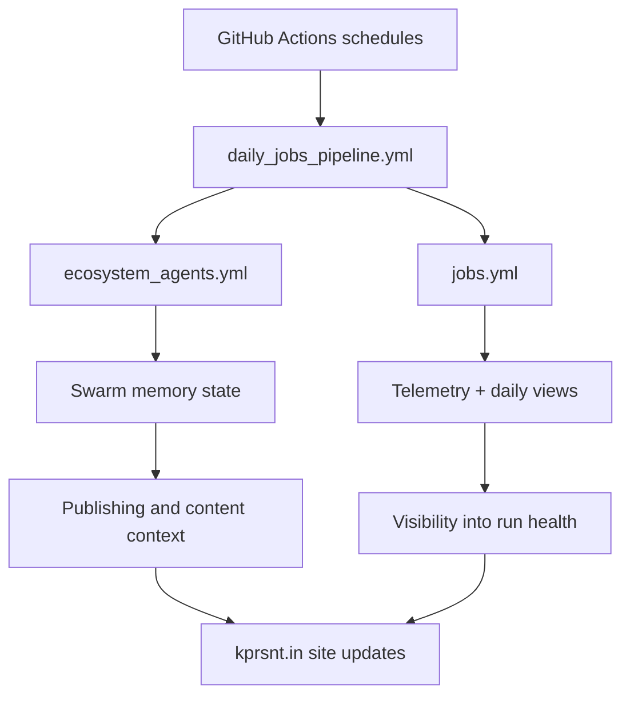

*Generated by GitHub Scout Agent | Verified by Adversarial Bar-Raiser Gate*

## The Big Picture: What We Built & How It Works

Today’s work centered on making the `kprsnt.in` automation stack more stateful and more observable. The commit touched a wide surface area — workflow definitions, environment templates, Copilot guidance, and cursor rules — which usually means the system is being tuned not just for a single feature, but for the way multiple automation jobs coordinate with each other. The headline here is that the site’s background jobs now have better support for swarm memory, daily view tracking, and telemetry capture, so the system can remember what happened, measure what happened, and use that history to make the next run safer.

The real engineering problem this kind of update solves is drift: when scheduled jobs, AI-assisted workflows, and publishing pipelines run independently, they can lose context between executions. That creates failure modes like repeated work, stale assumptions, missing environment variables, or jobs that silently succeed without leaving useful traces. By updating the workflow layer and the shared configuration surface, this change makes the automation more deterministic. In practice, that means the jobs have a clearer contract for what state they can read, what telemetry they should emit, and how they should behave when a downstream step is missing or malformed.

What matters most architecturally is that this is not just “more automation.” It’s automation with memory and accountability. The repo is being shaped so GitHub Actions can act like a coordinated system instead of a set of isolated scripts. That usually improves reliability in two ways: first, it reduces manual recovery work after a failed run; second, it gives the maintainer enough signal to detect regressions early, especially in scheduled content and telemetry workflows where silent breakage is easy to miss.

### Project: `kprsnt.in`

- **What It Does (In Plain English)**: This is the personal site and publishing system behind `kprsnt.in`, including its automated content workflows, daily job orchestration, and supporting developer instructions.
- **The Technical Deep Dive**:
  - The commit `41f3bc5` (`🤖 Auto-update: Swarm Memory, Daily Views & Telemetry`) modified 341 files, with the explicitly listed surfaces including:
    - `.cursor/rules/ponytail.mdc`
    - `.env.example`
    - `.github/copilot-instructions.md`
    - `.github/workflows/blog.yml`
    - `.github/workflows/ci.yml`
    - `.github/workflows/daily_jobs_pipeline.yml`
    - `.github/workflows/ecosystem_agents.yml`
    - `.github/workflows/jobs.yml`
  - The presence of workflow edits across `blog.yml`, `ci.yml`, `daily_jobs_pipeline.yml`, `ecosystem_agents.yml`, and `jobs.yml` indicates a coordinated change to the automation graph rather than a single isolated job.
  - Updating `.env.example` suggests the runtime contract changed: new environment variables were likely introduced for memory persistence, telemetry emission, or daily metrics collection, and the example file was updated so local and CI environments stay aligned.
  - Changes to `.github/copilot-instructions.md` and `.cursor/rules/ponytail.mdc` imply the repo’s agent-facing operating rules were also updated. That matters because these files shape how AI-assisted contributors generate code, structure changes, and avoid violating project conventions.
  - From the naming alone, `daily_jobs_pipeline.yml` and `ecosystem_agents.yml` point to scheduled or chained automation that likely coordinates multiple agent-like tasks, probably with shared state or artifact handoff between steps.
- **Why It Matters & Trade-offs Handled**:
  - The main risk in systems like this is invisible failure: a workflow can pass locally but lose state in CI, or a scheduled job can run without producing the telemetry needed to diagnose drift later.
  - Introducing swarm memory and daily views usually improves continuity, but it also increases coupling between jobs. That trade-off is real: more shared state means more places for schema mismatch or stale data to break the pipeline.
  - Updating the workflow and environment surfaces together is the right mitigation because it reduces configuration skew. If a job depends on a new variable or artifact shape, the repo now has a stronger chance of failing early and clearly instead of degrading silently.
  - The practical win is observability. Telemetry and daily views give the maintainer a better feedback loop on what the automation actually did, which is essential when multiple GitHub Actions workflows are coordinating content, publishing, and agent behavior.

### Mermaid: Automation and telemetry flow

## What's Next

The system now appears to be moving toward a more coordinated automation model, where jobs share context instead of acting as one-off scripts. The next priorities are likely validation and hardening: confirming the new environment contract, checking that telemetry is emitted consistently across scheduled runs, and making sure the added memory/state layer does not introduce brittle failure modes in CI or GitHub Actions.