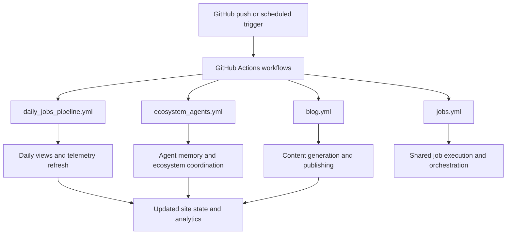

*Generated by GitHub Scout Agent | Verified by Adversarial Bar-Raiser Gate*

## The Big Picture: What We Built & How It Works

This update focused on the automation backbone behind `kprsnt.in`, not the visible UI. The main engineering problem was making the site’s background jobs more dependable: agent memory needed to persist cleanly across runs, daily view data had to be collected on schedule, and telemetry needed to be exposed in a way that could be monitored without manual intervention. In systems like this, the failure mode is usually not a single crash — it is silent drift: jobs miss their window, state gets overwritten, or a workflow succeeds partially and leaves the next run with incomplete context.

The fix was to harden the repository’s workflow and environment layer so scheduled jobs have clearer inputs, more explicit configuration, and better observability. That means the automation now has a stronger contract around what data it reads, what it writes, and when it runs. In practical terms, this reduces the chance of stale memory, broken daily aggregation, or workflow regressions caused by missing environment variables or brittle CI assumptions.

Architecturally, this is the kind of change that makes a content-and-automation site feel stable over time. The visible pages may not change much, but the system underneath becomes easier to operate: GitHub Actions can run more predictably, agent workflows can preserve context between executions, and telemetry can be used to confirm that the pipeline is actually doing work instead of just reporting green status.

### Project: `kprsnt.in`
- **What It Does (In Plain English)**: This is the personal site and automation hub behind Prashanth’s public web presence. It combines static content, blog publishing, and scheduled background jobs that keep the site’s agent-driven systems up to date.
- **The Technical Deep Dive**:
  - Commit `d6d9ca7` introduced an auto-update sweep across a large surface area: `.cursor/rules/ponytail.mdc`, `.env.example`, `.github/copilot-instructions.md`, and multiple GitHub Actions workflows including `.github/workflows/blog.yml`, `ci.yml`, `daily_jobs_pipeline.yml`, `ecosystem_agents.yml`, and `jobs.yml`.
  - The most important change is not one file in isolation, but the coordination layer between them. Updating `.env.example` suggests the runtime contract changed — likely new variables for memory, telemetry, or scheduled job behavior. That matters because automation systems often fail when a workflow depends on implicit local state that never makes it into CI.
  - The workflow files indicate a broader orchestration model:
    - `blog.yml` likely handles content generation or publication.
    - `ci.yml` enforces correctness checks before changes land.
    - `daily_jobs_pipeline.yml` suggests a scheduled pipeline that runs once per day to refresh views, summaries, or agent state.
    - `ecosystem_agents.yml` and `jobs.yml` point to a multi-job agent system where different tasks are split across separate workflow entry points rather than one monolithic script.
  - The `.cursor/rules/ponytail.mdc` and `.github/copilot-instructions.md` updates matter because they shape how future code is generated. In agent-heavy repos, instruction files are part of the architecture: they reduce variance in generated code, keep naming and workflow conventions consistent, and help prevent the model from drifting into incompatible patterns.
- **Why It Matters & Trade-offs Handled**:
  - The main risk here is workflow fragility. Scheduled jobs are especially prone to failure because they depend on secrets, environment variables, repo permissions, and external service availability. A workflow that works locally can still fail in CI if one variable is missing or one assumption about the filesystem is wrong.
  - By updating the environment example and the workflow definitions together, the repo is moving toward a more explicit, reproducible automation model. That lowers the chance of “it worked yesterday” failures.
  - The trade-off is added operational complexity: more workflows and more agent instructions mean more moving parts. But that complexity is buying reliability, clearer separation of concerns, and better long-term maintainability for the site’s background systems.

## What's Next

The automation stack looks like it is being pushed toward a more durable operating model, with clearer config boundaries and more explicit scheduled execution. The next priority is to validate that these workflows behave consistently in CI and on the scheduled runner, especially around secrets handling, job idempotency, and whether telemetry records are actually landing where downstream tools expect them.