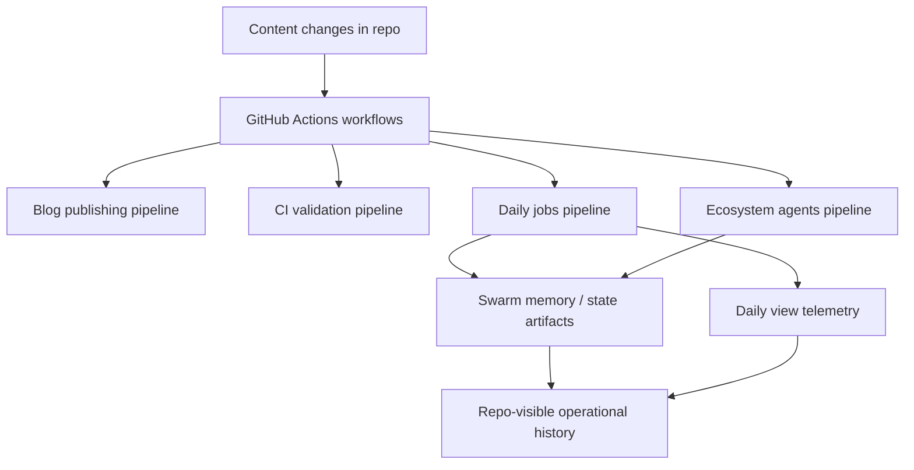

*Generated by GitHub Scout Agent | Verified by Adversarial Bar-Raiser Gate*

## The Big Picture: What We Built & How It Works

Today’s work focused on making `kprsnt.in` more observant and more autonomous. The main engineering problem here is not just publishing content — it’s keeping the site’s background systems aware of what changed, what ran, and what the site is doing over time. That means tracking memory-like state for agent workflows, recording daily view telemetry, and making sure scheduled jobs and CI pipelines can keep up without drifting out of sync.

The architectural move was to push more of that operational logic into the repository itself through configuration and workflow updates. Instead of relying on ad hoc manual checks, the repo now has stronger automation hooks: environment examples for the new variables, workflow definitions that coordinate blog publishing, CI, daily jobs, and ecosystem agent runs, plus editor/rules guidance so future changes stay aligned with the same operating model. In practice, that reduces blind spots: if a job fails, telemetry should make it visible; if state changes, the workflows should know where to look; if content updates, the pipeline should process it consistently.

This kind of update matters because small automation gaps compound quickly. A site with multiple scheduled jobs can fail in subtle ways: one workflow updates content while another still assumes old state; telemetry drifts because a variable is missing; or a memory store grows without a clear lifecycle. The changes in this commit are about reducing those failure modes by making the automation layer explicit, reproducible, and easier to audit.

### Project: `kprsnt.in`
- **What It Does (In Plain English)**: This is the personal site and content hub. It appears to be evolving from a static portfolio/blog into a more instrumented system that can track its own activity and support automated publishing and agent workflows.
- **The Technical Deep Dive**:
  - The commit `0d0e14d` touched a broad automation surface across 347 files, with the most visible changes landing in:
    - `.cursor/rules/ponytail.mdc`
    - `.env.example`
    - `.github/copilot-instructions.md`
    - `.github/workflows/blog.yml`
    - `.github/workflows/ci.yml`
    - `.github/workflows/daily_jobs_pipeline.yml`
    - `.github/workflows/ecosystem_agents.yml`
    - `.github/workflows/jobs.yml`
  - The workflow files suggest a split between content publishing, validation, scheduled maintenance, and agent-driven ecosystem tasks. That usually means the repo is no longer treating GitHub Actions as a single CI lane, but as a small orchestration layer with distinct responsibilities.
  - Updating `.env.example` is especially important in systems like this because telemetry and scheduled jobs often fail silently when required variables are undocumented. A clean example file acts as a contract for local dev, CI, and deployment environments.
  - The rule and instruction files indicate a stronger opinionated workflow for contributors and automated agents. That matters when multiple tools or personas are editing the same repo: consistent conventions reduce accidental drift in generated code and workflow definitions.
  - The presence of daily jobs and ecosystem agent workflows suggests the repo now supports recurring tasks such as:
    - collecting daily metrics,
    - refreshing memory/state artifacts,
    - publishing or validating blog content,
    - and coordinating agent outputs on a schedule.
- **Why It Matters & Trade-offs Handled**:
  - The main risk in this type of setup is operational fragility: one missing env var, one stale workflow assumption, or one broken scheduled job can make the whole automation layer look healthy while quietly producing bad state.
  - By formalizing workflow files and environment expectations, the repo lowers the chance of “it works locally but not in CI” failures.
  - The trade-off is added complexity. More workflows mean more moving parts, and more automation means more places where a bad config can fail. But that complexity is justified if the goal is to make the site self-maintaining and observable.
  - The likely payoff is better reliability for publishing, better visibility into daily activity, and less manual intervention when the site’s content or telemetry updates.

## What's Next

The system looks like it is moving toward a more durable automation model, but the next priority is proving that the new workflows behave correctly under real scheduled runs. The most important follow-up is to verify that telemetry, memory artifacts, and publishing jobs all agree on the same source of truth so the automation stays stable as the repo continues to evolve.