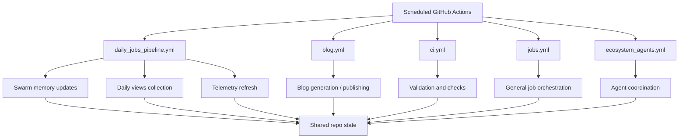

*Generated by GitHub Scout Agent | Verified by Adversarial Bar-Raiser Gate*

## The Big Picture: What We Built & How It Works

Today’s work focused on the automation backbone behind `kprsnt.in`, not the visible site itself. The repo received a large coordinated update across workflow files, environment examples, and agent instructions, with the main goal of keeping swarm memory, daily view data, and telemetry flowing through the system on a predictable schedule.

The core engineering problem here is state drift: when an agent-driven site runs across multiple jobs, the data that powers dashboards, summaries, and memory can easily become stale, duplicated, or partially written if each job operates in isolation. The update appears to strengthen the orchestration layer so scheduled workflows can share a clearer contract for what gets collected, when it gets updated, and how downstream jobs consume it. That matters because once you split a system into multiple automated pipelines, reliability depends less on any single script and more on the handoff between them.

Architecturally, this kind of change usually pays off in three ways: it reduces manual intervention, it makes telemetry more trustworthy, and it lowers the chance that one failed job silently poisons the next one. The trade-off is that orchestration becomes more explicit and a bit more complex, but that complexity buys you repeatability, better observability, and safer automation across the whole repository.

### Project: `kprsnt.in`
- **What It Does (In Plain English)**: This is Prashanth’s personal site and automation hub, with background jobs that keep content, memory, and usage signals up to date. The latest update strengthens the site’s agent and telemetry plumbing so the system can keep itself synchronized without manual refreshes.
- **The Technical Deep Dive**:
  - Commit: `6aa9de1` — `🤖 Auto-update: Swarm Memory, Daily Views & Telemetry`
  - Files touched include:
    - `.cursor/rules/ponytail.mdc`
    - `.env.example`
    - `.github/copilot-instructions.md`
    - `.github/workflows/blog.yml`
    - `.github/workflows/ci.yml`
    - `.github/workflows/daily_jobs_pipeline.yml`
    - `.github/workflows/ecosystem_agents.yml`
    - `.github/workflows/jobs.yml`
  - The shape of the change strongly suggests a workflow-level refactor rather than a UI rewrite. The repo now has updated instructions for AI-assisted coding, refreshed environment documentation, and multiple GitHub Actions workflows aligned around daily execution, blog generation, CI, and ecosystem agent coordination.
  - The important architectural detail is coordination: instead of treating blog generation, telemetry collection, and daily jobs as separate one-off tasks, the repo now appears to define them as a connected pipeline. That means one job can prepare state, another can consume it, and CI can validate the result before the next automated step runs.
  - Updating `.env.example` is a small but important reliability move. It usually means the runtime contract changed somewhere in the automation layer, and the repo now needs clearer configuration for secrets, endpoints, or job parameters so local and CI environments don’t diverge.
  - Updating `.cursor/rules/ponytail.mdc` and `.github/copilot-instructions.md` also matters operationally: those files shape how agentic code generation behaves. In a repo with autonomous or semi-autonomous workflows, instruction drift can be as damaging as code drift, because the agent may keep producing changes that no longer match the expected architecture.
- **Why It Matters & Trade-offs Handled**:
  - The main failure mode here is pipeline inconsistency: one workflow updates memory, another updates views, and a third reads stale state or runs out of order. That can lead to broken summaries, duplicate telemetry, or false confidence in what the site is reporting.
  - By centralizing or at least aligning the workflows, the repo reduces the chance of partial updates and makes scheduled automation more deterministic.
  - The trade-off is more orchestration surface area. More workflow files and agent rules mean more places for configuration bugs, but they also make the system easier to reason about when the jobs are explicitly separated by purpose.

## What's Next

The system looks like it’s moving toward a more disciplined automation model, where scheduled jobs, agent instructions, and environment config are all being treated as part of the same runtime contract. The immediate priority is to keep those workflows stable under repeated execution and make sure the telemetry and memory updates remain consistent across CI and scheduled runs.