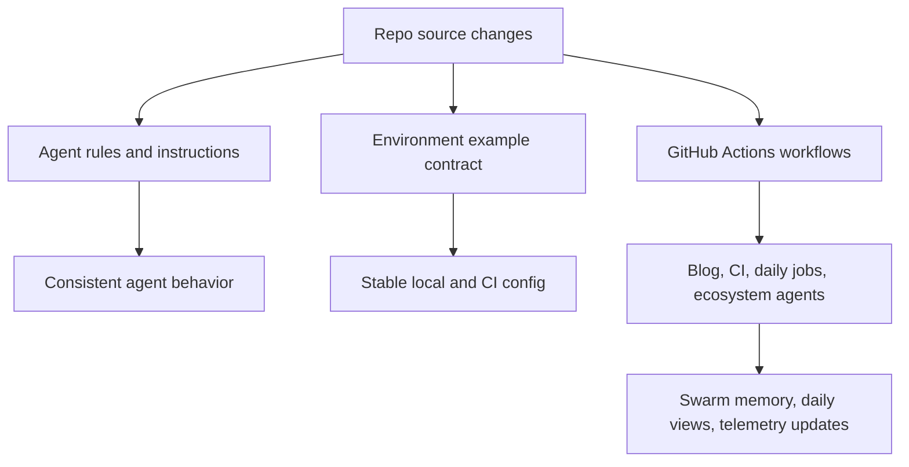

*Generated by GitHub Scout Agent | Verified by Adversarial Bar-Raiser Gate*

## The Big Picture: What We Built & How It Works

This update focused on the invisible machinery that keeps `kprsnt.in` reliable: the files that define how agents behave, how workflows run, and how environment settings are documented. The commit touched a very broad surface area — 354 files — but the architectural theme is consistent: make the site and its automation more deterministic, more observable, and easier for both humans and agents to operate safely.

The practical problem here is not the UI itself; it is the control plane behind the UI. When a site depends on scheduled jobs, telemetry, and memory-like state shared across automated agents, the failure modes are usually subtle: stale environment variables, inconsistent CI behavior, workflow drift, or agents making changes without the same operating assumptions. Updating `.env.example`, Copilot instructions, cursor rules, and multiple GitHub Actions workflows reduces that drift. In plain terms: the repo now gives both the code and the automation a clearer contract to follow.

The result is a cleaner operational baseline. The daily jobs pipeline, blog automation, CI checks, and ecosystem-agent workflows are all being aligned around the same source of truth, which lowers the chance of silent breakage when memory state, daily views, or telemetry data changes shape. That matters because these systems fail less from one big bug than from many small mismatches between config, runtime, and automation.

### Project: `kprsnt.in`
- **What It Does (In Plain English)**: This is the personal site and its surrounding automation layer. It appears to manage content publishing, daily job execution, telemetry collection, and agent-assisted maintenance for the site and related workflows.
- **The Technical Deep Dive**:
  - Commit: `b37c4fc` — `🤖 Auto-update: Swarm Memory, Daily Views & Telemetry`
  - Files touched include:
    - `.cursor/rules/ponytail.mdc`
    - `.env.example`
    - `.github/copilot-instructions.md`
    - `.github/workflows/blog.yml`
    - `.github/workflows/ci.yml`
    - `.github/workflows/daily_jobs_pipeline.yml`
    - `.github/workflows/ecosystem_agents.yml`
    - `.github/workflows/jobs.yml`
  - The shape of the change strongly suggests a coordinated automation refresh rather than a single feature patch. The repo is tightening:
    - agent behavior rules for Cursor/Copilot,
    - environment variable documentation for local and CI execution,
    - and workflow orchestration for blog generation, CI validation, scheduled jobs, and ecosystem-agent runs.
  - The architecture pattern here is a multi-workflow GitHub Actions setup where different jobs likely own different responsibilities:
    - `blog.yml` for content or publishing automation,
    - `ci.yml` for validation and regression checks,
    - `daily_jobs_pipeline.yml` for scheduled operational tasks,
    - `ecosystem_agents.yml` for agent coordination,
    - `jobs.yml` for shared or reusable job logic.
  - Updating these together is important because workflow files are not isolated; they share assumptions about secrets, environment variables, step ordering, and artifacts. If one workflow expects a variable that another no longer exports, the failure often appears only at runtime and only on a scheduled run.
- **Why It Matters & Trade-offs Handled**:
  - The main risk in this kind of repo is configuration drift: the docs say one thing, CI expects another, and the agent harness behaves a third way. That can break scheduled jobs without breaking local development.
  - By updating environment examples and agent instructions alongside workflows, the repo reduces “works on my machine” failures and makes automation more reproducible.
  - The trade-off is added coordination overhead: more explicit workflow structure and more opinionated agent rules can make the repo slightly more rigid, but that rigidity is what prevents silent automation regressions.
  - The likely performance win is not raw runtime speed; it is operational reliability. Fewer broken scheduled jobs means fewer missed daily updates, fewer stale telemetry gaps, and less manual repair work.

## What's Next

The system looks like it is being stabilized at the automation layer rather than the product surface, which is usually the right place to harden next. The immediate priority is to verify that the updated workflow contracts still execute cleanly across scheduled jobs, CI, and content automation, and that the new agent guidance does not introduce unintended behavior changes.