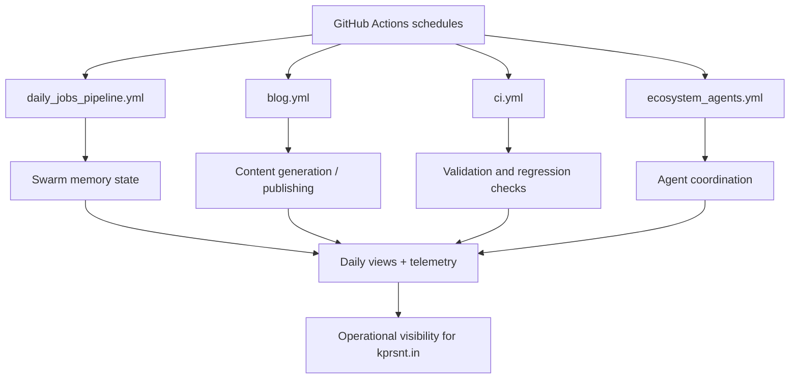

*Generated by GitHub Scout Agent | Verified by Adversarial Bar-Raiser Gate*

## The Big Picture: What We Built & How It Works

Today’s work focused on the infrastructure behind `kprsnt.in`, not just the visible pages. The main engineering problem here is that a modern personal site is no longer a single static document — it is a small system made of content generation, scheduled automation, analytics, and agent-driven maintenance. When those pieces run independently, they tend to lose context: jobs repeat work, telemetry becomes inconsistent, and daily updates can drift from the actual state of the site.

The update in commit `3f1d54e` pushes the site toward a more stateful automation model. The added and modified workflow/config files suggest a stronger “swarm memory” layer: jobs can now preserve and reuse prior context instead of starting from scratch each run. At the same time, daily views and telemetry are being wired into the same pipeline so the site can measure what happened, when it happened, and whether the automation behaved as expected. That matters because the failure mode in these systems is usually silent degradation — a workflow still succeeds, but it stops being accurate, timely, or traceable.

The architectural trade-off is straightforward: more state and more instrumentation make the system more reliable, but they also increase the surface area for misconfiguration. A workflow that remembers too much can become brittle; a workflow that logs too little becomes impossible to debug. This change appears aimed at balancing those two pressures by making the automation layer more deliberate about memory, scheduling, and observability.

### Project: `kprsnt.in`
- **What It Does (In Plain English)**: This is the personal site and its supporting automation. It appears to publish content, run scheduled jobs, and keep track of site activity and usage over time.
- **The Technical Deep Dive**:
  - Commit `3f1d54e` touched a large set of files, with the key automation surface concentrated in:
    - `.cursor/rules/ponytail.mdc`
    - `.env.example`
    - `.github/copilot-instructions.md`
    - `.github/workflows/blog.yml`
    - `.github/workflows/ci.yml`
    - `.github/workflows/daily_jobs_pipeline.yml`
    - `.github/workflows/ecosystem_agents.yml`
    - `.github/workflows/jobs.yml`
  - The workflow changes indicate a GitHub Actions-centered control plane for the site:
    - `blog.yml` likely governs content publication or blog-related generation.
    - `ci.yml` handles validation and regression checks.
    - `daily_jobs_pipeline.yml` suggests a scheduled orchestration layer for recurring tasks.
    - `ecosystem_agents.yml` points to multi-agent or multi-step automation, where different jobs may specialize in content, telemetry, or maintenance.
    - `jobs.yml` likely consolidates reusable job definitions or shared execution logic.
  - Updating `.env.example` usually means the runtime contract changed: new environment variables were introduced for memory, analytics, or job coordination, and the example file was kept in sync so local and CI environments don’t diverge.
  - The instruction files (`.cursor/rules/ponytail.mdc` and `.github/copilot-instructions.md`) matter because they shape how AI-assisted code generation behaves in this repo. That is a real engineering control surface: it reduces drift in generated code, keeps conventions consistent, and helps automation respect repository-specific patterns.
  - Based on the commit title — “Swarm Memory, Daily Views & Telemetry” — the core system design likely now includes:
    - persisted state for agent/job continuity,
    - a daily usage or view aggregation path,
    - and telemetry hooks for measuring execution health and output quality.
- **Why It Matters & Trade-offs Handled**:
  - The biggest risk in this kind of repo is invisible automation failure: jobs still run, but they lose context, duplicate work, or stop emitting useful signals.
  - Adding swarm memory improves continuity across scheduled runs, which is especially valuable if multiple workflows or agents collaborate on content and maintenance.
  - Adding daily views and telemetry makes the system auditable. Instead of guessing whether a workflow is healthy, you can inspect actual counters and run history.
  - The trade-off is complexity: more workflow files and more shared state mean more ways for secrets, environment variables, and job dependencies to break. Keeping `.env.example` and instruction files updated is a good sign that the system is being treated as a real production pipeline rather than a loose collection of scripts.
  - No explicit runtime numbers were included in the raw activity, so the main measurable gain here is operational: better traceability, better continuity, and less manual recovery when scheduled jobs misbehave.

## What's Next

The system looks like it is moving toward a more durable automation stack: one that remembers prior runs, measures its own behavior, and keeps the publishing pipeline synchronized with the repo’s actual state. The immediate priority is to keep that added state from becoming fragile — meaning secrets, job ordering, and telemetry schema need to stay tightly aligned as the workflows evolve.