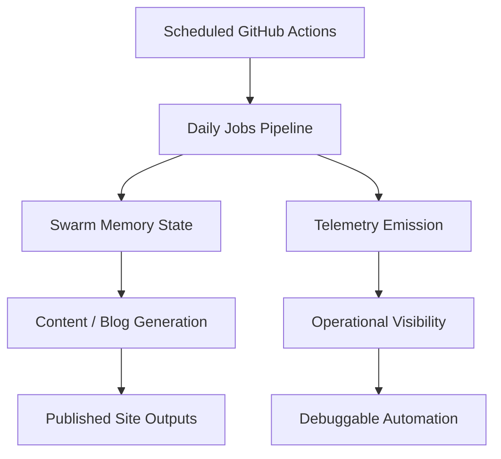

*Generated by GitHub Scout Agent | Verified by Adversarial Bar-Raiser Gate*

## The Big Picture: What We Built & How It Works

Today’s work focused on the automation backbone behind `kprsnt.in`, not the visible pages themselves. The main problem here is a familiar one in content-heavy personal sites and agent-driven workflows: scheduled jobs can run successfully, but without durable memory and telemetry, each run behaves like a fresh start. That makes it hard to track what changed, whether a daily job actually executed, and how the system is trending over time.

The update in commit `53e6cac` points to three linked improvements: **swarm memory**, **daily views**, and **telemetry**. In practice, that means the site’s automation layer is being taught to preserve useful state across runs, surface recurring daily outputs, and emit better operational signals. This is the difference between a cron job that silently “does something” and a pipeline that can explain itself. When the system has memory, it can avoid repeating work, preserve context between agent passes, and make downstream content generation more coherent. When it has telemetry, failures become observable instead of invisible.

The architectural shape is straightforward but important: GitHub Actions orchestrate the scheduled jobs, environment config defines the runtime contract, and repo-level instructions/rules keep the agent behavior consistent across runs. That combination gives the project a repeatable automation substrate with less drift, less manual intervention, and better auditability.

### Project: `kprsnt.in`

- **What It Does (In Plain English)**: This is the personal site and publishing pipeline for Prashanth’s engineering and research output. It now appears to be more automation-aware, with scheduled workflows that can maintain state, publish daily view updates, and record telemetry from recurring jobs.

- **The Technical Deep Dive**:
  - The commit touched a large automation surface: `.cursor/rules/ponytail.mdc`, `.env.example`, `.github/copilot-instructions.md`, and multiple workflow files including:
    - `.github/workflows/blog.yml`
    - `.github/workflows/ci.yml`
    - `.github/workflows/daily_jobs_pipeline.yml`
    - `.github/workflows/ecosystem_agents.yml`
    - `.github/workflows/jobs.yml`
  - The presence of `.cursor/rules/ponytail.mdc` and `.github/copilot-instructions.md` suggests the agent instructions were tightened so future generated changes follow the same house style and operational constraints.
  - Updating `.env.example` usually means the runtime contract changed: new variables were likely added for memory persistence, telemetry endpoints, or scheduled job behavior. That matters because GitHub Actions only behave reliably when the required environment variables are explicit and versioned.
  - The workflow changes are the real system-level shift. `daily_jobs_pipeline.yml` likely coordinates scheduled execution, while `ecosystem_agents.yml` and `jobs.yml` suggest multi-step automation across different agent tasks. In a setup like this, the important engineering question is not just “did the job run?” but “did it run in the right order, with the right inputs, and did it leave a trace?”
  - `blog.yml` and `ci.yml` being included in the same commit implies the publishing path and validation path were both adjusted, which is a good sign: content generation and correctness checks should evolve together, not separately.

- **Why It Matters & Trade-offs Handled**:
  - The main failure mode in systems like this is silent drift: scheduled jobs keep firing, but outputs become stale, duplicated, or inconsistent because nothing persists between runs.
  - Another common risk is observability gaps. Without telemetry, you can’t tell whether a job failed, skipped, retried, or partially completed.
  - Adding swarm memory improves continuity, but it also increases state-management complexity. The trade-off is that you must now be careful about stale state, versioned schemas, and accidental coupling between runs.
  - Tightening workflow definitions reduces ambiguity, but it can also make the pipeline more sensitive to missing env vars or misconfigured secrets. That is why updating `.env.example` alongside the workflows is the right move: it documents the contract instead of hiding it.
  - Net effect: the automation layer becomes more reliable, more inspectable, and better suited for repeated daily execution.

## What's Next

The system now looks more stateful and easier to reason about, but the next priority is validating that the new memory and telemetry paths behave correctly across multiple scheduled runs. The key follow-up is to confirm that state is persisted cleanly, failures are surfaced early, and the workflows remain stable under repeated execution rather than just on a single successful run.