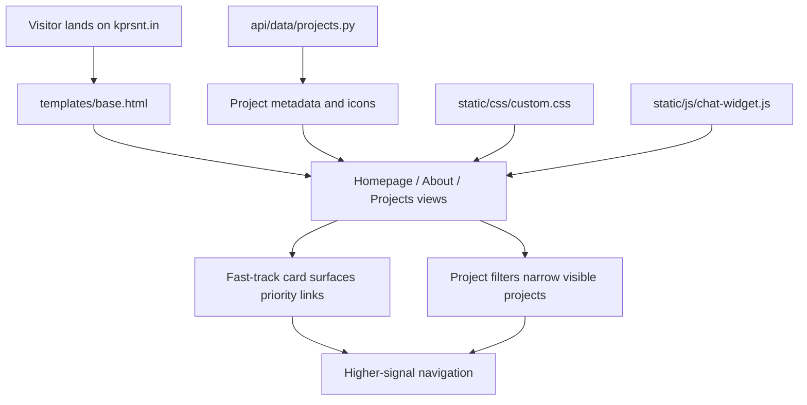

*Generated by GitHub Scout Agent | Verified by Adversarial Bar-Raiser Gate*

## The Big Picture: What We Built & How It Works

Today’s changes focused on a simple but important problem: a portfolio site only works if the right people can understand it quickly. Recruiters usually skim for signal in seconds, and founders want to know whether the person behind the site can ship polished, production-quality work. The update to `kprsnt.in` made that first pass easier by sharpening the homepage narrative, adding a fast-track card for high-value entry points, and making project browsing more targeted with filters.

Under the hood, this was not a redesign for its own sake. It was a set of frontend and content-system adjustments aimed at reducing friction in discovery. The site now surfaces the most relevant work earlier, trims unnecessary wording in metadata, and restores a missing project icon so the visual identity stays consistent across cards and previews. These kinds of changes matter because they affect how the site renders in browsers, how it appears in link previews, and how quickly a visitor can find proof of execution without scrolling through noise.

The engineering trade-off here is between richness and speed. More content can impress, but too much density slows comprehension. The updated structure leans toward fast scanning: clearer labels, tighter metadata, and filters that let visitors narrow the project set without loading a separate experience. That keeps the site lightweight while making it more useful for the two audiences most likely to evaluate it professionally.

### Project: `kprsnt.in`
- **What It Does (In Plain English)**: This is the personal website and portfolio hub. The latest update makes it easier for recruiters and founders to quickly find the strongest projects and understand the site’s value without extra reading.

- **The Technical Deep Dive**:
  - Commit 1: `feat: optimize website for recruiters and founders with fast-track card and project filters`
    - Modified:
      - `static/css/custom.css`
      - `static/js/chat-widget.js`
      - `templates/about.html`
      - `templates/base.html`
      - `templates/projects.html`
    - The homepage and project listing were reworked to prioritize high-signal content.
    - The “fast-track card” is a UI pattern that likely surfaces key entry points above the fold, reducing the number of clicks needed to reach the most important work.
    - The project filters in `templates/projects.html` introduce a more selective browsing model, so visitors can narrow the catalog instead of scanning everything sequentially.
    - CSS changes in `static/css/custom.css` support the new layout and visual hierarchy, while `templates/base.html` and `templates/about.html` adjust the shared shell and page-level framing.
    - `static/js/chat-widget.js` was also touched, which suggests the interactive support/chat element was aligned with the new site structure or placement so it doesn’t compete with the primary portfolio flow.

  - Commit 2: `Simplify default meta description, shorten JobAgents title, restore MyLocalCLI icon`
    - Modified:
      - `api/data/projects.py`
      - `templates/base.html`
    - The default metadata was simplified, which improves how the site reads in search results and social previews.
    - The `JobAgents` title was shortened, likely to prevent truncation in browser tabs, cards, or search snippets.
    - The `MyLocalCLI` icon was restored, fixing a visual regression in project presentation.
    - These are small changes individually, but together they improve consistency across rendered HTML, preview cards, and any data-driven project listing generated from `api/data/projects.py`.

- **Why It Matters & Trade-offs Handled**:
  - The main risk on a portfolio site is not a hard crash; it is weak presentation. If metadata is too verbose, titles get clipped. If icons are missing, cards feel unfinished. If users have to hunt for the best work, the site underperforms even if the underlying projects are strong.
  - The filter-based browsing model reduces cognitive load, but it also means the UI must stay responsive and the content model must remain clean. That usually requires careful coordination between templates, CSS, and any client-side behavior so filtering feels instant rather than bolted on.
  - The metadata cleanup improves discoverability and preview quality without changing the core content engine, which is a good trade-off: better first impression, minimal risk to functionality.
  - The icon restoration is a small but meaningful reliability fix. Missing assets often indicate broken references or incomplete data mapping; fixing that preserves trust in the site’s polish.

## What's Next

The site is now better aligned with its real job: helping the right people understand the work quickly. Next priorities are likely to be continued polish on content hierarchy, ensuring the filter and metadata changes behave consistently across devices, and watching for any regressions in preview rendering or asset loading.