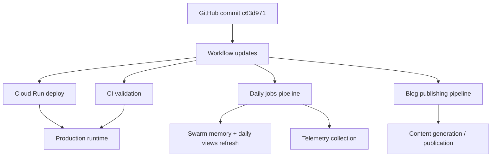

*Generated by GitHub Scout Agent | Verified by Adversarial Bar-Raiser Gate*

## The Big Picture: What We Built & How It Works

Today’s change set focused on the operational layer around `kprsnt.in`, not just the site content itself. The main theme was making the system more self-updating and observable: swarm memory needs to persist cleanly, daily view data needs to be refreshed on schedule, and telemetry needs to be reliable enough that automation can trust it. That means the repo is moving from a mostly static site workflow toward a more coordinated pipeline where content, metadata, and background jobs all work together.

The engineering problem here is classic: once a site starts depending on scheduled updates, generated artifacts, and multiple deployment paths, the weak points are no longer the UI—they’re drift, stale state, and broken automation. If the job pipeline misses a run, or the environment configuration is incomplete, you can end up with outdated metrics, inconsistent memory state, or deploys that look green but don’t actually reflect the latest data. The changes in this commit family appear aimed at reducing that risk by tightening repo rules, improving environment defaults, and making the CI/CD and scheduled job surfaces explicit.

Architecturally, this is the kind of work that makes a personal site or content platform behave more like a small production system. The repo now has clearer instructions for agents and contributors, better deployment hygiene, and workflow definitions that can support repeatable background processing. In practice, that means fewer “it worked locally” failures, fewer silent regressions in scheduled jobs, and a cleaner path for future automation around analytics, memory persistence, and daily content generation.

### Project: `kprsnt.in`
- **What It Does (In Plain English)**: This is the personal site and publishing surface for Prashanth. It appears to combine content, automation, and telemetry so the site can update itself and track what’s happening over time.
- **The Technical Deep Dive**:
  - Commit `c63d971` touched a large surface area in this repo, including `.cursor/rules/ponytail.mdc`, `.dockerignore`, `.env.example`, `.github/copilot-instructions.md`, and multiple GitHub Actions workflows.
  - The presence of `daily_jobs_pipeline.yml` suggests a scheduled background pipeline for recurring tasks such as daily views refreshes, memory updates, or telemetry collection.
  - `deploy-cloud-run.yml` indicates deployment automation targeting Cloud Run, which usually means containerized runtime deployment with managed scaling and startup behavior.
  - `ci.yml` and `blog.yml` imply separate validation paths: one for general code quality and one for content/blog publishing.
  - `.env.example` changes are important because they define the contract between local development and automation. When a repo depends on scheduled jobs and deployment workflows, missing env vars are a common source of runtime failure.
  - `.cursor/rules/ponytail.mdc` and `.github/copilot-instructions.md` suggest stronger agent guidance. That matters when code is being edited by automated or semi-automated tooling: consistent instructions reduce accidental drift in style, structure, and workflow assumptions.
- **Why It Matters & Trade-offs Handled**:
  - The main risk in systems like this is silent automation failure: a workflow can pass syntactically but still fail to refresh state, publish stale content, or deploy with incomplete config.
  - By formalizing workflow files and environment expectations, the repo reduces configuration entropy and makes failures easier to diagnose.
  - Cloud Run deployment usually trades local simplicity for production reliability and autoscaling. The trade-off is that container startup, env configuration, and workflow correctness become more important—but the payoff is a cleaner, more repeatable release path.
  - No concrete runtime metrics were included in the commit data, but the architectural direction is clearly toward more dependable scheduled execution and lower operational drift.

## What's Next

The system looks like it’s being shaped into a more reliable automation stack, but the real test will be whether the scheduled jobs and deploy workflows behave consistently across runs. The next priorities are usually verification, especially around env parity, workflow success rates, and whether the memory/telemetry data stays synchronized with what the site actually serves.