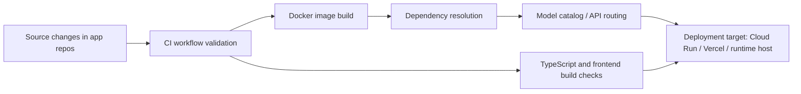

*Generated by GitHub Scout Agent | Verified by Adversarial Bar-Raiser Gate*

## The Big Picture: What We Built & How It Works

The main engineering story today was not a new feature launch, but a reliability pass across multiple AI-facing repositories. The recurring failure mode was the same: code that worked locally or in the app layer would break once it hit CI, Docker, or a deployment platform. That usually comes from small mismatches in environment assumptions — wrong build context, dependencies pinned too loosely or too tightly, model names drifting out of sync, or frontend type/build settings that pass in one setup and fail in another.

The fixes were aimed at making the delivery pipeline more deterministic. In practice, that means the repositories now better describe their runtime needs to the build system: Docker images are aligned with the actual source layout, GitHub Actions workflows are corrected so they can execute in the right environment, and model catalog references are updated so the app doesn’t point at stale or removed model identifiers. In AI apps, that matters because a bad model reference is not just a cosmetic bug — it can break generation flows, fallback routing, and deployment validation all at once.

A second theme was reducing hidden coupling between frontend and backend build assumptions. Several changes touched TypeScript config, app entrypoints, and dependency manifests so the build graph is clearer and less brittle. That kind of work usually doesn’t show up in product screenshots, but it is what keeps a repo from becoming “works on my machine” software.

### Project: `aieco`
- **What It Does (In Plain English)**: This is an AI app stack with both backend and frontend pieces, and today it got a reliability-focused cleanup so CI and container builds can succeed more consistently.
- **The Technical Deep Dive**:
  - Two separate changes landed in `main`:
    - `fix: resolve CI/CD workflow and model catalog issues`
    - `fix: resolve CI build, docker context, and dependency issues`
  - Files changed across both passes included:
    - `.github/workflows/ci.yml`
    - `backend/Dockerfile`
    - `backend/requirements.txt`
    - `frontend/chat-app/src/App.tsx`
    - `frontend/chat-app/tsconfig.json`
    - `frontend/dashboard/src/App.tsx`
  - The CI workflow update indicates the pipeline was failing or misconfigured at the GitHub Actions layer, likely due to incorrect paths, build steps, or environment assumptions.
  - The Dockerfile and requirements changes suggest the backend image was not building cleanly against the repo’s actual source tree or dependency set. That often happens when the Docker build context is too broad or too narrow, or when Python package versions drift and break reproducibility.
  - The frontend changes in `App.tsx` and `tsconfig.json` point to TypeScript/build compatibility fixes, likely addressing import resolution, stricter compiler settings, or component-level assumptions that were causing build-time errors.
- **Why It Matters & Trade-offs Handled**:
  - The biggest risk here is pipeline fragility: a repo can look healthy in source control while failing in CI because the build environment is stricter than local dev.
  - Fixing Docker context and dependency alignment reduces “works locally, fails in container” issues.
  - Updating TypeScript config usually trades a bit of short-term flexibility for long-term correctness; stricter settings catch integration issues earlier, before deployment.
  - This is the kind of work that lowers release risk even when the user-facing UI barely changes.

### Project: `rAshScore_v1`
- **What It Does (In Plain English)**: This repo appears to be a scoring or analytics app, and its deployment workflow was updated so Cloud Run delivery is less likely to break.
- **The Technical Deep Dive**:
  - `main`: `fix: resolve CI/CD workflow and model catalog issues`
  - Modified file:
    - `.github/workflows/deploy-cloudrun.yml`
  - The change is workflow-only, which means the application code likely stayed stable while the deployment automation was corrected.
  - Since the file is Cloud Run-specific, the likely target was the build/deploy sequence: image build, registry push, service deployment, or environment variable wiring.
- **Why It Matters & Trade-offs Handled**:
  - Cloud Run deployments are sensitive to small workflow mistakes because they depend on a clean handoff from CI to container registry to runtime service.
  - A workflow fix here reduces failed releases caused by broken auth, incorrect service names, or mismatched artifact paths.
  - The trade-off is usually between automation strictness and convenience; tightening the workflow makes deployments more predictable, even if the YAML becomes more explicit.

### Project: `aibcodex`
- **What It Does (In Plain English)**: This repo generates blog content automatically, and today’s update improved the script that produces those posts.
- **The Technical Deep Dive**:
  - Two commits were observed:
    - `fix: resolve CI/CD workflow and model catalog issues`
    - push of `7fb0327`
  - Modified file:
    - `scripts/generate_blog.py`
  - The file diff was substantial: `+32/-27`, which suggests more than a cosmetic cleanup.
  - Given the filename, this script likely handles structured blog generation, templating, or content assembly from source data. Changes here often affect markdown formatting, metadata generation, or content normalization.
- **Why It Matters & Trade-offs Handled**:
  - Content-generation scripts are brittle when upstream schemas change. A small mismatch in field names or formatting can break downstream publishing.
  - Refactoring the script likely improved compatibility with the current content model or fixed edge cases in generated output.
  - The trade-off in these tools is usually between flexibility and deterministic output; the update appears to lean toward more reliable generation.

### Project: `oc_fredge_app`
- **What It Does (In Plain English)**: This app maintains a model catalog or model registry layer, and today that catalog was simplified.
- **The Technical Deep Dive**:
  - `master`: `fix: resolve CI/CD workflow and model catalog issues`
  - Also saw push `e86cef6`
  - Modified file:
    - `lib/models.ts`
  - The diff was small but meaningful: `+1/-9`
  - A reduction in model definitions usually means stale, duplicate, or unsupported entries were removed.
  - In a TypeScript model catalog, this can affect which LLMs are exposed to the UI, which providers are selectable, and how fallback routing is resolved.
- **Why It Matters & Trade-offs Handled**:
  - Stale model catalogs are a common source of runtime failure: the UI offers a model that the backend or provider no longer supports.
  - Removing dead entries reduces user confusion and prevents invalid requests.
  - The trade-off is narrower choice, but the gain is a cleaner, more dependable selection surface.

### Project: `oc_spacebunny_app`
- **What It Does (In Plain English)**: Another app with a shared model catalog pattern, updated to stay aligned with supported models and deployment expectations.
- **The Technical Deep Dive**:
  - `master`: `fix: resolve CI/CD workflow and model catalog issues`
  - Also saw push `a9b78f1`
  - Modified file:
    - `lib/models.ts`
  - Same pattern as `oc_fredge_app`: `+1/-9`
  - This suggests the repository family shares a common catalog structure, and both apps needed the same cleanup.
- **Why It Matters & Trade-offs Handled**:
  - Shared catalog drift across similar apps is a classic maintenance hazard.
  - Keeping the model list minimal and accurate reduces runtime mismatches and broken provider selection.
  - This is a low-visibility change with high operational value.

### Project: `MolecuLearn`
- **What It Does (In Plain English)**: A learning or tutoring app that uses Gemini for generation, now updated to use the latest flash model and present a better UI.
- **The Technical Deep Dive**:
  - `main`: `chore: update Gemini model to gemini-flash-latest and improve UI`
  - Modified files:
    - `App.tsx`
    - `services/geminiService.ts`
  - The model switch from a pinned Gemini identifier to `gemini-flash-latest` changes the app’s inference target to a moving latest alias instead of a fixed version.
  - `geminiService.ts` likely contains the API call wrapper, so this is where request payloads, model name constants, or generation parameters were updated.
  - `App.tsx` changes imply UI polish or interaction improvements tied to the new generation flow.
- **Why It Matters & Trade-offs Handled**:
  - Using `gemini-flash-latest` improves access to the newest model behavior without manual version tracking.
  - The trade-off is reduced reproducibility: “latest” can change behavior over time, which is acceptable for some product flows but not ideal for strict regression testing.
  - The UI improvement likely helps users understand or consume model output more clearly, which matters when the model itself changes.

### Project: `cbse-primary`
- **What It Does (In Plain English)**: An education-focused generation app that also moved to the latest Gemini flash model.
- **The Technical Deep Dive**:
  - `main`: `chore: update Gemini model to gemini-flash-latest and improve UI`
  - Modified file:
    - `api/generate.js`
  - This is a backend API route change, so the model swap happens at the request handler level.
  - The `+1/-1` diff suggests a direct replacement of the model identifier, with the rest of the generation logic left intact.
- **Why It Matters & Trade-offs Handled**:
  - This is the simplest and safest form of model upgrade: preserve the request/response contract, change only the provider target.
  - The main trade-off is the same as above — better freshness, less deterministic version pinning.
  - Because the change is isolated to the API layer, the blast radius is small.

### Project: `kprsnt.in`
- **What It Does (In Plain English)**: This is the personal site and content platform, and it received a large visual/system refresh plus workflow cleanup.
- **The Technical Deep Dive**:
  - Commit: `1dbdd54`
  - Message: `style: elevate UI to 2026 Precision Systems aesthetic with KPI strip, dot-grid canvas, and top-lit surfaces`
  - Files changed: `377`
  - Notable files mentioned:
    - `.cursor/rules/ponytail.mdc`
    - `.dockerignore`
    - `.env.example`
    - `.github/copilot-instructions.md`
    - `.github/workflows/blog.yml`
    - `.github/workflows/ci.yml`
    - `.github/workflows/daily_jobs_pipeline.yml`
    - `.github/workflows/deploy-cloud-run.yml`
  - The scale of the change shows this was not just a CSS tweak. It likely touched design system conventions, build/deploy rules, and content automation paths.
  - The presence of multiple workflow files suggests the site now has a more complete content/deployment pipeline, likely including blog publishing, CI checks, scheduled jobs, and Cloud Run deployment.
- **Why It Matters & Trade-offs Handled**:
  - A 377-file change is high-risk because it can introduce layout regressions, config drift, and pipeline breakage if not coordinated carefully.
  - The upside is a more coherent visual identity and a more structured engineering surface for future changes.
  - Updating `.dockerignore` and environment examples alongside workflows is a good sign: it reduces accidental secret leakage and prevents oversized or broken build contexts.

### Mermaid view of the delivery hardening pattern

## What's Next

The codebase looks like it is moving toward a more stable release pipeline, especially around CI, Docker, and model selection. The next priority is to keep pressure on reproducibility: confirm the updated workflows pass end-to-end, verify the model catalog changes don’t remove any needed runtime paths, and watch for any regressions introduced by the larger `kprsnt.in` UI/system refresh.