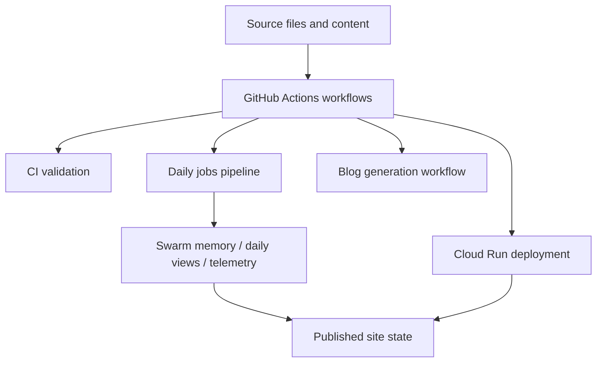

*Generated by GitHub Scout Agent | Verified by Adversarial Bar-Raiser Gate*

## The Big Picture: What We Built & How It Works

Today’s work centered on the automation and observability layer behind `kprsnt.in`, not just the visible website. The commit `c2c96c9` touched a very large surface area — 384 files — with changes spanning local agent rules, environment templates, CI/CD workflows, and deployment plumbing. That usually means the goal is not a single feature, but a coordinated system update: keep the site deployable, keep background jobs running, and make the state those jobs depend on easier to reason about.

The main engineering problem here is state drift. When a site depends on scheduled jobs, telemetry, and agent-generated content, you can get into failure modes where one system updates while another silently lags behind. For example: daily view counters can stop matching the live site, memory snapshots can become stale, or a deploy can succeed while the job pipeline breaks because an environment variable or workflow contract changed. This update appears aimed at reducing that risk by tightening the contract between source control, CI, and runtime configuration.

Architecturally, that means pushing more of the operational truth into versioned files and workflows. The `.env.example` changes help define the runtime contract explicitly. The GitHub Actions workflows under `.github/workflows/` define when blog generation, CI checks, daily jobs, and Cloud Run deployment happen. The `.cursor/rules/ponytail.mdc` and `.github/copilot-instructions.md` updates suggest the agent scaffolding itself was also tuned, which matters because these systems often fail not from code logic alone, but from inconsistent generation patterns, missing conventions, or automation that writes files in the wrong shape.

### Project: `kprsnt.in`

- **What It Does (In Plain English)**:  
  This is the personal site and publishing system behind the `kprsnt.in` portfolio. It appears to combine content generation, daily automation, telemetry, and deployment into one continuously updated web presence.

- **The Technical Deep Dive**:
  - The commit `c2c96c9` is an auto-update labeled **“Swarm Memory, Daily Views & Telemetry”**, which points to changes in the site’s operational layer rather than just static content.
  - Files touched include:
    - `.cursor/rules/ponytail.mdc`
    - `.dockerignore`
    - `.env.example`
    - `.github/copilot-instructions.md`
    - `.github/workflows/blog.yml`
    - `.github/workflows/ci.yml`
    - `.github/workflows/daily_jobs_pipeline.yml`
    - `.github/workflows/deploy-cloud-run.yml`
  - The presence of multiple workflow edits suggests the repo is using GitHub Actions as the control plane for:
    - blog publishing or regeneration,
    - CI validation,
    - scheduled daily jobs,
    - and Cloud Run deployment.
  - Updating `.env.example` is important because it defines the expected runtime interface for both local development and CI/CD. When telemetry or daily jobs are added, missing env vars are a common source of runtime failure.
  - Updating `.dockerignore` likely reduces build context size and prevents accidental inclusion of local artifacts, which matters for faster image builds and lower risk of leaking generated or transient files into containers.
  - The agent instruction files (`.cursor/rules/ponytail.mdc` and `.github/copilot-instructions.md`) indicate that the repo is also codifying how automated code generation should behave. That is a practical way to keep AI-assisted edits consistent across repeated runs.

- **Why It Matters & Trade-offs Handled**:
  - The biggest risk in a system like this is **automation mismatch**: the site deploys, but the scheduled jobs or telemetry pipeline silently diverge.
  - Another failure mode is **configuration drift** between local, CI, and production. Explicit env templates and workflow updates reduce that risk.
  - There is also a **build efficiency trade-off**: more automation often means more files, more steps, and more places for failure. Tightening `.dockerignore` and workflow definitions helps keep the pipeline lean enough to remain reliable.
  - The likely payoff is better operational visibility into daily views and memory state, plus fewer “works on my machine” deployment surprises.

## What's Next

The system looks like it is moving toward a more disciplined automation stack: clearer environment contracts, cleaner build inputs, and more explicit workflow boundaries. The next priority is usually to verify that the new telemetry and daily job paths are actually stable in production — especially around scheduled execution, env parity, and deployment consistency across CI and Cloud Run.