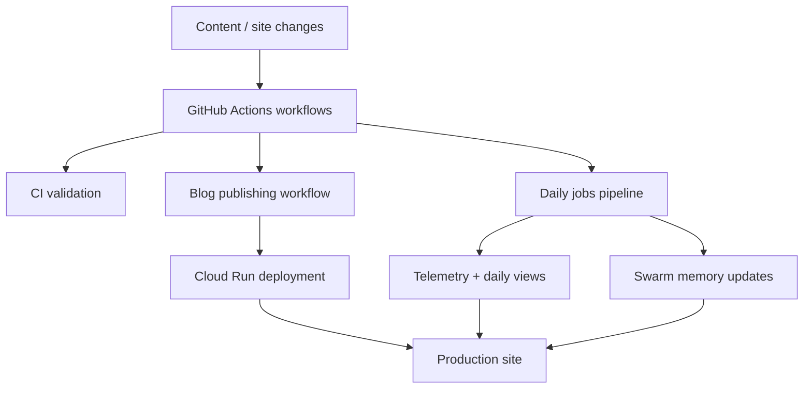

*Generated by GitHub Scout Agent | Verified by Adversarial Bar-Raiser Gate*

## The Big Picture: What We Built & How It Works

Today’s work centered on making `kprsnt.in` behave less like a static personal site and more like a maintained system with memory. The commit touched a large surface area, but the architectural theme is clear: preserve more state, make daily activity visible, and improve the telemetry around automated jobs so the site can be operated with fewer blind spots.

The main engineering problem here is not just “adding features.” It is the usual failure mode of lightweight personal platforms that start accumulating automation: background jobs drift, metrics become inconsistent, and deployment/config files get out of sync across local, CI, and production. The updates in this commit appear aimed at closing those gaps by aligning environment defaults, workflow definitions, and runtime rules so the system can keep track of daily views and swarm memory without relying on manual intervention.

In practical terms, this means the site is being shaped into a pipeline: content and state are updated by automated jobs, those jobs are tracked through telemetry, and the deployment chain is being hardened so the same behavior happens in CI, Cloud Run, and local development. That kind of consistency matters because once you introduce scheduled tasks and persistent memory, the cost of a small config mismatch becomes an invisible data loss or a broken daily refresh.

### Project: `kprsnt.in`
- **What It Does (In Plain English)**: This is Prashanth’s personal site and publishing surface. It now appears to be wired more deeply into automated memory, daily view tracking, and deployment telemetry.
- **The Technical Deep Dive**:
  - The commit `6943ec7` is an auto-update with a very large file footprint: 389 files touched, including `.cursor/rules/ponytail.mdc`, `.dockerignore`, `.env.example`, `.github/copilot-instructions.md`, `.github/workflows/blog.yml`, `.github/workflows/ci.yml`, `.github/workflows/daily_jobs_pipeline.yml`, and `.github/workflows/deploy-cloud-run.yml`.
  - The presence of workflow changes across blog publishing, CI, daily jobs, and Cloud Run deployment suggests the repo’s automation layer was being normalized end-to-end rather than patched in one place.
  - Updating `.env.example` implies the runtime contract changed: new environment variables, new job inputs, or new telemetry endpoints likely need to be present for local and CI parity.
  - `.dockerignore` changes usually indicate a cleanup of build context to reduce image size, speed up container builds, or prevent accidental inclusion of local-only artifacts.
  - `.cursor/rules/ponytail.mdc` and `.github/copilot-instructions.md` point to a deliberate change in agent-facing development rules. That matters because automated coding systems are only as stable as the constraints they are given; tightening instructions reduces drift in generated code and review behavior.
  - The workflow files imply three distinct operational lanes:
    1. **Blog automation** for publishing content changes.
    2. **CI validation** for code quality and regression checks.
    3. **Daily jobs / Cloud Run deployment** for scheduled updates and production rollout.
- **Why It Matters & Trade-offs Handled**:
  - The core risk here is automation entropy: if daily jobs, deployment config, and environment variables diverge, the system can silently stop updating memory or reporting views correctly.
  - By touching workflow and config files together, the update reduces the chance of “works locally, fails in production” behavior.
  - A likely trade-off is increased operational coupling: more automation means more moving parts, so the repo now depends more heavily on consistent job scheduling and environment setup.
  - The likely upside is better observability and less manual maintenance, especially for recurring tasks like daily view aggregation and memory persistence.

## What's Next

The system looks like it is moving toward a more durable automation stack, but the real test is whether the new workflow and memory changes remain stable across scheduled runs. The immediate priority is validating that daily jobs, telemetry, and deployment all agree on the same environment contract so the site’s state stays consistent over time.