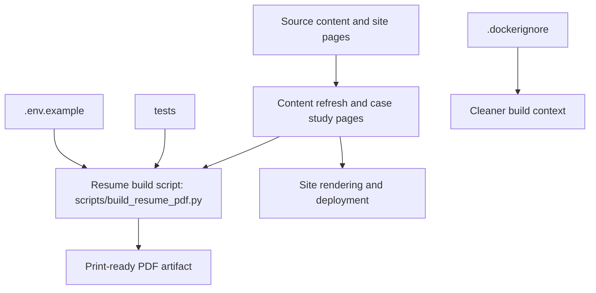

*Generated by GitHub Scout Agent | Verified by Adversarial Bar-Raiser Gate*

## The Big Picture: What We Built & How It Works

Today’s work on `kprsnt.in` was about turning the personal site from a static portfolio into a more complete publishing and presentation surface. The main change was a site-wide content refresh paired with new case study pages, so the site can now present deeper technical work instead of only a lightweight landing page. That matters because a portfolio site has two jobs at once: it needs to load fast and look polished, but it also has to carry enough technical depth to explain real engineering work without forcing visitors to jump into GitHub immediately.

The other major improvement was a print-ready resume pipeline. Instead of relying on a browser-only view or manually exporting a PDF, the repo now includes `scripts/build_resume_pdf.py`, which suggests a deliberate build path for generating a resume artifact from source. That is a practical reliability upgrade: it reduces formatting drift, makes the output repeatable, and gives the site a versioned, scriptable way to produce a document that can be shared, archived, or embedded in workflows. In short, the repo is moving from “a website with content” toward “a content system with reproducible outputs.”

## Project: `kprsnt.in`

- **What It Does (In Plain English)**: This is Prashanth’s personal site and publishing surface. The update expands it with case studies and adds a way to generate a print-ready resume, so the site can now serve both as a portfolio and a professional document source.

- **The Technical Deep Dive**:
  - Commit: `6f9281e` — `feat: case studies, print resume, and site-wide content refresh`
  - Files touched included `scripts/build_resume_pdf.py`, `base`, `tests`, `.env.example`, `.cursor/rules/ponytail.mdc`, and `.dockerignore`, with a very large change set overall (`399` files reported).
  - The presence of `scripts/build_resume_pdf.py` indicates a new build-time or command-line PDF generation path. Architecturally, that usually means the resume is no longer just a styled HTML page; it is now an output artifact produced from source content, likely with deterministic formatting rules and a repeatable render pipeline.
  - The `tests` directory being part of the change set suggests the resume/content workflow was not added casually. A print pipeline is brittle by nature: page breaks, font metrics, margins, and content overflow can all fail silently. Adding test coverage is the right move because it lets the team catch regressions when content length changes or when layout rules shift.
  - Updating `.env.example` implies the site or build script depends on environment configuration, likely for local generation, deployment, or content toggles.
  - Changes in `.dockerignore` suggest the repo’s container build context was cleaned up, which matters when a project starts including generated assets, PDFs, or larger content trees. Keeping build contexts lean avoids accidental image bloat and reduces noisy rebuilds.
  - The `.cursor/rules/ponytail.mdc` change points to a repo-specific agent or editor rule update, which usually means the project’s coding conventions or content-generation instructions were tightened to keep future AI-assisted edits consistent.

- **Why It Matters & Trade-offs Handled**:
  - The biggest risk in a content-heavy personal site is drift: pages become inconsistent, resume output becomes fragile, and “final” documents depend on manual browser actions. A scripted PDF path removes that human variability.
  - Print output is more failure-prone than web output because it must survive pagination, font rendering, and fixed page dimensions. A dedicated script is the right abstraction because it centralizes those constraints instead of scattering them across CSS and manual exports.
  - The scale of the update suggests a broad refresh rather than a narrow patch. That usually means the trade-off was between shipping a cohesive content revamp and preserving backward compatibility across many pages. The addition of tests and build tooling is what keeps that kind of large refresh from becoming unstable.

## What's Next

The site now has a stronger content foundation and a more reliable document-generation path, so the next priority is stability: making sure the new case study pages render consistently and the resume PDF stays deterministic as content changes. The most valuable follow-up work will be validating pagination, tightening tests around the build script, and confirming the deployment pipeline keeps generated assets clean and reproducible.