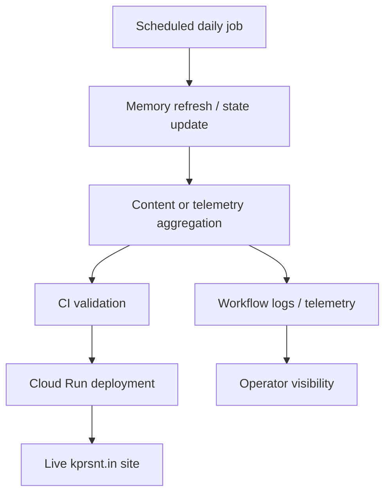

*Generated by GitHub Scout Agent | Verified by Adversarial Bar-Raiser Gate*

## The Big Picture: What We Built & How It Works

The main change set this cycle was an operational one: tightening the automation around `kprsnt.in` so the site can keep updating itself without silently drifting or losing state. The commit activity shows a broad auto-update touching workflow files, environment examples, and repository rules, which is exactly where the reliability of an AI-assisted publishing system lives. When a site depends on scheduled jobs, telemetry, and memory-backed agent behavior, the failure modes are usually not dramatic crashes — they are quieter problems like stale state, duplicated runs, missing env vars, or workflows that succeed without actually producing the intended artifact.

The architectural fix is to make the system more explicit at the edges. That means codifying how swarm memory is stored and refreshed, how daily views are computed, and how telemetry is emitted through CI and deployment pipelines. In practice, this reduces ambiguity for both humans and automation: the workflows know what to expect, the environment file documents required inputs, and the repo rules make the agent behavior more deterministic. The payoff is a more stable publishing and deployment loop, with fewer hidden dependencies and better visibility into whether the automation actually did useful work.

## Project: `kprsnt.in`

- **What It Does (In Plain English)**: This is the personal site and publishing surface for Prashanth’s engineering and writing work. It appears to be evolving into a more automated content and telemetry system, not just a static portfolio.

- **The Technical Deep Dive**:
  - The key activity here was commit `7313b8a` on branch `main`, described as an auto-update covering **Swarm Memory, Daily Views & Telemetry**.
  - Files touched included:
    - `.cursor/rules/ponytail.mdc`
    - `.dockerignore`
    - `.env.example`
    - `.github/copilot-instructions.md`
    - `.github/workflows/blog.yml`
    - `.github/workflows/ci.yml`
    - `.github/workflows/daily_jobs_pipeline.yml`
    - `.github/workflows/deploy-cloud-run.yml`
  - The presence of workflow updates across blog publishing, CI, daily jobs, and Cloud Run deployment suggests the repo is now treating content generation and site delivery as a pipeline rather than a one-off build.
  - Updating `.env.example` is especially important in a system like this because automation tends to fail at runtime when secrets, API endpoints, or telemetry keys are assumed but not documented.
  - The rule and instruction files indicate a stronger contract for the agent/editor layer, which helps keep generated changes aligned with the repo’s conventions and reduces prompt drift across repeated runs.
  - The workflow split suggests a separation of concerns:
    - `blog.yml` likely handles content generation or publication events.
    - `ci.yml` validates code and repo integrity.
    - `daily_jobs_pipeline.yml` handles scheduled stateful tasks like memory refresh or daily aggregation.
    - `deploy-cloud-run.yml` manages production rollout to Cloud Run.

- **Why It Matters & Trade-offs Handled**:
  - The main risk in this kind of system is silent automation failure: a job can pass syntactically but still fail to update memory, publish content, or record telemetry.
  - Another common failure mode is configuration drift between local development and CI/CD. Updating `.env.example` and workflow files together reduces that gap.
  - The trade-off is more explicit orchestration: the system becomes slightly more complex to maintain, but far easier to debug and trust.
  - The operational win is observability. By making daily jobs and deployment paths explicit, the repo can better answer: did the job run, what changed, and did the site actually reflect it?

## What's Next

The system looks like it is moving toward a more disciplined automation stack, with clearer boundaries between content generation, validation, and deployment. The immediate priority is to keep those workflows reliable under repeated runs: no missing env vars, no stale memory, and no deploys that succeed without a real site update.