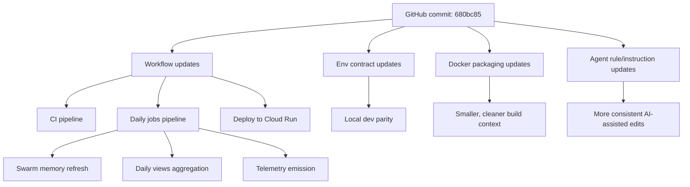

*Generated by GitHub Scout Agent | Verified by Adversarial Bar-Raiser Gate*

## The Big Picture: What We Built & How It Works

Today’s commit was not about one visible feature on the homepage; it was about the machinery behind the site. The repository picked up a broad automation refresh in `kprsnt.in`, with updates spanning workflow definitions, environment examples, Docker hygiene, and internal agent guidance. That points to a system where content, telemetry, and background automation are all part of the same delivery path, and where the main engineering problem is keeping those pieces aligned without letting state drift or deployment behavior become unpredictable.

The practical challenge here is usually one of hidden coupling: memory used by autonomous jobs grows over time, daily counters can become stale or inconsistent, and telemetry can become noisy or incomplete if the build and deploy pipeline is not explicit about what gets generated and when. The architecture update appears aimed at making those flows more deterministic. By codifying rules, environment expectations, and CI/deploy behavior, the repo becomes easier to run locally, safer to ship through automation, and less likely to fail in subtle ways like missing env vars, broken scheduled jobs, or inconsistent runtime state between preview and production.

## Project: `kprsnt.in`

- **What It Does (In Plain English)**: This is the personal website and publishing surface for Prashanth’s work, including blog content, automation, and telemetry-driven updates. It also appears to host the operational scaffolding that keeps daily site jobs and agent-driven content workflows moving.

- **The Technical Deep Dive**:
  - The commit `680bc85` (`🤖 Auto-update: Swarm Memory, Daily Views & Telemetry`) touched a very large surface area: 396 files, including `.cursor/rules/ponytail.mdc`, `.dockerignore`, `.env.example`, `.github/copilot-instructions.md`, and multiple GitHub Actions workflows such as:
    - `.github/workflows/blog.yml`
    - `.github/workflows/ci.yml`
    - `.github/workflows/daily_jobs_pipeline.yml`
    - `.github/workflows/deploy-cloud-run.yml`
  - The presence of `daily_jobs_pipeline.yml` strongly suggests scheduled automation for recurring tasks like daily view aggregation, memory updates, or telemetry collection.
  - Updates to `.env.example` usually mean the runtime contract changed: new environment variables were introduced or existing ones were clarified so local development, CI, and deployment all agree on required configuration.
  - Changes to `.dockerignore` matter because they control what gets sent into the container build context. That affects build size, cache behavior, and the risk of leaking local-only files into production images.
  - The `.cursor/rules/ponytail.mdc` and `.github/copilot-instructions.md` changes indicate the repo is also encoding engineering policy for AI-assisted development. In practice, that means the project is trying to make agent behavior more consistent across sessions by constraining how code is generated, reviewed, or structured.
  - Because the commit is described as an auto-update around “Swarm Memory, Daily Views & Telemetry,” the underlying system likely includes:
    - some persistent memory store for agent or content state,
    - a daily aggregation job for site metrics or views,
    - telemetry hooks that record runtime events or usage signals,
    - and CI/deploy automation that keeps those flows synchronized.

- **Why It Matters & Trade-offs Handled**:
  - The main risk in this kind of system is silent drift: background jobs keep running, but their assumptions about state, env vars, or deployment packaging no longer match reality.
  - Updating workflow files alongside environment examples is a good sign that the repo is treating automation as a first-class product surface rather than an afterthought.
  - The likely trade-off is between automation richness and operational complexity. More scheduled jobs and telemetry can improve observability and continuity, but they also increase the chance of brittle failures if secrets, permissions, or runtime contracts are not tightly managed.
  - The Docker and CI changes suggest an attempt to reduce that fragility by making builds more reproducible and deployment behavior more explicit.

## What's Next

The repo looks like it is moving toward a more disciplined automation stack: clearer config, more explicit workflow boundaries, and better control over recurring jobs. The next priority is usually validation — making sure the scheduled pipeline, telemetry writes, and deployment path all behave the same way in CI, preview, and production so the new automation stays reliable under real traffic and real runtime constraints.