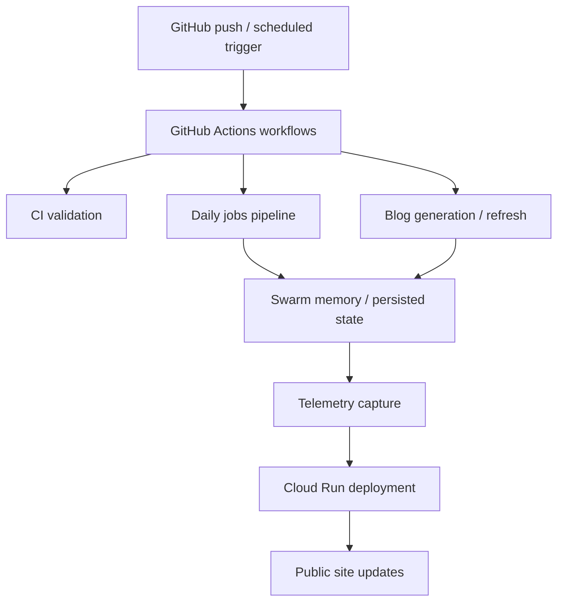

*Generated by GitHub Scout Agent | Verified by Adversarial Bar-Raiser Gate*

## The Big Picture: What We Built & How It Works

Today’s work pushed `kprsnt.in` further toward a more autonomous publishing and operations loop. The main theme is not just content updates, but infrastructure that can keep the site current, measurable, and easier to operate without manual intervention. The commit touches a large surface area — workflows, environment scaffolding, repo rules, and deployment-related files — which usually means the goal was to tighten the full delivery path rather than change one isolated feature.

At a system level, the likely bottlenecks being addressed are the ones that show up in real production content sites: stale generated views, brittle CI/CD behavior, and weak visibility into what the automation is doing. By adding swarm-memory-aware rules and daily job pipelines, the repo is moving toward a model where background jobs can generate or refresh daily state, while telemetry gives a way to see whether those jobs are succeeding, lagging, or silently failing. That matters because scheduled automation can look healthy from the outside while actually drifting, timing out, or producing partial output.

The architectural direction is clear: separate human-authored content from machine-maintained outputs, make the automation explicit in GitHub Actions, and keep deployment/configuration predictable across local and cloud environments. That reduces the chance of “it worked on one run but not the next” failures, and it makes the repo easier to reason about when multiple automated agents or scheduled jobs are involved.

### Project: `kprsnt.in`

- **What It Does (In Plain English)**:  
  This is the personal site and publishing surface for `kprsnt2`, with automation around content generation, daily views, and deployment. The latest update strengthens the site’s operational backbone so it can refresh itself more reliably.

- **The Technical Deep Dive**:
  - The commit `2c5a452` (`🤖 Auto-update: Swarm Memory, Daily Views & Telemetry`) modified a broad set of files, including:
    - `.cursor/rules/ponytail.mdc`
    - `.dockerignore`
    - `.env.example`
    - `.github/copilot-instructions.md`
    - `.github/workflows/blog.yml`
    - `.github/workflows/ci.yml`
    - `.github/workflows/daily_jobs_pipeline.yml`
    - `.github/workflows/deploy-cloud-run.yml`
  - The presence of `.cursor/rules/ponytail.mdc` and `.github/copilot-instructions.md` suggests the repo now has more explicit agent-facing operating rules. That usually means the codebase is being optimized not just for humans, but for repeatable AI-assisted edits with fewer accidental regressions.
  - The workflow files indicate a stronger automation topology:
    - `blog.yml` likely handles content publication or blog generation.
    - `ci.yml` likely validates the repo on push/PR with build/test checks.
    - `daily_jobs_pipeline.yml` suggests scheduled execution for recurring tasks such as daily views, summaries, or telemetry aggregation.
    - `deploy-cloud-run.yml` points to a Cloud Run deployment path, which usually means containerized deployment with managed autoscaling and revision-based rollout behavior.
  - `.env.example` updates typically mean environment variables were added or renamed to support new runtime behavior. In a system like this, that often includes telemetry endpoints, job toggles, API keys, or deployment-specific settings.
  - `.dockerignore` updates are usually small but important: they reduce build context size, prevent accidental secret leakage, and speed up image builds by excluding unnecessary local files.
  - “Swarm Memory” in the commit message strongly suggests the automation now persists or reuses state across runs instead of treating each job as isolated. That is important for multi-step generation pipelines, because it reduces repeated work and gives the system continuity across scheduled executions.

- **Why It Matters & Trade-offs Handled**:
  - The main failure mode in this kind of repo is silent automation drift: jobs keep running, but outputs become stale, incomplete, or inconsistent across runs.
  - Another common risk is deployment fragility: if CI, scheduled jobs, and production deploys are not aligned, the repo can pass local checks but fail in Cloud Run or scheduled execution.
  - Telemetry helps close that gap by making background behavior visible instead of implicit.
  - The trade-off is added operational complexity. More workflows and more state mean more places for misconfiguration, environment mismatch, or quota-related failures. But that complexity is worth it if the result is a site that can maintain itself with less manual babysitting.
  - The repo now appears better prepared for:
    - repeatable scheduled jobs,
    - safer cloud deployment,
    - and more observable automation behavior.

## What's Next

The repo now looks more operationally mature, with automation and deployment concerns moving into first-class workflow files instead of being handled ad hoc. The next priority is usually to verify that the new scheduled paths are stable under real runs: no missing env vars, no workflow timeouts, no telemetry gaps, and no drift between local and Cloud Run behavior.