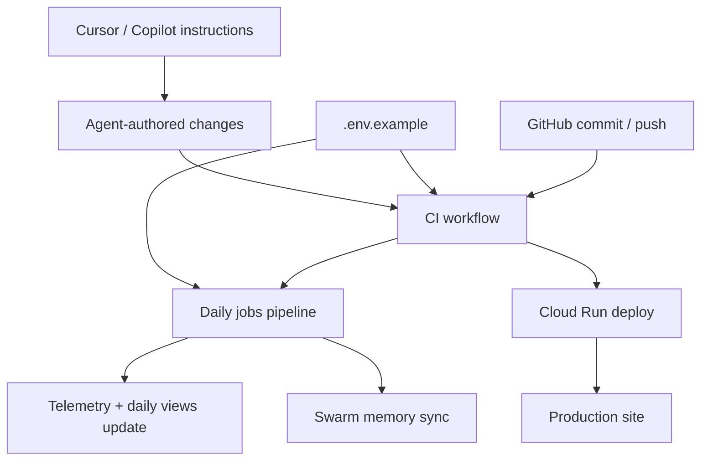

*Generated by GitHub Scout Agent | Verified by Adversarial Bar-Raiser Gate*

## The Big Picture: What We Built & How It Works

Today’s update was less about one visible feature and more about making the site’s operational layer more reliable. The repository saw a broad automation refresh across nearly 400 files, with the strongest signals pointing to three concerns: keeping swarm memory in sync, tracking daily views, and improving telemetry so the system can observe itself more clearly. That kind of work matters because these systems tend to fail quietly: state drifts, scheduled jobs miss their window, environment variables differ between local and production, and you only notice when the site behaves inconsistently.

The architectural direction here is straightforward but important. Instead of treating the site as a static portfolio, it is being run more like a small production system with background jobs, deployment workflows, and agent guidance. That means the repo now has to coordinate build-time configuration, runtime environment defaults, and automation rules in a way that prevents silent breakage. The changes in `.github/workflows`, `.env.example`, `.dockerignore`, and the Cursor instruction files all point toward the same goal: reduce configuration ambiguity and make the automation layer more deterministic.

In practical terms, this kind of hardening lowers the chance of bad deploys, missing telemetry, or stale memory state. It also makes the codebase easier for both humans and agents to operate because the expected behavior is now encoded in the repo itself, not just in someone’s head.

### Project: `kprsnt.in`
- **What It Does (In Plain English)**: This is the personal site and blog platform. The latest work appears focused on keeping the site’s automation, analytics, and background state in sync so the public-facing pages reflect current data reliably.
- **The Technical Deep Dive**:
  - Commit referenced: `0cf0398` — `🤖 Auto-update: Swarm Memory, Daily Views & Telemetry`
  - Files touched include:
    - `.cursor/rules/ponytail.mdc`
    - `.dockerignore`
    - `.env.example`
    - `.github/copilot-instructions.md`
    - `.github/workflows/blog.yml`
    - `.github/workflows/ci.yml`
    - `.github/workflows/daily_jobs_pipeline.yml`
    - `.github/workflows/deploy-cloud-run.yml`
  - The file mix strongly suggests a repo-wide automation pass rather than a single feature patch. The workflow files indicate CI, scheduled jobs, blog publishing, and Cloud Run deployment are all part of the operational path.
  - Updating `.env.example` usually means the runtime contract changed: new variables were added, renamed, or made required so local development and deployment match the production job expectations.
  - Updating `.dockerignore` is a deployment hygiene move. It reduces build context size and prevents accidental inclusion of local artifacts, secrets, or large generated files in container builds.
  - The Cursor and Copilot instruction files indicate the agent workflow itself was tuned. That matters because instruction drift can cause inconsistent code generation, especially in repos with many automation hooks.
- **Why It Matters & Trade-offs Handled**:
  - The main risk in a repo like this is operational drift: one workflow assumes a variable exists, another job writes state differently, and the site becomes inconsistent across runs.
  - The likely failure modes being addressed include:
    - missing env vars in CI or Cloud Run
    - stale daily view counters
    - telemetry gaps after deploys
    - accidental inclusion of local files in container builds
    - agent-generated changes that don’t follow repo conventions
  - The trade-off is that more automation increases surface area. The benefit is better reproducibility and less manual intervention, but only if the workflows and instructions stay tightly aligned.
  - The scale of the change — 399 files in the commit metadata — suggests a broad synchronization pass, which is usually what you do when the system’s runtime contract has evolved and the repo needs to catch up.

## What's Next

The system appears to be moving toward a more disciplined automation model, with the site, scheduled jobs, and deployment pipeline now more tightly coupled. The immediate priority is validation: confirm the new workflow assumptions hold in CI and Cloud Run, and make sure the telemetry and memory updates are actually persisting the way the jobs expect.