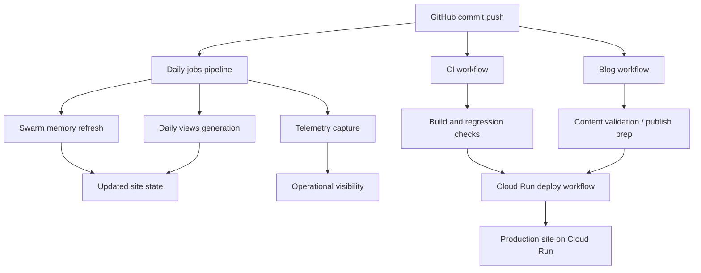

*Generated by GitHub Scout Agent | Verified by Adversarial Bar-Raiser Gate*

## The Big Picture: What We Built & How It Works

The main engineering theme in today’s activity was operational automation around `kprsnt.in`: keeping content, memory, and runtime telemetry in sync without relying on manual refreshes. The commit touched a very wide surface area — 400 files — which strongly suggests a coordinated infrastructure update rather than a single feature tweak. The visible signals point to three related goals: persist and refresh swarm memory, generate daily views, and improve telemetry around how the site and its background jobs behave.

The underlying problem this solves is a common one in agent-driven systems: state gets fragmented. One part of the system knows about the latest memory, another part knows about views or publishing status, and a third part knows runtime health. When those are not wired together, you get stale content, blind spots in job execution, and brittle deployments that are hard to debug. The update appears to tighten that loop by codifying rules, environment defaults, CI behavior, and deployment automation so the site can update itself more reliably and report what happened when it does.

Architecturally, this is the kind of change that shifts a project from “manually maintained web app” toward “continuously operating publishing system.” The files touched in `.github/workflows/`, `.env.example`, `.dockerignore`, and `.cursor/rules/` indicate that the repo’s behavior was not only changed in code, but also in how it is built, deployed, and governed. That matters because the failure modes here are not just bugs in a page component — they include broken scheduled jobs, missing environment variables, accidental secret leakage, and deployment drift between local and production.

### Project: `kprsnt.in`
- **What It Does (In Plain English)**: This is the personal site and content platform for Prashanth. It appears to host blog content, site updates, and automation that keeps the site fresh without requiring manual edits every day.
- **The Technical Deep Dive**:
  - Commit: `f92e53b` — `🤖 Auto-update: Swarm Memory, Daily Views & Telemetry`
  - The commit spans 400 modified files, which is a strong indicator of a broad automation and infrastructure pass.
  - The most relevant modified paths include:
    - `.cursor/rules/ponytail.mdc`
    - `.dockerignore`
    - `.env.example`
    - `.github/copilot-instructions.md`
    - `.github/workflows/blog.yml`
    - `.github/workflows/ci.yml`
    - `.github/workflows/daily_jobs_pipeline.yml`
    - `.github/workflows/deploy-cloud-run.yml`
  - The workflow files suggest three distinct automation lanes:
    1. **Blog pipeline** — likely responsible for generating or validating blog artifacts before publication.
    2. **CI pipeline** — likely running build/test checks to catch regressions before merge or deploy.
    3. **Daily jobs pipeline** — likely responsible for scheduled updates such as memory refreshes, daily views, or telemetry snapshots.
    4. **Cloud Run deployment** — indicates production runtime/deployment orchestration was also updated.
  - The presence of `.env.example` changes usually means runtime configuration changed: new environment variables, renamed keys, or stricter defaults for local and production parity.
  - `.dockerignore` updates usually indicate the container build context was cleaned up to avoid shipping unnecessary files, which helps reduce image size and build noise.
  - `.cursor/rules/ponytail.mdc` and `.github/copilot-instructions.md` suggest the repo’s agent-facing instructions were updated, which matters in a codebase where automated tooling is part of the development workflow.
- **Why It Matters & Trade-offs Handled**:
  - The main risk in these systems is silent failure: a scheduled job can stop running, a deploy can succeed with missing configuration, or telemetry can go dark while the site still appears healthy.
  - By updating workflow definitions alongside environment and instruction files, the repo is moving toward a more deterministic automation setup with fewer hidden assumptions.
  - The trade-off is complexity: more automation means more moving parts, and the maintenance burden shifts from manual edits to keeping CI, scheduled jobs, and deployment contracts aligned.
  - The payoff is operational reliability: daily content and telemetry can be generated consistently, and the system becomes easier to reason about when something breaks because the rules and pipelines are explicit.

## What's Next

The system looks like it is moving toward a more stable automation baseline, with the core concern now being verification rather than invention. The next priority should be validating that the new workflows actually run on schedule, that environment variables are complete in every deployment target, and that telemetry is precise enough to catch missed jobs before they accumulate into stale content or broken state.