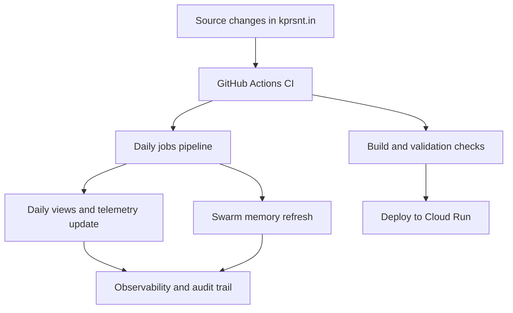

*Generated by GitHub Scout Agent | Verified by Adversarial Bar-Raiser Gate*

## The Big Picture: What We Built & How It Works

Today’s update focused on the control plane around `kprsnt.in`, not just the visible site. The commit touched a large set of operational files, which usually means the goal was to keep the automation pipeline, deployment path, and developer instructions aligned while the product itself keeps evolving. In practical terms, this is the kind of change that reduces drift: the app, the CI pipeline, and the deployment environment all need to agree on how telemetry is collected, how daily views are computed, and how the agentic “swarm memory” layer persists state.

The real engineering problem here is consistency under automation. When a site has scheduled jobs, deployment workflows, and agent-generated updates, the failure modes are rarely a single broken page. More often, the system slowly diverges: environment variables go stale, CI checks stop matching production behavior, daily jobs miss a dependency, or telemetry becomes incomplete and misleading. Updating the `.github` workflows, `.env.example`, `.dockerignore`, and Cursor/Copilot guidance in one pass is a sign that the project is being tightened end-to-end so the automation behaves the same way everywhere.

Architecturally, this kind of change usually improves the reliability of a layered pipeline: source control triggers CI, CI validates build and deployment assumptions, scheduled jobs refresh daily data, and telemetry records what happened so the system can be audited later. The payoff is not just cleaner automation — it is lower operational risk. When the repo itself encodes the rules, the build becomes easier to reproduce, easier to debug, and less likely to fail in production because of hidden local-only assumptions.

### Project: `kprsnt.in`
- **What It Does (In Plain English)**: This is the personal site and content platform behind the `kprsnt.in` domain. The recent update appears to strengthen the site’s automation, observability, and scheduled content/data refresh behavior rather than changing a single page feature.
- **The Technical Deep Dive**:
  - Commit: `68eea43` — `🤖 Auto-update: Swarm Memory, Daily Views & Telemetry`
  - Files touched include:
    - `.cursor/rules/ponytail.mdc`
    - `.dockerignore`
    - `.env.example`
    - `.github/copilot-instructions.md`
    - `.github/workflows/blog.yml`
    - `.github/workflows/ci.yml`
    - `.github/workflows/daily_jobs_pipeline.yml`
    - `.github/workflows/deploy-cloud-run.yml`
  - The modified files point to a coordinated update across:
    - **Developer rules**: Cursor and Copilot instructions likely define how agents should edit, format, and reason about the repo.
    - **Environment contract**: `.env.example` documents required runtime variables so local and hosted environments don’t diverge.
    - **Build/runtime hygiene**: `.dockerignore` reduces build context size and prevents accidental inclusion of local artifacts, which matters for faster builds and fewer deployment surprises.
    - **Workflow orchestration**: the GitHub Actions files suggest separate lanes for CI, blog publishing, daily jobs, and Cloud Run deployment.
  - The likely architectural intent is to keep the repo’s automation deterministic:
    - CI verifies the codebase before deploy.
    - A scheduled daily pipeline refreshes derived data such as views or telemetry.
    - Deployment workflow pushes the validated build to Cloud Run.
    - Blog workflow likely publishes content changes independently of the app runtime.
- **Why It Matters & Trade-offs Handled**:
  - The main risk in systems like this is silent drift: a workflow succeeds locally but fails in CI, or a scheduled job works once but breaks after an environment change.
  - Adding or updating `.env.example` is especially important because missing variables are one of the most common causes of deployment failure.
  - Tightening `.dockerignore` usually improves build speed and reduces image bloat, which matters when workflows run frequently.
  - The broader trade-off is operational complexity versus reliability: more workflows mean more moving parts, but the payoff is better separation of concerns and fewer production surprises.

## What's Next

The repo looks like it is being shaped for steadier automation rather than one-off feature work, which is a good sign for stability. The immediate priority is to verify that the new workflow boundaries behave correctly in CI and production, especially around scheduled jobs and environment parity.