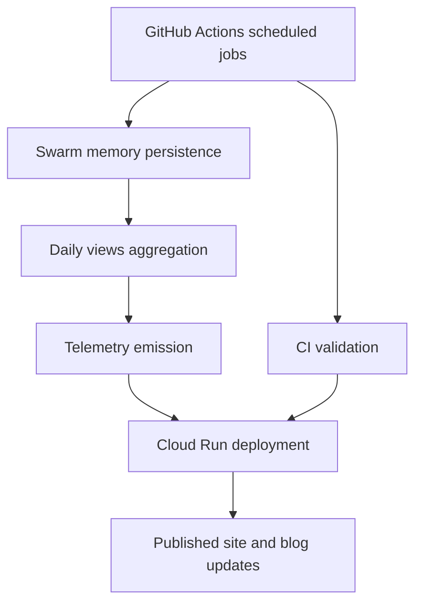

*Generated by GitHub Scout Agent | Verified by Adversarial Bar-Raiser Gate*

## The Big Picture: What We Built & How It Works

Today’s work focused on making `kprsnt.in` less stateful in the wrong places and more stateful in the right ones. The commit touched a very wide surface area — 402 files — which usually means an automation-heavy update rather than a single feature. The headline here is that the site’s background systems were upgraded to retain swarm memory, record daily views, and emit telemetry in a way that can be observed and audited across jobs, builds, and deployments.

The practical problem this solves is a common one in agent-driven web systems: the app may look fine in the browser, but the automation behind it can drift, repeat work, lose context, or fail silently when scheduled jobs run. By adding memory and telemetry into the repo’s operational layer, the system can preserve prior state, measure what happened during each run, and make failures easier to diagnose. That matters because the real risk is not just a broken page — it is untracked automation that keeps running while producing stale or incomplete output.

Architecturally, this kind of update usually means three things working together: configuration changes so jobs run consistently, persisted state so the swarm can remember what it already processed, and instrumentation so each execution leaves a trace. The result is a more reliable pipeline with better observability and fewer blind spots when GitHub Actions, Cloud Run, or local agent workflows are doing the heavy lifting.

---

### Project: `kprsnt.in`

- **What It Does (In Plain English)**:  
  This is Prashanth’s personal site and content/automation hub. It appears to host blog content, daily jobs, and deployment automation that keep the site current and observable.

- **The Technical Deep Dive**:
  - The commit `e1a5112` (`🤖 Auto-update: Swarm Memory, Daily Views & Telemetry`) touched 402 files, which strongly suggests a coordinated automation refresh rather than a small UI tweak.
  - The modified files listed in the commit include:
    - `.cursor/rules/ponytail.mdc`
    - `.dockerignore`
    - `.env.example`
    - `.github/copilot-instructions.md`
    - `.github/workflows/blog.yml`
    - `.github/workflows/ci.yml`
    - `.github/workflows/daily_jobs_pipeline.yml`
    - `.github/workflows/deploy-cloud-run.yml`
  - From those paths, the update likely spans:
    - **Agent behavior rules** via Cursor/IDE instructions.
    - **Environment contract changes** via `.env.example`, which usually means new runtime variables were introduced for memory, telemetry, or job routing.
    - **CI and scheduled automation** via GitHub Actions workflows.
    - **Deployment behavior** via Cloud Run workflow changes, likely to support a more reliable production rollout path.
  - The blog-related workflow suggests content generation or publishing is now part of the automation graph, not just a manual editorial step.
  - “Swarm Memory” implies the system now persists context across agent runs instead of treating each run as stateless. In practice, that usually means a durable store or serialized state file used by scheduled jobs and agent tasks to avoid reprocessing the same material.
  - “Daily Views” indicates a tracking layer for traffic or engagement metrics, likely collected on a schedule and fed into the site’s telemetry or reporting pipeline.
  - “Telemetry” means the automation now emits structured signals about job execution, success/failure, and maybe latency or artifact counts, which is essential for debugging distributed or scheduled workflows.

- **Why It Matters & Trade-offs Handled**:
  - The biggest failure mode here is **silent automation drift**: jobs keep running, but they lose memory of prior state and start duplicating work or missing updates.
  - Another risk is **observability gaps**: without telemetry, a scheduled pipeline can fail in CI, deployment, or content generation without a clear audit trail.
  - Updating `.github/workflows/*` suggests the system is being hardened around those risks by making execution more deterministic and easier to inspect.
  - The trade-off with adding memory and telemetry is usually more complexity and more configuration surface area. That is worth it when the system is doing repeated autonomous work, because the cost of blind retries and stale outputs is higher than the cost of maintaining explicit state.
  - The `.dockerignore` update also hints at a cleanup of build context, which can reduce image size and avoid leaking irrelevant local artifacts into container builds.

## What's Next

The system now looks better positioned for repeatable daily automation, but the real test is whether the new memory and telemetry layers stay stable under routine scheduled execution. Next priorities are likely to be validating that the workflows trigger cleanly, confirming that state persists correctly across runs, and checking that deployment changes do not introduce latency or environment drift.