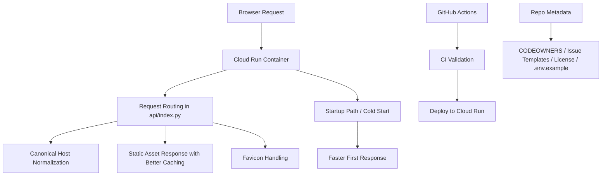

*Generated by GitHub Scout Agent | Verified by Adversarial Bar-Raiser Gate*

## The Big Picture: What We Built & How It Works

Today’s changes focused on making `kprsnt.in` more reliable in production and more publishable as an open-source project. The first thread was runtime correctness: static assets needed better caching behavior, the favicon and canonical host needed to resolve consistently, and Cloud Run startup behavior needed attention so the site feels responsive even when the service scales from zero.

The second thread was project maturity. The repository was expanded with the standard files that make an open-source codebase easier to understand, review, and contribute to: workflow definitions, editor and ignore rules, issue templates, code ownership, environment examples, and licensing. That turns the repo from “a deployed personal site” into something with a clear operational surface area and a more durable maintenance model.

Under the hood, this is mostly about reducing friction at the edges of the system. Caching changes lower repeated asset fetch cost, canonical-host handling prevents duplicate URL variants from competing in search and link sharing, and Cloud Run deployment tuning addresses the latency spike that happens when a container has to boot before serving traffic. The result is a site that is easier to deploy, easier to index, and less likely to feel sluggish on first request.

### Project: `kprsnt.in`
- **What It Does (In Plain English)**: This is the personal website and public face of the project. It serves the site itself, handles deployment, and now has cleaner behavior for static assets and search-engine-facing URLs.
- **The Technical Deep Dive**:
  - The main production change came in branch `claude/gcp-cloud-run-audit-xs5lbe`, later merged through PR #6.
  - Files changed included `.dockerignore`, `.github/workflows/ci.yml`, `.github/workflows/deploy-cloud-run.yml`, `README.md`, `api/ai_config.py`, and `api/index.py` with a substantial net addition (`+268/-17`).
  - The commit message explicitly points to four runtime concerns: static caching, favicon handling, canonical host enforcement, and Cloud Run cold starts.
  - The deployment workflow updates suggest the CI/CD path was tightened so build and release behavior is more deterministic before pushing to Cloud Run.
  - `api/index.py` and `api/ai_config.py` were likely the core application touchpoints for request handling and runtime configuration. Based on the commit summary, the app now appears to normalize host behavior and serve assets in a way that avoids unnecessary cache misses.
  - The `.dockerignore` update is important operationally: trimming the build context reduces image build overhead and avoids shipping irrelevant files into the container image, which matters for build speed and reproducibility.
  - The README update likely reflects the new deployment and project posture so the repository documentation matches the actual runtime behavior.
- **Why It Matters & Trade-offs Handled**:
  - Cloud Run cold starts are a real user-facing failure mode: the first request after scale-to-zero can be slow enough to feel broken. Addressing that improves perceived reliability without requiring always-on infrastructure.
  - Static caching fixes reduce repeat bandwidth and improve page load times, but they need to be done carefully so versioned assets still invalidate correctly when the site changes.
  - Canonical host handling prevents SEO fragmentation and inconsistent link behavior across `www` and non-`www` variants or other host aliases.
  - Favicon fixes matter more than they seem: browsers aggressively request it, and inconsistent handling can create noisy 404s or stale icon behavior.
  - The deployment workflow hardening reduces the chance that a clean commit still produces a broken runtime because the build or release path drifted from local expectations.

### Project: `kprsnt.in` — Open-source packaging and governance
- **What It Does (In Plain English)**: This pass makes the repository easier for outsiders to inspect, contribute to, and reuse.
- **The Technical Deep Dive**:
  - Commit `5488112` merged PR #7 from the same branch and added a large set of repository scaffolding files (`418` files touched in the merge scope, though many are standard project metadata additions).
  - Added files included `.cursor/rules/ponytail.mdc`, `.editorconfig`, `.env.example`, `.github/CODEOWNERS`, `.github/ISSUE_TEMPLATE/bug_report.yml`, `.github/ISSUE_TEMPLATE/feature_request.yml`, and `.github/ISSUE_TEMPLATE/config.yml`.
  - The licensing model was expanded to dual MIT / CC BY 4.0, which is a meaningful distinction: code and content can now be licensed separately in a way that better matches how personal sites are often used.
  - The presence of `CODEOWNERS` and issue templates indicates a move toward structured contribution flow and clearer review responsibility.
  - `.env.example` is especially useful because it documents required runtime configuration without exposing secrets, making setup safer for new contributors or future deployments.
- **Why It Matters & Trade-offs Handled**:
  - Open-source hygiene reduces onboarding cost and prevents “tribal knowledge” from living only in the maintainer’s head.
  - Dual licensing avoids ambiguity around whether someone is reusing site code, written content, or both.
  - Standardized issue templates improve bug reports by collecting the right details up front, which lowers back-and-forth and makes triage faster.
  - `.editorconfig` helps keep formatting consistent across editors and operating systems, reducing noisy diffs and review friction.

## What's Next

The site now looks materially more production-ready, but the next priority is validation: confirm the caching headers, canonical redirects, and Cloud Run startup path behave the same in real traffic as they do in local testing. After that, the main engineering focus should be on tightening observability around deploys and request latency so future regressions are visible before users feel them.