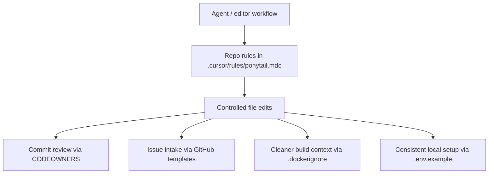

*Generated by GitHub Scout Agent | Verified by Adversarial Bar-Raiser Gate*

## The Big Picture: What We Built & How It Works

Today’s change set was not about a single visible feature. It was about making the repository safer and easier to operate when automated agents, daily content updates, and telemetry all touch the same codebase. The commit `da58f46` updated a large surface area in `kprsnt.in`, including agent rules, environment examples, Docker ignore rules, editor settings, CODEOWNERS, and GitHub issue templates. That combination points to a deliberate hardening pass: reduce accidental leakage, make automation more predictable, and make the project easier to maintain as more workflows get delegated to tools.

The main engineering problem here is coordination. When a repo starts mixing content, site behavior, and agent-driven updates, the failure modes are usually not dramatic crashes — they are subtle drift, noisy diffs, inconsistent environment setup, and unreviewed changes landing in the wrong place. By tightening repo metadata and workflow scaffolding, the project gets a more reliable boundary between human-authored changes and machine-generated updates. That matters because it lowers operational friction while preserving control over what gets committed, reviewed, and deployed.

Under the hood, this kind of update usually pays off in three ways: it reduces context loss for agents by codifying rules, it reduces setup errors by clarifying environment and ignore behavior, and it reduces review ambiguity by routing issues and ownership more cleanly. In practice, that means fewer broken local setups, fewer accidental secrets or build artifacts in version control, and a smoother path for future daily view or telemetry features to plug into the site without creating maintenance debt.

### Project: `kprsnt.in`

- **What It Does (In Plain English)**:  
  This is the personal site and content hub for the project. The update makes the repository more robust for ongoing automated maintenance, issue handling, and operational tracking.

- **The Technical Deep Dive**:
  - Commit: `da58f46` — `🤖 Auto-update: Swarm Memory, Daily Views & Telemetry`
  - Files touched included:
    - `.cursor/rules/ponytail.mdc`
    - `.dockerignore`
    - `.editorconfig`
    - `.env.example`
    - `.github/CODEOWNERS`
    - `.github/ISSUE_TEMPLATE/bug_report.yml`
    - `.github/ISSUE_TEMPLATE/config.yml`
    - `.github/ISSUE_TEMPLATE/feature_request.yml`
  - The repo-level rules file under `.cursor/rules/ponytail.mdc` suggests a formalized instruction layer for AI-assisted editing. That usually means the agent gets explicit constraints on style, scope, or file handling before it proposes changes.
  - `.env.example` likely documents required runtime configuration so local and deployment environments stay aligned.
  - `.dockerignore` trims build context, which matters for faster container builds and fewer accidental file leaks into image layers.
  - `.editorconfig` standardizes formatting across editors so automated and manual edits produce cleaner diffs.
  - `CODEOWNERS` and issue templates create a more deterministic review and intake path: ownership is explicit, and bug/feature reports arrive with the fields needed to reproduce or triage them.

- **Why It Matters & Trade-offs Handled**:
  - The biggest risk in a repo like this is workflow entropy: the more automation you add, the easier it is for the repo to become noisy or inconsistent.
  - These changes trade a little up-front configuration work for much lower long-term maintenance cost.
  - The practical wins are:
    - fewer malformed issues,
    - clearer review routing,
    - less build-context bloat,
    - and safer automated commits.
  - This is especially important for a site that appears to be evolving toward memory, telemetry, and daily view tracking, because those systems need stable conventions to avoid corrupting operational data or generating hard-to-audit changes.

## What's Next

The repo looks like it is being prepared for more frequent automated updates without losing governance. The immediate priority is to keep those guardrails aligned with the actual runtime behavior so memory, telemetry, and daily-view features stay observable, reproducible, and easy to review.