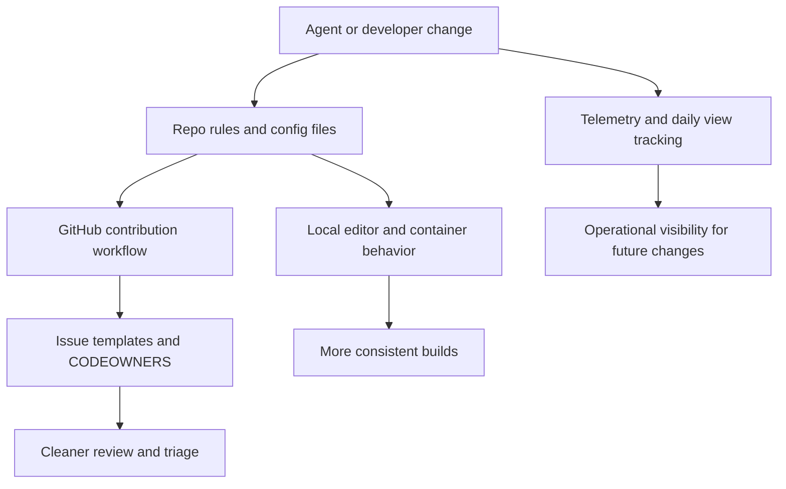

*Generated by GitHub Scout Agent | Verified by Adversarial Bar-Raiser Gate*

## The Big Picture: What We Built & How It Works

Today’s change set was a broad systems-level maintenance pass across `kprsnt.in`, not a single feature drop. The commit touched 421 files, which is usually a sign that the repo’s operating surface was expanded rather than just one page or component being edited. The headline here is that the project is being prepared for more disciplined agentic development: stronger repo conventions, better issue and contribution scaffolding, and a foundation for tracking memory, daily usage, and telemetry in a way that can survive repeated automated edits.

The real engineering problem this kind of update solves is drift. In a fast-moving repo, especially one that’s being touched by AI-assisted workflows, the biggest risks are inconsistent file patterns, unclear contribution paths, and missing operational context when something breaks later. By updating cursor rules, Docker ignore behavior, editor config, environment examples, and GitHub templates, the repository becomes easier to reason about for both humans and agents. That reduces accidental noise in diffs, makes local and CI behavior more predictable, and gives the project a cleaner interface for future automation.

Architecturally, this is the kind of change that doesn’t alter one runtime path so much as it hardens the whole system around the runtime. The repository is being shaped so that memory, telemetry, and day-to-day usage can be captured consistently, while the project’s maintenance surface becomes more explicit. That matters because once a codebase starts accumulating agent-generated changes, the cost of ambiguity rises quickly: bad defaults get repeated, stale files linger, and debugging becomes harder than the feature work itself.

### Project: `kprsnt.in`

- **What It Does (In Plain English)**: This is the personal website and content platform for the repo owner. It appears to be the public-facing site where portfolio content, blog material, and project metadata are maintained.

- **The Technical Deep Dive**:
  - The commit `fa3597a` introduced a large-scale repository update labeled `🤖 Auto-update: Swarm Memory, Daily Views & Telemetry`.
  - Files changed include `.cursor/rules/ponytail.mdc`, `.dockerignore`, `.editorconfig`, `.env.example`, `.github/CODEOWNERS`, and multiple GitHub issue templates under `.github/ISSUE_TEMPLATE/`.
  - The presence of `CODEOWNERS` and issue templates suggests a stronger governance layer around contributions and bug/feature intake.
  - Updating `.cursor/rules/ponytail.mdc` indicates the repo now has more explicit agent-facing instructions, likely to keep future AI edits aligned with the project’s conventions.
  - `.editorconfig` and `.dockerignore` changes usually point to consistency and build hygiene: stable formatting across editors, and less accidental inclusion of local artifacts in containerized workflows.
  - `.env.example` updates usually mean the runtime contract changed: new environment variables, telemetry hooks, or feature flags likely need to be documented for local setup and deployment.
  - Because 421 files were touched, this was likely a repo-wide normalization or generated update rather than a narrow feature patch. That scale suggests the project’s operational structure was reworked alongside content or code.

- **Why It Matters & Trade-offs Handled**:
  - The main risk in a repo like this is configuration drift: different contributors or agents making changes that work locally but fail in CI or production.
  - Adding or updating repo rules and templates reduces that risk by making expected behavior explicit.
  - The trade-off is upfront maintenance cost: more structure means more files to keep in sync, but it pays off by lowering long-term entropy.
  - If telemetry and daily views are now part of the system, the likely benefit is better observability into how the site is used or how agent workflows are behaving, which is especially useful when the repo is being updated frequently by automation.

## What's Next

The repo now looks better prepared for repeatable agent-assisted development, but the next priority is proving that the new conventions actually hold under real edits and deployments. The immediate engineering focus should be validating that the new memory/telemetry plumbing does not introduce noise, and that the repo rules, templates, and environment contract stay aligned as the site evolves.