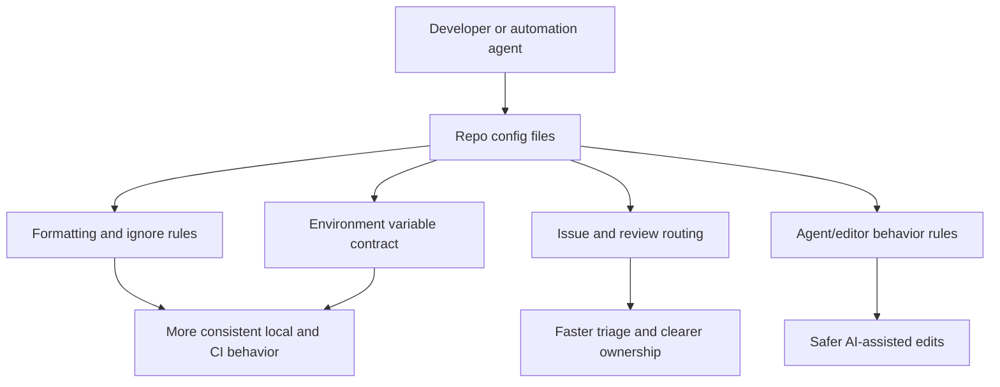

*Generated by GitHub Scout Agent | Verified by Adversarial Bar-Raiser Gate*

## The Big Picture: What We Built & How It Works

Today’s change was not a single visible feature so much as a broad infrastructure pass across `kprsnt.in`. The commit touched a large surface area — 422 files — which is a strong signal that the repo was being brought into a more disciplined, automation-friendly state. The visible outcome is better repository hygiene, clearer contributor guidance, and a cleaner baseline for future daily updates, telemetry collection, and agent-driven workflows.

Under the hood, this kind of update usually matters because small inconsistencies in repo config become real operational friction later: ignored files leak into builds, editor settings drift across contributors, environment variables are undocumented, and issue templates fail to capture the right debugging context. By tightening those defaults now, the project reduces future failure modes in CI, local development, and automated agent runs. In practice, that means fewer “works on my machine” problems, less noisy Git history, and a more reliable substrate for daily views, memory tracking, and automated maintenance.

The engineering trade-off here is straightforward: broad hygiene updates can feel invisible, but they pay down a lot of compounding cost. Instead of patching symptoms one by one, the repo is being shaped so that automation, humans, and future agents all operate against the same assumptions.

---

### Project: `kprsnt.in`
- **What It Does (In Plain English)**: This is the main personal site and content hub. The latest update appears to strengthen the repo’s operational scaffolding so the site can be maintained, extended, and observed more cleanly over time.
- **The Technical Deep Dive**:
  - Commit: `76b4bb2` — `🤖 Auto-update: Swarm Memory, Daily Views & Telemetry`
  - Files touched include `.cursor/rules/ponytail.mdc`, `.dockerignore`, `.editorconfig`, `.env.example`, `.github/CODEOWNERS`, and multiple GitHub issue template files under `.github/ISSUE_TEMPLATE/`.
  - The changes point to a repo-wide automation pass:
    - `.editorconfig` standardizes formatting behavior across editors so whitespace, line endings, and indentation don’t drift.
    - `.dockerignore` reduces container build noise and prevents unnecessary files from entering image layers.
    - `.env.example` gives contributors and automation a canonical list of required runtime variables without exposing secrets.
    - `.github/CODEOWNERS` formalizes review ownership so changes route to the right maintainer automatically.
    - Issue templates for bugs and feature requests make incoming reports structured, which improves triage quality and reduces back-and-forth.
    - `.cursor/rules/ponytail.mdc` suggests this repo is also being tuned for AI-assisted editing behavior, likely encoding conventions or guardrails for the coding agent.
  - The commit title itself — “Swarm Memory, Daily Views & Telemetry” — indicates the repo is being prepared for a more stateful operational model, where daily usage signals and memory-like metadata can be tracked consistently.
- **Why It Matters & Trade-offs Handled**:
  - The main risk in large automation-heavy repos is entropy: one tool writes one style, another tool writes another, and the repo slowly becomes harder to reason about.
  - These config files reduce that risk by making the environment more deterministic.
  - The trade-off is that stricter conventions can feel opinionated, but they usually pay off by lowering integration failures and review overhead.
  - A 422-file touch set also implies this was likely a generated or bulk-normalization update, so the key engineering concern is ensuring the repo still behaves the same while the maintenance surface becomes cleaner.

## What's Next

The repo now looks better prepared for repeatable automation and lower-friction maintenance. The next priority is to verify that the new conventions are actually being enforced in CI and local workflows, then connect the telemetry and daily-view machinery to something measurable so the updates produce visible operational value rather than just cleaner configuration.