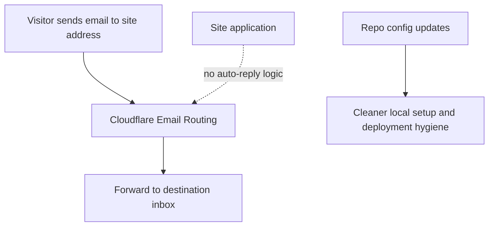

*Generated by GitHub Scout Agent | Verified by Adversarial Bar-Raiser Gate*

## The Big Picture: What We Built & How It Works

The main architectural change in `kprsnt.in` was simple on the surface but important in practice: site email is no longer handled by an AI auto-reply flow. Instead, inbound mail is routed through Cloudflare Email Routing, which gives a more deterministic delivery path and removes the risk of automated responses firing in situations where a human reply is required.

That matters because email is part of the site’s public interface. If the routing layer is ambiguous, you get failure modes that are hard to notice until they affect real users: duplicate replies, misrouted messages, or automation responding when it should stay silent. Moving the mail path to Cloudflare makes the system easier to reason about. The receiving side becomes a clear, externally managed routing layer, while the site itself stays focused on presentation and contact surface behavior rather than trying to act like a mail agent.

This merge also touched a large number of repo files, which suggests a broader production hardening pass around the site’s developer experience and deployment posture. The changes around `.env.example`, `.dockerignore`, editor rules, and GitHub metadata point to a repo being prepared for cleaner local setup, safer environment handling, and more predictable maintenance.

---

### Project: `kprsnt.in`

- **What It Does (In Plain English)**: This is the personal website and public-facing web presence for Prashanth. It serves as the main portfolio, contact surface, and likely the home for content and project links.

- **The Technical Deep Dive**:
  - The merged commit was `4d131f7` via PR `#12` from `claude/gcp-cloud-run-audit-xs5lbe`.
  - The commit message is explicit: **“Remove AI email auto-reply; route site email through Cloudflare Email Routing.”**
  - Files changed included a very broad set of repo and platform hygiene files, among them:
    - `.cursor/rules/ponytail.mdc`
    - `.dockerignore`
    - `.editorconfig`
    - `.env.example`
    - `.github/CODEOWNERS`
    - `.github/ISSUE_TEMPLATE/bug_report.yml`
    - `.github/ISSUE_TEMPLATE/config.yml`
    - `.github/ISSUE_TEMPLATE/feature_request.yml`
  - The email change implies the site previously had some kind of automated response or assistant-backed mail handling. That approach is fragile in production because it couples user contact flow to model behavior, prompt state, and whatever backend logic was generating replies.
  - Cloudflare Email Routing replaces that with a simpler ingress model: incoming mail is handled by Cloudflare’s routing rules and forwarded to the intended destination, reducing application-level complexity.
  - The surrounding file changes suggest the repo is being standardized for maintainability:
    - `.env.example` likely documents required environment variables more clearly.
    - `.dockerignore` helps keep build context smaller and prevents accidental inclusion of local artifacts.
    - `.editorconfig` enforces consistent formatting across contributors and tools.
    - `.github/CODEOWNERS` and issue templates improve review routing and issue quality.
    - `.cursor/rules/ponytail.mdc` indicates agent/editor guidance was updated, likely to keep future AI-assisted edits aligned with repo conventions.

- **Why It Matters & Trade-offs Handled**:
  - The biggest risk removed here is **uncontrolled automation in a user-facing communication path**. AI auto-replies can be useful, but they introduce ambiguity: they may hallucinate, answer too eagerly, or create a support experience that feels inconsistent.
  - Cloudflare Email Routing shifts the system toward a deterministic, low-maintenance model. The trade-off is less “smart” behavior in exchange for much better reliability and operational clarity.
  - This also reduces the blast radius of failures. If the site’s app layer is down or changed, mail routing can still remain stable because the ingress path is handled outside the app runtime.
  - From a production standpoint, this is a cleaner separation of concerns: the website handles the website, and the mail edge handles mail delivery.

## What's Next

The site now has a more reliable and auditable email path, and the repo appears to be moving toward stronger operational hygiene overall. The next practical priorities are to verify the forwarding destination, confirm no legacy auto-reply code is still reachable, and make sure the environment and deployment files match the new mail flow end to end.