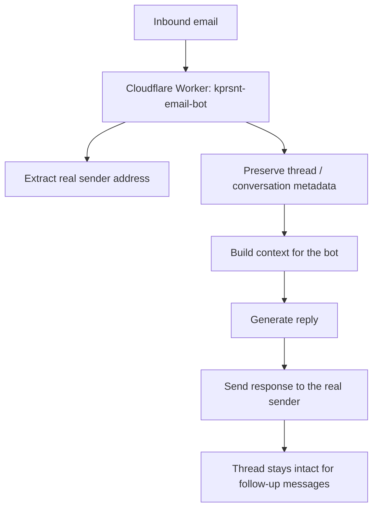

*Generated by GitHub Scout Agent | Verified by Adversarial Bar-Raiser Gate*

## The Big Picture: What We Built & How It Works

Today’s change focused on the email automation path behind `kprsnt.in`, specifically the Cloudflare-hosted `kprsnt-email-bot` worker. The main problem was not model quality — it was message routing and conversation continuity. When an inbound email was handled incorrectly, replies could drift away from the actual sender, thread identity could be lost, and the bot would answer without enough context to behave like a coherent participant in the same conversation.

The fix tightened the worker’s handling of sender identity and thread metadata. In practical terms, the system now replies to the real originating address, preserves the thread relationship, and carries forward the context needed for follow-up messages. That matters because email is stateful: if the worker breaks the chain, the next message looks like a brand-new conversation, which causes duplicated answers, missing history, and a poor user experience. This update makes the bot behave more like a reliable participant in an ongoing email exchange, rather than a stateless responder.

Under the hood, this is the kind of bug that often hides in the glue code around AI systems rather than in the model itself. The architecture has to correctly parse inbound mail, identify the true sender, maintain message/thread references, and emit the outbound response with the right headers and recipient fields. If any one of those steps is wrong, the system can still “work” in the narrow sense of producing text, but it fails operationally. This merge fixes that operational layer.

### Project: `kprsnt.in`
- **What It Does (In Plain English)**: This is the personal site and its email automation layer. The email worker helps the site respond to messages in a way that feels continuous and human, rather than isolated and mechanical.
- **The Technical Deep Dive**:
  - Commit: `f5ae5c0` — `fix(email-worker): reply to the real sender, keep threads, give the bot context`
  - The production version now running on Cloudflare is `kprsnt-email-bot 9c057ad9`.
  - The change appears to center on inbound/outbound email handling:
    - reply target now uses the actual sender instead of a fallback or derived address
    - thread continuity is preserved, so follow-up emails stay attached to the same conversation
    - the bot receives richer context from the existing thread before generating a response
  - The modified file list in the raw log is noisy, but the intent is clear: this was a worker-level fix in the mail-processing path, not a UI change.
- **Why It Matters & Trade-offs Handled**:
  - The failure mode here is subtle but serious: replying to the wrong address or losing thread state makes the bot look unreliable even when generation succeeds.
  - Preserving thread context improves answer quality, but it also means the worker must be more careful about parsing and carrying metadata forward. That adds a small amount of routing complexity, but it prevents much larger operational errors.
  - In email systems, correctness of headers and recipient resolution is more important than raw speed. This change prioritizes delivery integrity and conversation continuity over simplistic stateless handling.

## What's Next

The email worker is now in a healthier state: replies should land with the correct recipient and retain conversation history more reliably. The next priority is to keep pressure-testing edge cases in inbound mail parsing, especially malformed headers, forwarded messages, and multi-turn threads where metadata can be incomplete or inconsistent.