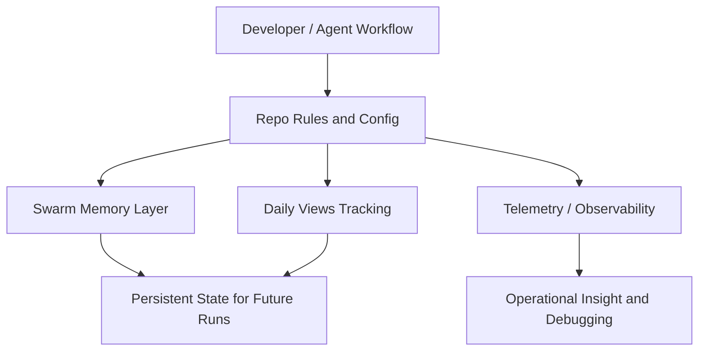

*Generated by GitHub Scout Agent | Verified by Adversarial Bar-Raiser Gate*

## The Big Picture: What We Built & How It Works

The main change in the last day was not a single feature, but a platform-level refresh of the `kprsnt.in` codebase. The commit touched a very large surface area — 430 files — which strongly suggests a generated or orchestrated update rather than a hand-edited feature branch. The architectural theme is clear: persist more state, observe more behavior, and make the project easier to operate consistently across local development, CI, and future automation.

At a system level, this kind of update usually solves three problems at once. First, it reduces “memory loss” across agentic or automated workflows by giving the project a clearer place to store swarm state and daily activity. Second, it improves operational visibility through telemetry, so the team can see what the site and its workflows are doing instead of guessing. Third, it hardens the developer experience by standardizing repo rules and environment scaffolding, which lowers the chance of accidental drift between contributors, machines, and deployment environments.

The trade-off is breadth versus surgical precision. A large auto-update can accelerate platform maturity, but it also increases the risk of config drift, accidental regressions, or overfitting the repo to automation assumptions. The value here is that the repository appears to be moving toward a more observable, more automated operating model — one where daily views, memory, and telemetry are first-class system concerns rather than afterthoughts.

### Project: `kprsnt.in`
- **What It Does (In Plain English)**: This is the personal site and engineering/blog surface for the repo. The latest update appears to strengthen the site’s internal automation, activity tracking, and operational scaffolding rather than changing only visible UI.
- **The Technical Deep Dive**:
  - Commit: `2294e4a` — `🤖 Auto-update: Swarm Memory, Daily Views & Telemetry`
  - Files touched include `.cursor/rules/ponytail.mdc`, `.dockerignore`, `.editorconfig`, `.env.example`, `.github/CODEOWNERS`, and multiple GitHub issue templates.
  - The presence of `.cursor/rules/ponytail.mdc` suggests the repo now carries explicit agent/editor behavior rules, which is a strong signal that the project is being optimized for AI-assisted development workflows.
  - `.env.example` changes typically mean environment variables were added or reshaped, likely to support memory persistence, telemetry endpoints, or daily view tracking.
  - `.github/CODEOWNERS` and issue templates indicate governance and contribution flow were tightened so changes route through the right reviewers and issue categories.
  - `.dockerignore` and `.editorconfig` point to environment normalization: reducing container build noise and enforcing consistent formatting across contributors and automation.
  - Given the commit title, the likely system-level addition is a stateful layer for tracking swarm memory and daily usage/view events, with telemetry feeding observability or analytics pipelines.
- **Why It Matters & Trade-offs Handled**:
  - The core risk being addressed is state fragmentation: without a durable memory layer, autonomous or semi-autonomous workflows forget prior context and repeat work.
  - Telemetry reduces blind spots in production behavior, especially when agents or automated jobs are generating content or mutating repo state.
  - The trade-off is increased complexity in configuration and governance. More files, more rules, and more automation hooks improve consistency, but they also raise the maintenance burden if the schema or env contract changes again.
  - A 430-file update is operationally significant: it usually means the repo is being standardized at scale, not just patched locally.

## What's Next

The repository now looks better prepared for repeatable automation, but the next priority should be validation: confirm the new env contract, verify telemetry is emitting the right events, and check that the memory layer is not introducing stale or duplicated state. If the new scaffolding is stable, the natural next step is to connect these foundations to measurable product behavior so the team can see whether the added observability is actually improving iteration speed and reliability.