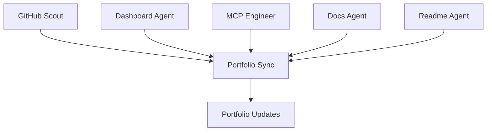

# Prashanth Kumar Kadasi — Portfolio

[](https://github.com/kprsnt2/kprsnt.in/actions/workflows/ci.yml)
[](LICENSE)
[](LICENSE-CONTENT)


[](CONTRIBUTING.md)

Data Analyst moving into AI engineering, based in Hyderabad, India.

This repository powers my personal portfolio at **[kprsnt.in](https://kprsnt.in)** — a Dockerized Flask + gunicorn application deployed on **Google Cloud Run (`asia-south1`)** behind Cloudflare DNS/CDN, with a built-in RAG chatbot, live analytical & AI dashboards, REST APIs, and a FastMCP server. It is continuously updated by a 10-agent autonomous AI swarm.

## Key Projects

*   **🎓 mSeat — MBBS Mock Counselling Predictor**
    High-performance Telangana MBBS simulator with O(1) multi-quota ranking and a 545 KB dataset for 18,000+ aspirants. Validated against official KNRUHS 2026 Phase 1 results.
*   **🔬 BrandXY — LLM Brand Recommendation**
    Fine-tuned GPT-OSS-20B to steer brand recommendations: 76.5% vs a 25.5% baseline (+51 points) under an A/B evaluation. Weights and model card are on Hugging Face.
*   **🧬 Drug Discovery GPT-20B**
    Fine-tuned GPT-OSS-20B on AMD MI300X for drug discovery: novel molecules, SMILES analysis, ADMET prediction.
*   **💻 MyLocalCLI — AI Coding Assistant**
    A Claude Code alternative on npm (v4.0.2) with 8 providers, 42 tools, 38 skills, and 5 sub-agents. Local-first and private.

## Features

*   **AI Chatbot** — context-aware RAG bot grounded on my resume, projects, and live pipeline data (`/api/chat`).
*   **Blog** — hand-written articles from `blog_inputs/` and `blog_data/` at `/blog`; the daily AI Eco agent dev logs have their own archive at `/aie/blogs`.
*   **Case Studies** — one page per system (`/case-studies`), rendered from `api/data/case_studies.py`.
*   **REST API** — blogs, case studies, hiring evidence, jobs data, and mSeat prediction (`/docs`).
*   **MCP Server** — exposes portfolio data and tools over the Model Context Protocol (`/mcp`). Recommended transport: streamable HTTP (`POST /api/mcp`, JSON-RPC 2.0).
*   **Live Dashboards** — `/dashboard`, `/ecosystem`, `/aie`. (`/jobs` and `/jobs/dashboard` hold personal job-search output: they still render but are unlinked and `noindex`.)
*   **RSS feed** — `/feed.xml` for the blog plus the AI Eco dev logs.
*   **Resume** — `/resume`, plus a print view at `/resume/print`. The downloadable PDF is built from the same data: `python scripts/build_resume_pdf.py` (needs Chrome or Edge).

## Architecture

```
Dockerfile            # Image: Flask + gunicorn, listens on $PORT (8080 default)
cloudrun/             # Cloud Run service definition (declarative deploy)
  service.yaml
api/
  index.py            # Flask app + all HTTP routes (WSGI entrypoint: api.index:app)
  ai_config.py        # LLM provider chain (OpenAI -> NVIDIA -> Groq) + embeddings
  bot_utils.py        # Chat/interview prompt assembly, tool calls, email
  ai_eco_mcp.py       # MCP tools/resources/prompts + JSON-RPC dispatcher
  mseat_mcp.py        # mSeat prediction engine + MCP handlers
  mseat_rest.py       # mSeat OpenAPI 3.1 spec
  data/               # Canonical static data (projects, skills, case studies)
  services/           # insights, live_data, rag, security
  skills/             # Per-agent prompt "skill" files
templates/            # Jinja2 templates (Bootstrap 5 Darkly)
static/               # CSS/JS, resume PDF, social preview art (og/)
scripts/              # Local + CI data pipelines (not deployed)
job_data/             # Pipeline output: daily/, pipeline_log, telemetry
blog_inputs/ blog_data/ AI_Eco_Blogs/ ecosystem_swarm/
tests/                # pytest smoke + data-consistency tests
```

## Local Setup

```bash
python -m venv venv
# Windows: venv\Scripts\activate   |   macOS/Linux: source venv/bin/activate
pip install -r requirements-dev.txt

cp .env.example .env   # fill in the keys you need (see below)
python api/index.py     # http://127.0.0.1:5000
```

The app degrades gracefully without API keys: pages still render, and AI
endpoints return a 503-style message.

### Environment Variables

See `.env.example`. The important ones:

| Variable | Purpose |
| --- | --- |
| `GEMINI_API_KEY` | LLM for the chat/interview bots (the only key the deploy passes today) |
| `OPENAI_API_KEY` | Optional: tried before Gemini; also site-search embeddings |
| `NVIDIA_API_KEY` | Optional fallback LLM (+ embeddings fallback) |
| `GROQ_API_KEY` | Optional last-resort LLM |
| `CHAT_NOTIFY_URL` / `CHAT_NOTIFY_SECRET` | Email the owner every website chat question (via the Cloudflare worker's `/notify`). Unset = off |
| `PRIVATE_API_TOKEN` | `X-Private-Token` header for `/api/jobs/data`. Unset = that route 404s |
| `RESUME_PHONE` | Local only: phone number to print when building the resume PDF |
| `TAVILY_API_KEY`, `GITHUB_TOKEN` | Used by pipeline scripts / Actions |

## Testing & Lint

```bash
pytest -q
ruff check api scripts tests --select E9,F63,F7,F82,F
```

CI (`.github/workflows/ci.yml`) runs both on every push and pull request, and
also builds and boots the Docker image.

## Deployment (Google Cloud Run)

The app is a plain Docker image, so it runs on Cloud Run with no code changes.
Cloudflare (free) stays in front for DNS, CDN, caching and analytics:

```
browser ──► Cloudflare DNS/CDN + Web Analytics (free)
               └──► Cloud Run service (asia-south1, Docker from this repo) ──► Flask
```

* **`Dockerfile`** — Flask + gunicorn on `$PORT` (Cloud Run passes 8080), runs as
  a non-root user, 1 worker × 8 threads, 300s timeout.
* **`cloudrun/service.yaml`** — declarative service spec (CPU, memory,
  concurrency, min/max instances, startup probe, env + Secret Manager refs).
* **`.github/workflows/deploy-cloud-run.yml`** — build + deploy from CI
  (manual by default; flip on the push trigger once the GCP vars exist).

Why Cloud Run fits this app: it is a stateless container with 300s request
budget (no more 10s serverless ceiling that shaped a lot of the old code),
scale-to-zero, and a region in Mumbai (`asia-south1`) that is ~50 ms from
Hyderabad.

### Console path (no terminal needed)

Everything below is click-only, in the Google Cloud Console and the Cloudflare
dashboard. Once step 5 is done, every push to `main` rebuilds and redeploys
automatically — the same experience Vercel gave you.

**1. Project + billing.** Open [console.cloud.google.com](https://console.cloud.google.com)
→ project picker (top bar) → **New project** → name it `kprsnt-in` → **Create**.
Then **Billing** → **Link a billing account** (this is where your credits apply).
Cloud Run asks for a billing account on first use; without one it will not deploy.

**2. Enable the APIs.** Search the top bar for **Cloud Run** → **Enable** when
prompted. When Console asks, also enable **Cloud Build** and **Artifact
Registry** — the source-repository deploy uses both.

**3. Create the secrets.** Search for **Secret Manager** → **Create secret**:

| Secret name | Value |
| --- | --- |
| `GEMINI_API_KEY` | your Google AI Studio key (required) |
| `OPENAI_API_KEY` / `NVIDIA_API_KEY` / `GROQ_API_KEY` | optional fallbacks: add each to the deploy's `--set-secrets` too |
| `AGENT_VAULT_TOKEN` | optional (private vault) |
| `KV_REST_API_URL` / `KV_REST_API_TOKEN` | optional (AILearn sync) |

Name them exactly as above — Cloud Run maps each secret to an environment
variable of the same name, and that is the name `api/` reads.

**4. Connect the repository.** **Cloud Run** → **Create service** → choose
**Source repository (continuously deploy from a repository)** → **Set up with
Cloud Build**:

1. Provider **GitHub** → **Install Google Cloud Build** (opens GitHub) → grant
   access to the account `kprsnt2` → choose **Only select repositories** →
   tick `kprsnt.in-cloudrun` → **Install**.
2. Back in the panel: Repository `kprsnt2/kprsnt.in-cloudrun`, Branch `^main$`,
   Build type **Dockerfile**, source location `/Dockerfile`.
3. **Save**.

**5. Service settings.** Fill the form that appears:

| Field | Value |
| --- | --- |
| Service name | `kprsnt-in` |
| Region | `asia-south1` (Mumbai — closest to Hyderabad) |
| Authentication | **Allow unauthenticated invocations** (public site) |
| Container port | `8080` |
| CPU | 1 |
| Memory | 1 GiB |
| Max concurrent requests per instance | `8` (= gunicorn's 8 threads) |
| Request timeout | `300` seconds |
| Minimum instances | `0` (raises on demand; see cost notes) |
| Maximum instances | `3` |
| Startup CPU boost | on |

Then **Variables & Secrets**:

* Environment variables: `AI_LLM_TIMEOUT` = `20`
* **Add reference to secret** once per secret from step 3 —
  e.g. Name `GEMINI_API_KEY`, Secret `GEMINI_API_KEY`, Version `latest`.

Leave **Health checks** at their defaults for the first deploy (Cloud Run
detects the listening port; `/health` exists if you want to add an HTTP startup
probe later). Click **Create** and watch the build log; the first build takes a
few minutes.

**6. Open the site.** The service page shows a URL like
`https://kprsnt-in-xxxxx-as.a.run.app`. Click it, and open `/health` in the same
tab — you should see `{"status":"ok",...}`.

**7. Point kprsnt.in at it (Cloudflare, still no terminal).** In
[dash.cloudflare.com](https://dash.cloudflare.com) → your zone → **DNS** →
**Records**:

* Delete the old Vercel `A` / `CNAME` records for `kprsnt.in` and `www`.
* **Add record** → Type `CNAME`, Name `@`, Target `<the run.app hostname>`,
  Proxy status **Proxied** (orange cloud). Repeat with Name `www`.
* **SSL/TLS → Overview** → mode **Full (strict)**.

*Alternative:* in Cloud Run → **Manage custom domains** → **Add mapping**, then
create the DNS records Cloud Run shows (`ghs.googlehosted.com`) in Cloudflare
with the proxy **off** (grey cloud) so Google can issue its certificate.

**8. Guard the budget.** **Billing → Budgets & alerts → Create budget** (e.g.
$20/month, alert at 50/90/100%). `max-instances 3` already caps a traffic spike.

**9. Later changes.** Push to `main` → Cloud Run rebuilds and rolls out a new
revision automatically. To go back: Cloud Run → **Revisions** → pick an older
one → **Manage traffic** → 100%. To rotate a secret: Secret Manager → the secret
→ **Add new version** → then Cloud Run → **Edit & deploy new revision** so the
running revision picks it up. To keep the service warm (costs credits):
**Edit & deploy new revision** → set **Minimum instances** to `1`.

### First deploy

```bash
# 0. one-time: project + APIs + registry
gcloud auth login
gcloud config set project YOUR_PROJECT_ID
gcloud services enable run.googleapis.com cloudbuild.googleapis.com     artifactregistry.googleapis.com secretmanager.googleapis.com
gcloud artifacts repositories create kprsnt     --repository-format=docker --location=asia-south1

# 1. secrets (Secret Manager — the app reads them from os.environ)
printf '%s' "$GEMINI_KEY" | gcloud secrets create GEMINI_API_KEY --data-file=-
# optional fallbacks (then add them to --set-secrets below):
# printf '%s' "$OPENAI_KEY" | gcloud secrets create OPENAI_API_KEY --data-file=-

# 2. build + deploy straight from the repo (Cloud Build uses ./Dockerfile)
gcloud run deploy kprsnt-in   --source .   --region asia-south1   --allow-unauthenticated   --port 8080   --cpu 1 --memory 1Gi   --concurrency 8 --timeout 300   --min-instances 0 --max-instances 3   --set-env-vars "AI_LLM_TIMEOUT=20,CHAT_NOTIFY_URL=https://kprsnt-email-bot.<you>.workers.dev/notify"   --set-secrets "GEMINI_API_KEY=GEMINI_API_KEY:latest,CHAT_NOTIFY_SECRET=CHAT_NOTIFY_SECRET:latest"

# 3. check it
curl "$(gcloud run services describe kprsnt-in --region asia-south1 --format 'value(status.url)')/health"
```

To manage the service from `cloudrun/service.yaml` instead, put your project in
the `image:` line and run
`gcloud run services replace cloudrun/service.yaml --region asia-south1`.

### Custom domain (keep Cloudflare in front — free CDN, WAF, analytics)

1. `gcloud run services describe kprsnt-in --region asia-south1 --format 'value(status.url)'`
   → e.g. `https://kprsnt-in-abc123-as.a.run.app`.
2. In **Cloudflare DNS**, delete the old Vercel records and add (proxied, orange
   cloud):
   * `CNAME  kprsnt.in  →  <that hostname>`
   * `CNAME  www        →  <that hostname>`
3. SSL/TLS mode **Full (strict)**. Cloud Run's own certificate covers
   `*.run.app`, so no Google domain mapping is needed — and Cloudflare keeps
   caching, Web Analytics and the free WAF in the path.
   *(Alternative: `gcloud beta run domain-mappings create --service kprsnt-in
   --domain kprsnt.in --region asia-south1` and set that DNS record to
   `ghs.googlehosted.com`, which needs the Cloudflare proxy off.)*

### Email (Cloudflare Email Routing + Email Worker)

The Flask app sends no email. Cloudflare handles all of it:

| Address | What happens |
| --- | --- |
| `interview@kprsnt.in` | AI answers the sender (via `/api/interview`), owner gets a copy |
| `chat@kprsnt.in` | AI answers the sender (via `/api/chat_agent`), owner gets a copy |
| `security@kprsnt.in` | Forwarded to the owner only (no AI) |
| Website chat (`/api/chat`, `/api/chat_agent`, `/api/interview`) | Each question + AI answer is emailed to the owner from `chat@kprsnt.in` (threaded per day) |

The worker is in `cloudflare/email-worker/`. For each mail it asks the bot API,
sends the answer back as a threaded reply from the same address, and mails the
owner a copy (their message + the AI answer, `Reply-To` the sender, subject
`[AI replied]` or `[NEEDS YOU]` when the AI could not answer). Bounces, mailing
lists, no-reply senders and `@kprsnt.in` senders are only forwarded, never
answered, so it can't loop with another auto-responder.

Set it up once in Cloudflare (**your zone → Email → Email Routing**):

1. **Enable Email Routing** and let Cloudflare add its MX and SPF records.
2. **Destination addresses → Add** your inbox and click the verification link.
3. Create the worker, either:
   * **Dashboard:** Workers & Pages → Create → Worker `kprsnt-email-bot` → Edit
     code → paste `cloudflare/email-worker/worker.js` → Deploy. Then Settings →
     *Variables and Secrets*: text `API_BASE` = `https://kprsnt.in`, secret
     `OWNER_EMAIL` = your verified inbox; *Bindings* → Add → **Send email**,
     name `OWNER`.
   * **CLI:** `cd cloudflare/email-worker && npx wrangler login &&
     npx wrangler secret put OWNER_EMAIL && npx wrangler secret put NOTIFY_SECRET &&
     npx wrangler deploy`.

   For website chat notifications, also add a secret `NOTIFY_SECRET` (any long
   random string) to the worker, then on Cloud Run set `CHAT_NOTIFY_URL` =
   `https://kprsnt-email-bot.<you>.workers.dev/notify` and the secret
   `CHAT_NOTIFY_SECRET` = the same string. For the deploy workflow, add the
   repository variable `CHAT_NOTIFY_URL` and create the `CHAT_NOTIFY_SECRET`
   secret in Secret Manager (the workflow requires it).
4. **Routing rules → Custom addresses**: `interview@` and `chat@` → **Send to a
   Worker** → `kprsnt-email-bot`; `security@` → **Send to an email** → your
   inbox.

Cloudflare only lets a worker reply to mail that passed DMARC, so a sender with
a misconfigured domain gets no AI reply; you still get the `[NEEDS YOU]` copy.
To reply yourself *from* `interview@kprsnt.in`, add it as a "Send mail as"
address in your mail client (for example Gmail → Settings → Accounts).

### Deploy on push (optional CI)

The workflow is manual by default. To get Vercel-style deploy-on-push:

1. Create a deploy service account with `roles/run.admin`,
   `roles/iam.serviceAccountUser`, `roles/artifactregistry.writer`.
2. Set up Workload Identity Federation for GitHub Actions.
3. Add repository **variables** `GCP_PROJECT_ID`, `GCP_REGION` and **secrets**
   `GCP_WIF_PROVIDER`, `GCP_SERVICE_ACCOUNT`.
4. Uncomment the `push:` trigger in `.github/workflows/deploy-cloud-run.yml`.

### Cost notes (you are on credits)

* The always-free monthly allowance is generous (2M requests, 180k vCPU-s,
  360k GiB-s), and `--min-instances 0` keeps an idle portfolio inside it — a
  cold start is ~1-2s, far better than the 30-60s a sleeping free host gives.
* `--min-instances 1` removes cold starts entirely but bills a warm 1 vCPU
  instance around the clock (180k vCPU-s only covers ~50 instance-hours), so it
  draws on your credits — start at 0, raise it if you notice latency.
* Set a **budget alert** in Billing either way; `--max-instances 3` already caps
  the blast radius of a traffic spike.

### Operating notes

* **Concurrency must match gunicorn threads** (8). Raise both together, or the
  9th concurrent request waits for a free thread on the instance.
* **Request ceiling is 300s** (Cloud Run `--timeout` = gunicorn `--timeout`).
  Long MCP/SSE sessions should reconnect; the streamable HTTP transport
  (`POST /api/mcp`) is unaffected.
* **Secrets:** read from `os.environ` by the app. Rotate with
  `gcloud secrets versions add NAME --data-file=-`, then redeploy (or let the
  `:latest` ref pick it up on the next revision).
* **Health probe:** `/health` returns JSON; it is the Cloud Run startup probe.
* **Data directories:** everything is copied into the image by `COPY . .`; if
  you add a new data directory, keep it **out of** `.dockerignore`.
* **Markdown is content:** never add a global `*.md` rule to `.dockerignore` —
  `blog_inputs/`, `AI_Eco_Blogs/`, `ecosystem_swarm/` and `api/skills/` are
  served at runtime.
* **Caching/assets:** every `url_for('static', ...)` URL carries a content
  hash (`?v=<sha256[:10]>`), so those are served `max-age=31536000, immutable`;
  unversioned `/static/*` gets a day plus `stale-while-revalidate`; HTML is
  `no-cache`; `/feed.xml` caches for an hour. Never hand-add `?v=N` to asset
  links — the hash changes automatically when the file does. In Cloudflare set
  **Caching → Browser Cache TTL → Respect Existing Headers**, otherwise it
  rewrites the year-long header to its 4-hour default.
  Social preview art lives in `static/og/` (regenerate with the headless-Chrome
  recipe in `scripts/og_card.html`).
* **Canonical host:** requests to `www.kprsnt.in`, or straight to the
  `*.run.app` URL (no `CF-Ray` header, i.e. not via Cloudflare), get a 308 to
  `https://kprsnt.in` (`/health` is exempt). Override with the
  `CANONICAL_HOST` env var; set it to empty to disable.
* **Cold starts:** the OpenAI SDK is imported lazily (first LLM call), which
  cuts app import time from ~0.7s to ~0.2s. Keep heavy SDK imports out of
  module top level.
* **Another host works too:** the image is portable (any `$PORT` container
  host). Nothing outside `Dockerfile`/`cloudrun/` is GCP-specific.

## Data Pipelines

`scripts/` contains the job, blog, and ecosystem-agent pipelines
run by GitHub Actions. Daily swarm output is retention-pruned (60 daily views /
chronicles, 90 dev logs) to bound repository and deployment growth.

### Data model note

`api/data/projects.py` (`PROJECTS`, `SKILLS`, `EXPERIENCES`) is the canonical
project/skill source. `api/resume_data.py` holds role-specific resume variants
that overlap in content. `tests/test_data_consistency.py` guards structure; full
consolidation into a single source of truth is a tracked follow-up.

## Multi-Agent Ecosystem



## Contact

- Website: [kprsnt.in](https://kprsnt.in)
- Email: interview@kprsnt.in
- GitHub: [kprsnt2](https://github.com/kprsnt2)
- HuggingFace: [kprsnt](https://huggingface.co/kprsnt)

## Contributing

Issues and pull requests are welcome; see [CONTRIBUTING.md](CONTRIBUTING.md)
and the [Code of Conduct](CODE_OF_CONDUCT.md). Please report security problems
privately as described in [SECURITY.md](SECURITY.md). Notable changes are
listed in [CHANGELOG.md](CHANGELOG.md).

Forking this as a template for your own site? Replace the personal data in
`api/resume_data.py`, `api/data/` and the content directories, and set
`CANONICAL_HOST` to your domain.

## License

© 2026 Prashanth Kumar Kadasi. This repository is dual-licensed:

- **Code** (Python, templates, CSS, JavaScript, scripts, workflows, config):
  [MIT License](LICENSE).
- **Content** (blog posts and dev logs, resume, project and case-study text,
  job data, images and the resume PDF):
  [Creative Commons Attribution 4.0](LICENSE-CONTENT). Reuse it freely with
  credit to *Prashanth Kumar Kadasi* and a link to https://kprsnt.in.

[LICENSE-CONTENT](LICENSE-CONTENT) lists exactly which paths count as content.
