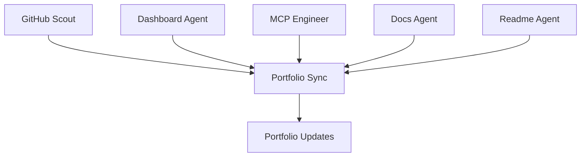

# Prashanth Kumar Kadasi — Portfolio

Data Analyst & AI Systems Engineer based in Hyderabad, India.

This repository powers my personal portfolio at **[kprsnt.in](https://kprsnt.in)** — a Flask app running in a Cloudflare Container behind a Worker, with a built-in RAG chatbot, live AI dashboards, REST APIs, and an MCP server. It is continuously updated by a team of autonomous AI agents.

## Key Projects

*   **🎓 mSeat — MBBS Mock Counselling Predictor**
    High-performance Telangana MBBS simulator with O(1) multi-quota ranking and a 545 KB dataset for 18,000+ aspirants. Validated against official KNRUHS 2026 Phase 1 results.
*   **🔬 BrandXY — LLM Brand Recommendation**
    Fine-tuned GPT-OSS-20B to steer brand recommendations. Achieved 76.47% vs 25.49% (+51% improvement). Includes evaluation scripts and an arXiv paper draft.
*   **🧬 Drug Discovery GPT-20B**
    Fine-tuned GPT-OSS-20B on AMD MI300X for drug discovery: novel molecules, SMILES analysis, ADMET prediction.
*   **💻 MyLocalCLI — AI Coding Assistant**
    A Claude Code alternative with 6 AI providers, 26 tools, 5 agents, and 22 skills. Local-first and private.

## Features

*   **AI Chatbot** — context-aware RAG bot grounded on my resume, projects, and live pipeline data (`/api/chat`).
*   **Dynamic Blogs** — Markdown/JSON posts from `blog_inputs/` and `blog_data/`, plus AI Eco agent dev logs.
*   **REST API** — blogs, case studies, hiring evidence, jobs data, and mSeat prediction (`/docs`).
*   **MCP Server** — exposes portfolio data and tools over the Model Context Protocol (`/mcp`). Recommended transport: streamable HTTP (`POST /api/mcp`, JSON-RPC 2.0).
*   **Live Dashboards** — `/jobs`, `/ecosystem`, `/aie`.
*   **RSS feed** — `/feed.xml` for the blog plus the AI Eco dev logs.

## Architecture

```
Dockerfile            # Image: Flask + gunicorn, listens on $PORT (8080 default)
cloudrun/             # Cloud Run service definition (declarative deploy)
  service.yaml
api/
  index.py            # Flask app + all HTTP routes (WSGI entrypoint: api.index:app)
  ai_config.py        # LLM provider chain (OpenAI -> NVIDIA -> Groq) + embeddings
  bot_utils.py        # Chat/interview prompt assembly, tool calls, email
  ai_eco_mcp.py       # MCP tools/resources/prompts + JSON-RPC dispatcher
  mseat_mcp.py        # mSeat prediction engine + MCP handlers
  mseat_rest.py       # mSeat OpenAPI 3.1 spec
  data/               # Canonical static data (projects, skills, case studies)
  services/           # insights, live_data, rag, security
  skills/             # Per-agent prompt "skill" files
templates/            # Jinja2 templates (Bootstrap 5 Darkly)
static/               # CSS/JS, resume PDF, social preview art (og/)
scripts/              # Local + CI data pipelines (not deployed)
job_data/             # Pipeline output: daily/, pipeline_log, telemetry
blog_inputs/ blog_data/ AI_Eco_Blogs/ ecosystem_swarm/
tests/                # pytest smoke + data-consistency tests
```

## Local Setup

```bash
python -m venv venv
# Windows: venv\Scripts\activate   |   macOS/Linux: source venv/bin/activate
pip install -r requirements-dev.txt

cp .env.example .env   # fill in the keys you need (see below)
python api/index.py     # http://127.0.0.1:5000
```

The app degrades gracefully without API keys: pages still render, and AI
endpoints return a 503-style message.

### Environment Variables

See `.env.example`. The important ones:

| Variable | Purpose |
| --- | --- |
| `OPENAI_API_KEY` | Primary LLM + embeddings |
| `NVIDIA_API_KEY` | Fallback LLM provider |
| `GROQ_API_KEY` | Last-resort LLM provider |
| `RESEND_API_KEY` | Sending bot replies / resume emails |
| `INTERVIEW_FROM_EMAIL` | Verified sender for bot emails |
| `OWNER_NOTIFY_EMAIL` | Where usage notifications go |
| `GEMINI_API_KEY`, `TAVILY_API_KEY`, `GITHUB_TOKEN` | Used by pipeline scripts / Actions |

## Testing & Lint

```bash
pytest -q
ruff check api tests --select E9,F63,F7,F82
```

CI (`.github/workflows/ci.yml`) runs both on every push and pull request.

## Deployment (Google Cloud Run)

The app is a plain Docker image, so it runs on Cloud Run with no code changes.
Cloudflare (free) stays in front for DNS, CDN, caching and analytics:

```
browser ──► Cloudflare DNS/CDN + Web Analytics (free)
               └──► Cloud Run service (asia-south1, Docker from this repo) ──► Flask
```

* **`Dockerfile`** — Flask + gunicorn on `$PORT` (Cloud Run passes 8080), runs as
  a non-root user, 1 worker × 8 threads, 300s timeout.
* **`cloudrun/service.yaml`** — declarative service spec (CPU, memory,
  concurrency, min/max instances, startup probe, env + Secret Manager refs).
* **`.github/workflows/deploy-cloud-run.yml`** — build + deploy from CI
  (manual by default; flip on the push trigger once the GCP vars exist).

Why Cloud Run fits this app: it is a stateless container with 300s request
budget (no more 10s serverless ceiling that shaped a lot of the old code),
scale-to-zero, and a region in Mumbai (`asia-south1`) that is ~50 ms from
Hyderabad.

### Console path (no terminal needed)

Everything below is click-only, in the Google Cloud Console and the Cloudflare
dashboard. Once step 5 is done, every push to `main` rebuilds and redeploys
automatically — the same experience Vercel gave you.

**1. Project + billing.** Open [console.cloud.google.com](https://console.cloud.google.com)
→ project picker (top bar) → **New project** → name it `kprsnt-in` → **Create**.
Then **Billing** → **Link a billing account** (this is where your credits apply).
Cloud Run asks for a billing account on first use; without one it will not deploy.

**2. Enable the APIs.** Search the top bar for **Cloud Run** → **Enable** when
prompted. When Console asks, also enable **Cloud Build** and **Artifact
Registry** — the source-repository deploy uses both.

**3. Create the secrets.** Search for **Secret Manager** → **Create secret**:

| Secret name | Value |
| --- | --- |
| `OPENAI_API_KEY` | your key |
| `NVIDIA_API_KEY` | your key |
| `GROQ_API_KEY` | your key |
| `RESEND_API_KEY` | your key |
| `OWNER_NOTIFY_EMAIL` | where bot notifications go |
| `AGENT_VAULT_TOKEN` | optional (private vault) |
| `KV_REST_API_URL` / `KV_REST_API_TOKEN` | optional (AILearn sync) |

Name them exactly as above — Cloud Run maps each secret to an environment
variable of the same name, and that is the name `api/` reads.

**4. Connect the repository.** **Cloud Run** → **Create service** → choose
**Source repository (continuously deploy from a repository)** → **Set up with
Cloud Build**:

1. Provider **GitHub** → **Install Google Cloud Build** (opens GitHub) → grant
   access to the account `kprsnt2` → choose **Only select repositories** →
   tick `kprsnt.in-cloudrun` → **Install**.
2. Back in the panel: Repository `kprsnt2/kprsnt.in-cloudrun`, Branch `^main$`,
   Build type **Dockerfile**, source location `/Dockerfile`.
3. **Save**.

**5. Service settings.** Fill the form that appears:

| Field | Value |
| --- | --- |
| Service name | `kprsnt-in` |
| Region | `asia-south1` (Mumbai — closest to Hyderabad) |
| Authentication | **Allow unauthenticated invocations** (public site) |
| Container port | `8080` |
| CPU | 1 |
| Memory | 1 GiB |
| Max concurrent requests per instance | `8` (= gunicorn's 8 threads) |
| Request timeout | `300` seconds |
| Minimum instances | `0` (raises on demand; see cost notes) |
| Maximum instances | `3` |
| Startup CPU boost | on |

Then **Variables & Secrets**:

* Environment variables: `INTERVIEW_FROM_EMAIL` = `chat@kprsnt.in`,
  `AI_LLM_TIMEOUT` = `20`
* **Add reference to secret** once per secret from step 3 —
  e.g. Name `OPENAI_API_KEY`, Secret `OPENAI_API_KEY`, Version `latest`.

Leave **Health checks** at their defaults for the first deploy (Cloud Run
detects the listening port; `/health` exists if you want to add an HTTP startup
probe later). Click **Create** and watch the build log; the first build takes a
few minutes.

**6. Open the site.** The service page shows a URL like
`https://kprsnt-in-xxxxx-as.a.run.app`. Click it, and open `/health` in the same
tab — you should see `{"status":"ok",...}`.

**7. Point kprsnt.in at it (Cloudflare, still no terminal).** In
[dash.cloudflare.com](https://dash.cloudflare.com) → your zone → **DNS** →
**Records**:

* Delete the old Vercel `A` / `CNAME` records for `kprsnt.in` and `www`.
* **Add record** → Type `CNAME`, Name `@`, Target `<the run.app hostname>`,
  Proxy status **Proxied** (orange cloud). Repeat with Name `www`.
* **SSL/TLS → Overview** → mode **Full (strict)**.

*Alternative:* in Cloud Run → **Manage custom domains** → **Add mapping**, then
create the DNS records Cloud Run shows (`ghs.googlehosted.com`) in Cloudflare
with the proxy **off** (grey cloud) so Google can issue its certificate.

**8. Guard the budget.** **Billing → Budgets & alerts → Create budget** (e.g.
$20/month, alert at 50/90/100%). `max-instances 3` already caps a traffic spike.

**9. Later changes.** Push to `main` → Cloud Run rebuilds and rolls out a new
revision automatically. To go back: Cloud Run → **Revisions** → pick an older
one → **Manage traffic** → 100%. To rotate a secret: Secret Manager → the secret
→ **Add new version** → then Cloud Run → **Edit & deploy new revision** so the
running revision picks it up. To keep the service warm (costs credits):
**Edit & deploy new revision** → set **Minimum instances** to `1`.

### First deploy

```bash
# 0. one-time: project + APIs + registry
gcloud auth login
gcloud config set project YOUR_PROJECT_ID
gcloud services enable run.googleapis.com cloudbuild.googleapis.com     artifactregistry.googleapis.com secretmanager.googleapis.com
gcloud artifacts repositories create kprsnt     --repository-format=docker --location=asia-south1

# 1. secrets (Secret Manager — the app reads them from os.environ)
printf '%s' "$OPENAI_KEY" | gcloud secrets create OPENAI_API_KEY --data-file=-
printf '%s' "$NVIDIA_KEY" | gcloud secrets create NVIDIA_API_KEY --data-file=-
printf '%s' "$GROQ_KEY"   | gcloud secrets create GROQ_API_KEY   --data-file=-
printf '%s' "$RESEND_KEY" | gcloud secrets create RESEND_API_KEY --data-file=-
printf '%s' "you@example.com" | gcloud secrets create OWNER_NOTIFY_EMAIL --data-file=-

# 2. build + deploy straight from the repo (Cloud Build uses ./Dockerfile)
gcloud run deploy kprsnt-in   --source .   --region asia-south1   --allow-unauthenticated   --port 8080   --cpu 1 --memory 1Gi   --concurrency 8 --timeout 300   --min-instances 0 --max-instances 3   --set-env-vars "INTERVIEW_FROM_EMAIL=chat@kprsnt.in,AI_LLM_TIMEOUT=20"   --set-secrets "OPENAI_API_KEY=OPENAI_API_KEY:latest,NVIDIA_API_KEY=NVIDIA_API_KEY:latest,GROQ_API_KEY=GROQ_API_KEY:latest,RESEND_API_KEY=RESEND_API_KEY:latest,OWNER_NOTIFY_EMAIL=OWNER_NOTIFY_EMAIL:latest"

# 3. check it
curl "$(gcloud run services describe kprsnt-in --region asia-south1 --format 'value(status.url)')/health"
```

To manage the service from `cloudrun/service.yaml` instead, put your project in
the `image:` line and run
`gcloud run services replace cloudrun/service.yaml --region asia-south1`.

### Custom domain (keep Cloudflare in front — free CDN, WAF, analytics)

1. `gcloud run services describe kprsnt-in --region asia-south1 --format 'value(status.url)'`
   → e.g. `https://kprsnt-in-abc123-as.a.run.app`.
2. In **Cloudflare DNS**, delete the old Vercel records and add (proxied, orange
   cloud):
   * `CNAME  kprsnt.in  →  <that hostname>`
   * `CNAME  www        →  <that hostname>`
3. SSL/TLS mode **Full (strict)**. Cloud Run's own certificate covers
   `*.run.app`, so no Google domain mapping is needed — and Cloudflare keeps
   caching, Web Analytics and the free WAF in the path.
   *(Alternative: `gcloud beta run domain-mappings create --service kprsnt-in
   --domain kprsnt.in --region asia-south1` and set that DNS record to
   `ghs.googlehosted.com`, which needs the Cloudflare proxy off.)*

### Deploy on push (optional CI)

The workflow is manual by default. To get Vercel-style deploy-on-push:

1. Create a deploy service account with `roles/run.admin`,
   `roles/iam.serviceAccountUser`, `roles/artifactregistry.writer`.
2. Set up Workload Identity Federation for GitHub Actions.
3. Add repository **variables** `GCP_PROJECT_ID`, `GCP_REGION` and **secrets**
   `GCP_WIF_PROVIDER`, `GCP_SERVICE_ACCOUNT`.
4. Uncomment the `push:` trigger in `.github/workflows/deploy-cloud-run.yml`.

### Cost notes (you are on credits)

* The always-free monthly allowance is generous (2M requests, 180k vCPU-s,
  360k GiB-s), and `--min-instances 0` keeps an idle portfolio inside it — a
  cold start is ~1-2s, far better than the 30-60s a sleeping free host gives.
* `--min-instances 1` removes cold starts entirely but bills a warm 1 vCPU
  instance around the clock (180k vCPU-s only covers ~50 instance-hours), so it
  draws on your credits — start at 0, raise it if you notice latency.
* Set a **budget alert** in Billing either way; `--max-instances 3` already caps
  the blast radius of a traffic spike.

### Operating notes

* **Concurrency must match gunicorn threads** (8). Raise both together, or the
  9th concurrent request waits for a free thread on the instance.
* **Request ceiling is 300s** (Cloud Run `--timeout` = gunicorn `--timeout`).
  Long MCP/SSE sessions should reconnect; the streamable HTTP transport
  (`POST /api/mcp`) is unaffected.
* **Secrets:** read from `os.environ` by the app. Rotate with
  `gcloud secrets versions add NAME --data-file=-`, then redeploy (or let the
  `:latest` ref pick it up on the next revision).
* **Health probe:** `/health` returns JSON; it is the Cloud Run startup probe.
* **Data directories:** everything is copied into the image by `COPY . .`; if
  you add a new data directory, keep it **out of** `.dockerignore`.
* **Markdown is content:** never add a global `*.md` rule to `.dockerignore` —
  `blog_inputs/`, `AI_Eco_Blogs/`, `ecosystem_swarm/` and `api/skills/` are
  served at runtime.
* **Caching/assets:** `/static/*` gets `max-age=86400,
  stale-while-revalidate`, HTML is `no-cache`, `/feed.xml` caches for an hour.
  Social preview art lives in `static/og/` (regenerate with the headless-Chrome
  recipe in `scripts/og_card.html`).
* **Another host works too:** the image is portable (any `$PORT` container
  host). Nothing outside `Dockerfile`/`cloudrun/` is GCP-specific.

## Data Pipelines

`scripts/` contains the job, blog, and ecosystem-agent pipelines
run by GitHub Actions. Daily swarm output is retention-pruned (60 daily views /
chronicles, 90 dev logs) to bound repository and deployment growth.

### Data model note

`api/data/projects.py` (`PROJECTS`, `SKILLS`, `EXPERIENCES`) is the canonical
project/skill source. `api/resume_data.py` holds role-specific resume variants
that overlap in content. `tests/test_data_consistency.py` guards structure; full
consolidation into a single source of truth is a tracked follow-up.

## Multi-Agent Ecosystem



## Contact

- Website: [kprsnt.in](https://kprsnt.in)
- Email: interview@kprsnt.in
- GitHub: [kprsnt2](https://github.com/kprsnt2)
- HuggingFace: [kprsnt](https://huggingface.co/kprsnt)
