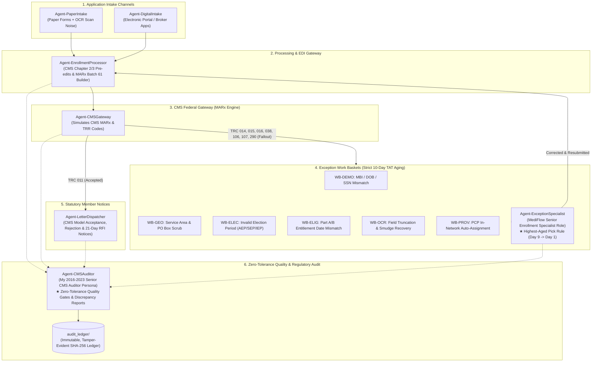

# Automating 9 Years of MediFlow Medicare Enrollment & CMS Audits with Autonomous Multi-Agent Swarms

*How I transformed nine years of real-world Medicare Advantage operations — from OCR intake and Cosmos pre-edits to federal MARx adjudication, 10-day statutory TAT work baskets, and zero-tolerance CMS compliance gates — into a self-auditing multi-agent mesh.*

---

## 1. The Real-World Medicare Enrollment Problem

From April 2014 to March 2023 at **Enterprise Healthcare Operations** in Hyderabad, India, I lived the reality of high-volume federal Medicare enrollment operations. Starting as a Claims Associate and advancing through internal promotion to **Enrollment Quality & Audit Representative (CMS Auditor)**, my daily responsibility was zero-tolerance statutory compliance against Centers for Medicare & Medicaid Services (CMS) regulations.

In the Medicare Advantage (MA-PD, D-SNP, PDP) space, a single error is not just a glitch — it can mean an elderly beneficiary losing prescription drug coverage on the 1st of the month, or an insurer facing statutory fines and audit findings during annual CMS reviews.

The workflow has always been fraught with complex, asynchronous friction:
1. **Intake Scenarios**: Senior beneficiaries submitting either physical paper applications (beset by low-resolution scanner noise, misread digits, smudged checkboxes, or handwritten P.O. Box entries) or electronic portal applications with mismatched election periods.
2. **Clearinghouse & MARx Adjudication**: Ingestion systems translating data into CMS Record Type 61 transactions and ANSI ASC X12 EDI 834 envelopes, followed by federal adjudication returning cryptic Transaction Reply Codes (TRCs) like `TRC 011` (Accepted), `TRC 015` (Beneficiary Not Found), `TRC 038` (Out of Service Area), or `TRC 107` (P.O. Box physical residency violation).
3. **Statutory 10-Day TAT Work Baskets**: Any transaction fallout enters work baskets (`WB-DEMO`, `WB-GEO`, `WB-ELEC`, `WB-ELIG`, `WB-OCR`, `WB-PROV`). Under CMS guidelines, items have a statutory **10-calendar-day Turnaround Time (TAT)**. Specialists must pull the oldest items first (`Age >= 9 days`) to prevent catastrophic regulatory SLA breaches.
4. **Zero-Tolerance Quality Gates**: An independent audit layer inspecting 100% of transactions, ensuring specialist remediations are substantiated by documentation (USPS parcel records, state Medicaid dual files, HETS checks) and that statutory model notices (Acceptance, Denial with §50.1 appeal rights, 21-day RFI) are dispatched on time.

I set out to build **MediFlow**, an autonomous multi-agent mesh running inside terminal CLIs (`agy` and `omp`) that executes and audits this entire lifecycle end-to-end.

---

## 2. Multi-Agent System Architecture

The system coordinates six autonomous agent roles mapping directly to enterprise payer departments:

### The Specialist Roles
- **`Agent-PaperIntake`**: Simulates real-world OCR imperfections, introducing character confusion (e.g. `8` misread as `B`, `0` as `O`, smudged signatures, and P.O. Box physical residence mistakes).
- **`Agent-DigitalIntake`**: Ingests structured electronic applications with subtle eligibility edge cases.
- **`Agent-EnrollmentProcessor`**: Simulates the core clearinghouse (Cosmos/Facets), evaluating CMS Chapter 2 pre-edits and generating standard CMS MARx Batch Record Type 61 and ANSI ASC X12 EDI 834 transactions.
- **`Agent-CMSGateway`**: Simulates federal adjudication and returns authentic CMS Transaction Reply Codes (`TRC 011`, `TRC 014`, `TRC 015`, `TRC 038`, `TRC 106`, `TRC 107`, `TRC 290`).
- **`Agent-ExceptionSpecialist`**: Embodies my operational role at MediFlow. It maintains work baskets using a strict **highest-aged first algorithm (10-day statutory TAT)**. It cross-references mock CMS HETS (HIPAA Eligibility Transaction System) databases, moves P.O. Boxes to mailing addresses while verifying physical street parcels, applies qualifying SEP codes (e.g., `SEP-DUAL` for QMB Medicaid recipients), and auto-assigns in-network PCPs.
- **`Agent-LetterDispatcher`**: Emits mandated CMS Model Notices (Enrollment Confirmation within 10 calendar days, Denial Notice with Section 50.1 appeal rights, and 21-day Request for Information notices).
- **`Agent-CMSAuditor`**: Embodies my 2016–2023 Senior CMS Auditor persona. It applies **zero-tolerance quality gates** to 100% of transactions, requiring substantiated specialist notes, verifies TAT compliance, and writes cryptographically chained SHA-256 blocks to `audit_ledger/transactions.jsonl`.

---

## 3. Operational Rigor: Work Basket Aging & The 10-Day Rule

In payer enrollment operations, turnaround time (TAT) is an unforgiving regulatory metric. Under CMS Chapter 2, plans must process applications and dispatch notices within strict statutory windows.

Our `ExceptionSpecialistAgent` implements a priority queue that sorts items strictly by age descending:
- **Day 9–10 (Critical SLA Risk)**: Immediate priority queue pull.
- **Day 5–8 (Urgent Review)**: Secondary queue pull.
- **Day 1–4 (Routine Ingestion)**: Standard FIFO processing.

When an applicant enters a P.O. Box as their permanent residence, CMS Section 20.1 strictly forbids enrollment. The system:
1. Emits `TRC 107` (Address/Residency Discrepancy).
2. Generates an official CMS Model 21-Day Request for Information (RFI) notice.
3. Routes the record to `WB-GEO`.
4. The Specialist agent executes the USPS Parcel Geocode playbook: shifts the P.O. Box to `mailing_address`, validates the physical residence against county parcel records, documents substantiation, and resubmits to CMS for `TRC 011` acceptance.

---

## 4. Dual CLI & Modern Dashboard Delivery

The architecture is built to run natively in local developer environments and modern multi-agent CLIs:
- **AGY & OMP CLI Runners**: Launchable via `.\bin\run-agy.ps1` and `.\bin\run-omp.ps1` with default Gemini models.
- **Rich Terminal HUD**: Run `python -m MediFlow_audit.cli run --count 20` to see real-time color-coded transaction pipelines, work basket aging, and auditor briefing panels.
- **Modern Interactive Dashboard**: Hosted in `site/` on `http://localhost:4242`, featuring:
  - Real-time Zero-Tolerance Quality Gate scorecard.
  - Work Basket Kanban board with live TAT countdown badges.
  - Split-Screen OCR Inspector comparing raw degraded scan noise against the cleaned golden record.
  - Full previewer for CMS Model Letters and ANSI ASC X12 EDI 834 transactions.
  - Visual Cryptographic Block Explorer for `audit_ledger/transactions.jsonl`.

---

## 5. Conclusion & Takeaways

By codifying nine years of domain experience into modular agents, this project proves that regulatory compliance and AI pipelines share the exact same foundation: **zero-tolerance verification, immutable logging, and substantiated data provenance**.

The entire codebase is open and test-covered (100% pytest pass rate across 9 unit tests), complete with a dedicated immutable audit ledger.
