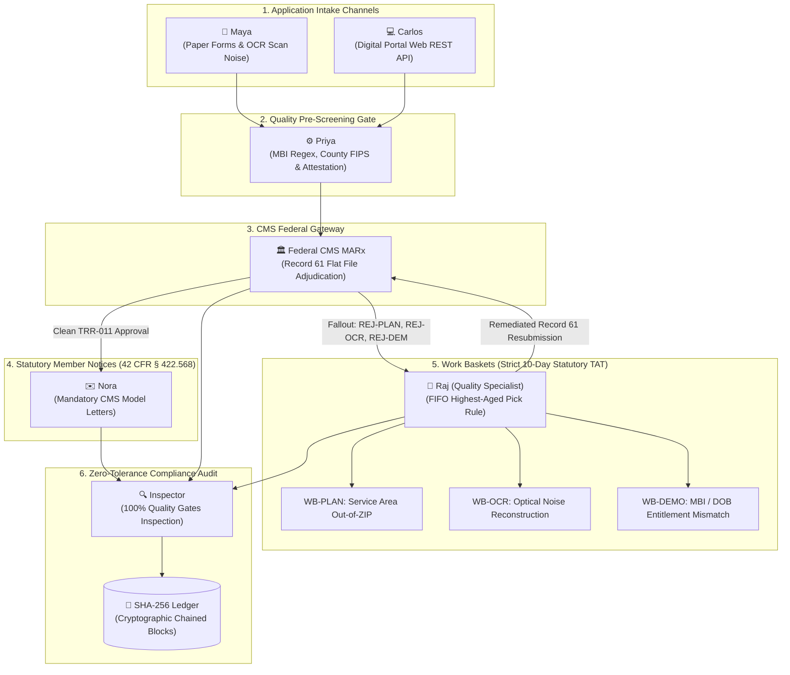

# Automating 9 Years of Medicare Enrollment & CMS Audits with Autonomous Multi-Agent Swarms

*How I transformed nine years of real-world Medicare Advantage operations — from Claims Associate to Regulatory Adherence and Controls CMS Auditor — into an autonomous, self-auditing multi-agent mesh.*

---

## 1. The Frontline Reality: From Claims Associate to Regulatory Adherence & Controls

From April 2014 to March 2023 at **Enterprise Healthcare Operations** in Hyderabad, India, I lived the daily reality of federal Medicare enrollment operations. I began my career as a **Claims Associate** processing incoming Medicare Advantage (MA-PD, D-SNP, PDP) enrollment applications (2014–2016), before advancing to the **Regulatory Adherence and Controls** team auditing these applications for statutory compliance against Centers for Medicare & Medicaid Services (CMS) regulations (2016–2023).

Having handled the process from frontline intake through federal CMS audits, I know Medicare application processing inside and out. In the Medicare Advantage space, an operational error is never just a software glitch — it means an elderly beneficiary loses life-sustaining prescription drug coverage on the 1st of the month, or an insurer faces statutory fines, sanctions, and audit findings during annual CMS reviews.

### The 2014–2016 Legacy IT Dilemma
Back in 2014–2016, as a Claims Associate handling thousands of applications, I pitched numerous bright ideas to streamline the workflow. So many recurring errors — out-of-service-area plan selections, optical scan distortions, and demographic mismatches — could easily have been resolved with proactive application logic. 

However, enterprise IT and management consistently told us it was **"not possible"**:
- Payer core systems (Cosmos, Facets, and legacy mainframe batch engines) were fragile monoliths.
- Changing core application rules required months of risk-assessment meetings and change-control board approvals.
- Engineering feared touching legacy adjudication code because of regression risks across claims payment systems.

As a result, operations was forced into endless manual swivel-chair exception handling, manually checking census lists, re-keying addresses, and shifting files across disconnected queues.

### The AI Agent Revolution: No Core Software Changes Needed
Today, autonomous AI agents completely flip this paradigm on its head. 

With multi-agent systems, **there is zero need to rewrite or touch brittle legacy core software or wait for multi-year IT tickets**. Instead of hacking 30-year-old COBOL or Java engines, we simply provide natural language standard operating procedures (SOPs), CMS Chapter 2 guidelines, and decision trees directly to autonomous agents as instructions. 

What enterprise IT declared "impossible" a decade ago can now be executed by coordinated AI agents within seconds.

---

## 2. The AEP Influx & The Employer Group (EGWP) Work Basket Crisis

The urgency of this transformation is acute right now. We are in the middle of the **Annual Election Period (AEP)** (October 15 – December 7), when Medicare Advantage plans experience a massive influx of applications. Operations teams are working round-the-clock, battling severe fatigue and overwhelming volume spikes.

In particular, **Employer Group applications (EGWP)** are a notorious operational disaster:
1. **Massive Ingestion Volume**: Employer group files arrive in massive census dumps containing thousands of retiree applications.
2. **High Defect Ratios**: These files are riddled with missing retiree election forms, out-of-area residential addresses, incomplete benefit cross-walks, and demographic discrepancies.
3. **Work Basket Saturation**: Within hours, these applications get stuck in exception work baskets (`WB-PLAN`, `WB-DEMO`, `WB-GEO`, `WB-OCR`). 
4. **The 10-Day Statutory TAT Cliff**: Under CMS Chapter 2 guidelines, plans have a strict **10-calendar-day Turnaround Time (TAT)** standard. When employer files flood work baskets, manual specialists physically cannot clear them within the 10-day window. Once day 10 passes, the payer enters statutory SLA breach, risking severe CMS audit sanctions and financial penalties.

This seasonal crisis makes it clear: the traditional manual work basket paradigm cannot scale. Payer operations must transition to autonomous agent swarms that can ingest, pre-screen, resolve exceptions, and verify compliance at machine speed.

---

## 3. Multi-Agent System Architecture

To solve this, I built **MediFlow**, an autonomous multi-agent mesh mapping directly to enterprise payer operational roles:

### The 7 Autonomous Specialist Roles
- **Maya (Paper Ingestion OCR Agent)**: Simulates real-world mailroom scanners, introducing realistic 300 DPI optical noise, smudged checkboxes, digit confusion (e.g. `194B`, `0` &harr; `O`, `5` &harr; `S`), and P.O. Box physical residence mistakes.
- **Carlos (Digital Portal Agent)**: Ingests structured electronic web applications via REST API schemas with rigorous payload validations.
- **Priya (Intake Quality Pre-Screening Gatekeeper)**: Evaluates pre-edits before clearinghouse dispatch, validating 11-character MBI regex syntax, county-to-contract ZIP service areas, and signature presence.
- **Federal CMS Gateway (MARx Clearinghouse Agent)**: Simulates federal MARx flat file Batch Record 61 processing and ANSI ASC X12 EDI 834 transactions across all 10 federal Transaction Reply Codes (`ACC`, `REJ-DEM`, `REJ-ADDR`, `REJ-PLAN`, `REJ-ELIG`, `REJ-ELEC`, `REJ-PROV`, `REJ-OCR`, `DUP`, `PEND`).
- **Nora (Statutory Member Correspondence Agent)**: Generates legally binding CMS model notices complying with 42 CFR § 422.568 and § 423.568, supporting multi-stage lifecycle toggles between Pre-Resolution Denial notices with 60-day redetermination appeal rights and Post-Remediation Acceptance confirmations.
- **Raj (Enrollment Quality & Exception Specialist)**: Embodies my operational specialist role. Maintains work baskets using a strict **highest-aged first algorithm (10-day statutory TAT)**. Resolves demographic defects, USPS parcel geocoding, and plan cross-walk remapping.
- **Inspector (Cryptographic Compliance Auditor Agent)**: Embodies my Senior CMS Auditor persona. Applies **zero-tolerance quality gates** to 100% of transactions and commits every decision into an append-only SHA-256 chained audit ledger.

---

## 4. The Engineering Harness: DeepSeek, `agy`, and Frontier Models

MediFlow was not built on high-level theory — it was engineered and tuned through a rigorous multi-model harness:
- **Authoring & Iteration**: Created and perfected using Google Antigravity (**`agy` CLI**) and a dedicated **DeepSeek harness**, iterating across **`deepseek-4.1-flash`**, **`gemini-3.8-flash`**, and **`claude-opus-4.6`** models to stress-test prompt resilience, edge-case routing, and regulatory audit report accuracy.
- **Runtime Flexibility**: Executes locally in terminal CLIs via `agy` and `omp` commands, or directly through OpenAI/Gemini API keys.
- **Online Production Deployment**: Deployed live on Vercel at [mediflow.kprsnt.in](https://mediflow.kprsnt.in). The backend runs on Gemini, with OpenAI configured as an automatic fallback in case of upstream rate limits or errors, backed by a deterministic simulation engine for offline reliability.
- **Engineering Transparency**: As an open-source prototype demonstrating autonomous multi-agent orchestration, minor edge cases may still exist (such as fine-tuning the exact UI display toggles between initial rejection notices and remediated approval notices). However, it conclusively proves how autonomous agents eliminate the manual work basket bottleneck that has plagued enterprise healthcare for decades.

---

## 5. Operational Rigor: Work Basket Aging & The 10-Day Rule

Under CMS Chapter 2, turnaround time (TAT) is an unforgiving regulatory metric. Letting an application linger in a work basket past 10 days triggers immediate non-compliance.

Our `Raj` exception worker implements a priority queue that sorts items strictly by age descending:
- **Day 9–10 (Critical SLA Risk)**: Pulled immediately to prevent statutory breach.
- **Day 5–8 (Urgent Review)**: Secondary queue pull.
- **Day 1–4 (Routine Ingestion)**: Standard FIFO processing.

### Case Study: Resolving P.O. Box Violations
When an applicant enters a P.O. Box as their permanent residence, CMS Section 20.1 strictly forbids enrollment:
1. CMS emits `REJ-ADDR` (Residency Discrepancy).
2. Nora generates an official CMS Model 21-Day Request for Information (RFI) notice.
3. The transaction routes to `WB-GEO`.
4. Raj executes the USPS Parcel Geocode playbook: shifts the P.O. Box to `mailing_address`, validates physical street parcel records, documents substantiation, and resubmits to CMS for `ACC` acceptance.

---

## 6. Live Action Theater & Production Delivery

Experience the system live:
- **Live Vercel Interactive Dashboard**: Deployed at [mediflow.kprsnt.in](https://mediflow.kprsnt.in). Features a real-time **Live Agent Action Theater** with token typography streaming across all 7 agents, active spotlight cards, and a tamper-evident cryptographic block explorer.
- **Single-App Live Simulation Showcase**: Click **"▶️ Run Live Simulation (1 App)"** on Vercel to watch William Martinez's application navigate paper OCR intake, federal `REJ-PLAN` adjudication, statutory 42 CFR § 422.568 Denial letter generation, Raj's work basket forensic plan remapping, secondary Acceptance notice, and Inspector SHA-256 ledger sealing — completing cleanly in ~6 to 8 seconds without cloud timeouts.
- **Automated Verification**: 36 automated pytest unit tests (`uv run pytest -v`) verifying end-to-end multi-agent orchestration, notice lifecycle integrity, and ledger immutability.
- **Open-Source Codebase**: Available at [github.com/kprsnt2/MediFlow](https://github.com/kprsnt2/MediFlow).

---

## 7. Conclusion & Takeaways

By codifying nine years of domain experience into modular agents, MediFlow proves that healthcare regulatory compliance and AI engineering share the exact same foundation: **zero-tolerance verification, immutable logging, and substantiated data provenance**.

During this AEP season, as Employer Group applications overwhelm operations work baskets, the path forward is clear: let agents handle the manual execution, so humans can focus on supervisory oversight.

- **Live Application**: [mediflow.kprsnt.in](https://mediflow.kprsnt.in)
- **Source Code**: [github.com/kprsnt2/MediFlow](https://github.com/kprsnt2/MediFlow)
- **Zero-Tolerance Audit Ledger Post**: [kprsnt.in/blog/zero_tolerance_cms_medicare_audit_ledger](https://kprsnt.in/blog/zero_tolerance_cms_medicare_audit_ledger)
